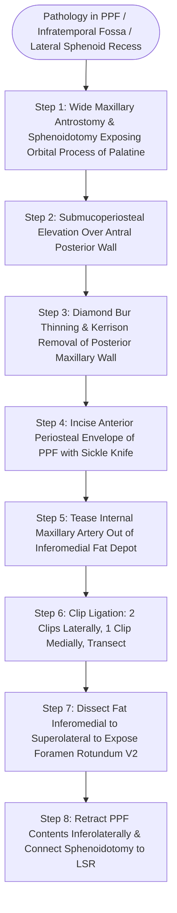

# Pterygopalatine fossa dissection requires internal maxillary artery ligation and posterior antral wall resection to access the lateral sphenoid recess

## Active Recall

> [!question]- What spatial rule defines the organization of neurovascular structures within the pterygopalatine fossa (PPF)?
> *Answer / Clinical Rationale*: **Vascular structures lie inferomedially; neural structures lie posterosuperiorly**. Specifically, the third segment of the internal maxillary artery and its arborizing branches (sphenopalatine, descending palatine) reside within anterior and inferomedial fat, whereas the maxillary nerve (V2), foramen rotundum, and pterygopalatine ganglion reside in the posterior and superolateral compartment.

> [!question]- What is the recommended endoscopic clip ligation rule for the internal maxillary artery during PPF exposure?
> *Answer / Clinical Rationale*: Apply **two surgical clips laterally and one clip medially** at the midpoint of exposure, then transect the vessel with endoscopic microscissors. Avoid placing the initial clips too far laterally in the pterygomaxillary fissure, as vessel tearing in this narrow bony junction causes retraction of the high-pressure arterial stump into the infratemporal fossa, producing hemorrhage that is extraordinarily difficult to control.

## Core Clinical & Mechanistic Principles
The pterygopalatine fossa (PPF) and pterygomaxillary space (PPS) form the central anatomical crossroads connecting the nasal cavity, orbit, infratemporal fossa (ITF), and middle cranial fossa. The endoscopic endonasal [[Transpterygoid EEA exposes juvenile nasopharyngeal angiofibromas and lateral sphenoid defects|transpterygoid approach]] provides a minimally invasive corridor through the posterior maxillary wall to address pathology within the PPF and the [[Sternberg's canal in the lateral sphenoid recess acts as a conduit for spontaneous CSF leaks|lateral sphenoid recess]], including encephaloceles, trigeminal schwannomas, and [[Sinonasal juvenile angiofibroma staging by Radkowski and Fisch guides surgical approach|juvenile nasopharyngeal angiofibroma]]. Maxillary artery ligation within the PPF is simultaneously utilized for definitive vascular control in intractable posterior epistaxis and prior to skull base tumor resection.

### Boundaries and Structural Geography of the PPF
The space behaves as an inverted teardrop bounded by:
- **Anterior**: Thin posterior wall of the maxillary sinus.
- **Medial**: Perpendicular plate of the palatine bone.
- **Posterior**: Pterygoid process and anterior face of the sphenoid bone.
- **Superior**: Inferior surface of the sphenoid body and orbital apex.
- **Lateral**: Pterygomaxillary fissure, opening freely into the infratemporal fossa.
- **Inferior**: Greater palatine canal leading to the hard palate.

Extensive sphenoid pneumatization lateral to the line connecting the Vidian canal and foramen rotundum creates a **lateral sphenoid recess (LSR)**, present in up to 25% to 48% of patients. The thin bony roof of the LSR lies directly beneath the temporal lobe of the middle cranial fossa and represents the primary site for spontaneous CSF fistulae and meningoencephaloceles associated with idiopathic intracranial hypertension (IIH), best confirmed intraoperatively using low-dose [[Intrathecal fluorescein enables visual localization of occult dural defects|intrathecal fluorescein]].

### Micro-Dissection Protocol & Vascular Control
1. **Wide Exposure**: A mega-antrostomy is executed through the posterior fontanelle flush to the posterior antral wall, fully exposing the orbital process of the palatine bone. A wide sphenoidotomy is opened to the sphenoid floor.
2. **Posterior Wall Removal**: The antral mucosa over the posterior wall is elevated. Using a 4-mm diamond bur and Kerrison rongeurs, the ascending process of the palatine bone and the thin posterior maxillary wall are completely removed. Crucially, the underlying periosteum is left intact during drilling to prevent premature vascular laceration and fat herniation.
3. **Periosteal Incision & Artery Identification**: The periosteum is opened with a sickle knife or low-power suction monopolar cautery. The internal maxillary artery (IMA) is teased out of the inferomedial adipose tissue using a curved ball-tip seeker.
4. **Vascular Ligation Rule**: An endoscopic clip applier places **two clips laterally and one clip medially** across the isolated vessel at its mid-exposure. The artery is divided sharply with endoscopic microscissors. Any collateral branches (descending palatine, sphenopalatine branches) are coagulated with bipolar electrocautery to prevent delayed vasospasm and secondary hemorrhage.
5. **Neural Exploration & LSR Access**: Dissection proceeds from the inferomedial vascular compartment toward the superolateral neural compartment. Bipolar cautery thins the adipose lobules, revealing the **maxillary nerve (V2)** issuing from the foramen rotundum and the [[Vidian canal identification at the junction of the sphenoid floor and pterygoid base differentiates the Vidian nerve from the inferomedial palatovaginal canal|Vidian canal]] at the pterygoid root. 
6. **Lateral Corridors**: By gently mobilizing and retracting the PPF neurovascular contents inferolaterally, the surgeon enters the corridor to the lateral sphenoid recess, exposing Sternberg's canal or JNA roots invading the pterygoid plates.

### JNA Considerations
- **Preoperative Embolization Timing**: Superselective embolization of feeding branches (maxillary, ascending pharyngeal) must be performed **strictly within 24 hours of surgery**; beyond 24 hours, rapid collateral revascularization negates hemodynamic benefit.
- **Intraoperative Clip Ligation**: Despite prior embolization, direct surgical clip ligation of the internal maxillary artery remains mandatory due to frequent recanalization under operative pressure changes.
- **Posterior Margin Delivery**: For large tumors with extensive nasopharyngeal burden, curved transoral adenoid bipolars free the posterior pharyngeal attachment, enabling delivery and extraction of the mass transorally.

## Connected Concepts & Graph Traversal
- **Far Lateral Transmaxillary Corridors**: [[Endoscopic Denker approach removes the piriform aperture and ascending maxillary process to expose the anterior antral wall and infratemporal fossa|Far Lateral Transmaxillary Corridors]]
- **Autonomic Ganglion Relationships**: [[The sphenopalatine ganglion serves as the primary parasympathetic relay for the sinonasal cavity|PPF Autonomic Relays]]
- **Pedicled Flap Reconstruction**: [[The Hadad-Bassagasteguy nasoseptal flap is pedicled on the posterior septal artery|Posterior Septal Artery Preservation]]
- **Critical Carotid Safety**: [[Intraoperative ICA injury requires two-surgeon suction and crushed muscle patch hemostasis|ICA Hemorrhage Control]]
- **Sphenoid Base Architecture**: [[Sphenoid sinus pneumatization patterns dictate carotid and optic canal exposure|Sphenoid Lateral Pneumatization]]
