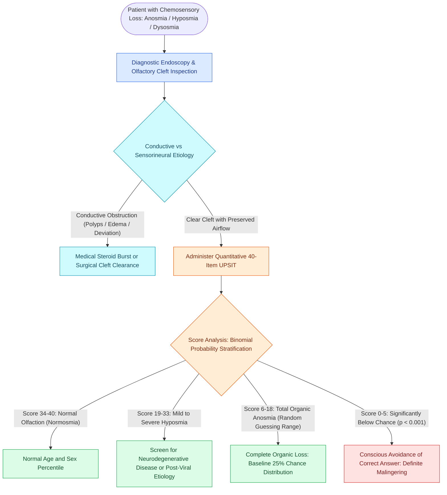

# Quantitative olfactory testing with the UPSIT differentiates conductive from sensorineural dysosmia and detects deliberate malingering through below-chance forced-choice scoring

## Active Recall

> [!question]- How does the forced-choice format of the 40-item UPSIT mathematically detect deliberate malingering or conscious symptom exaggeration?
> *Answer / Clinical Rationale*: In a 4-alternative forced-choice test, a patient with complete organic anosmia who guesses randomly will score according to a binomial distribution centered at **$25\%$ ($10 \pm 2.7$ out of 40 correct)**. A patient scoring **$\le 5$ out of 40 correct** achieves a score significantly below chance ($p < 0.001$), which mathematically requires that they recognized the correct odor and deliberately selected an incorrect answer, proving conscious malingering.

> [!question]- Which neurodegenerative disorders exhibit severe preclinical olfactory loss versus those with characteristically preserved olfaction?
> *Answer / Clinical Rationale*: **Idiopathic Parkinson's disease, Alzheimer's disease, dementia with Lewy bodies, and idiopathic REM sleep behavior disorder** exhibit severe, marked olfactory loss (++++), often preceding motor or cognitive deficits by years. Conversely, **essential tremor, progressive supranuclear palsy (PSP), corticobasal degeneration, and vascular parkinsonism** exhibit preserved or only mildly impaired olfaction (0 to +).

## Core Clinical & Mechanistic Principles
Chemosensory disorders significantly impair quality of life, nutritional status, and personal safety (e.g., failure to detect fire, leaking natural gas, or spoiled food). Over $90\%$ of patients presenting with a chief complaint of "loss of taste" actually have an impairment in retronasal olfaction, because true gustation is restricted to sweet, sour, salty, bitter, and umami tastants detected by lingual taste buds, while subtle culinary flavor profiles depend upon volatile odorants reaching the **[[Olfactory neuroepithelium contains bipolar sensory neurons and basal stem cells|olfactory neuroepithelium]]**.

Clinical evaluation requires categorizing smell loss into **conductive** (transport) and **sensorineural** (sensorimotor) dysosmia:
- **Conductive Olfactory Loss**: Arises from physical obstruction of the olfactory cleft preventing volatile odorants from reaching the olfactory neuroepithelium. Under normal baseline laminar respiration, less than $15\%$ of inspired nasal airflow traverses the high olfactory vault. Mucosal edema from chronic rhinosinusitis with nasal polyposis (CRSwNP), allergic fungal rhinosinusitis, acute viral edema, or severe septal deviation shunts airflow away from the cleft. Conductive losses typically fluctuate and demonstrate dramatic temporary recovery following systemic corticosteroid administration or targeted surgical unroofing of the olfactory cleft while strictly preserving the **[[Preserving the superior septal mucosal strip prevents post-NSF anosmia|olfactory strip]]**.
- **Sensorineural Olfactory Loss**: Reflects irreversible damage to primary olfactory receptor neurons, the unmyelinated fila olfactoria traversing the cribriform plate, the olfactory bulb, or central cortical olfactory projections (piriform cortex, entorhinal cortex, amygdala). Major etiologies include post-viral upper respiratory infections (wherein respiratory metaplasia permanently replaces sensory neuroepithelium), traumatic brain injury, aging (presbyosmia), toxic chemical inhalations, and neurodegenerative disease. In closed head trauma, rapid coup-contrecoup acceleration shears the delicate olfactory fila at the cribriform plate; bone fracture is not required.

### The University of Pennsylvania Smell Identification Test (UPSIT)
Developed by Richard L. Doty, the UPSIT is the international gold standard standardized psychophysical olfactory assessment:
- **Test Architecture**: A 40-item self-administered test comprising four 10-page booklets. Each page contains a $10–50\,\mu\text{m}$ microencapsulated "scratch-and-sniff" fragrance strip that is released with a pencil tip, accompanied by a 4-alternative forced-choice question.
- **Forced-Choice Requirement**: Even if the patient perceives absolutely no odor, they are legally and methodologically required to guess one of the four choices. This eliminates response bias and provides a rigorous statistical framework for malingering detection.
- **Normative Stratification**: Scores are stratified by age and sex into Normosmia (34–40 in females, 33–40 in males), Mild Hyposmia (30–33), Moderate Hyposmia (26–29), Severe Hyposmia (19–25), and Total Anosmia (6–18). Women outperform men across all age groups, and olfactory function naturally declines past age 65 (presbyosmia).

### Statistical Detection of Malingering
In forensic and disability examinations, patients may feign complete anosmia. The 4-choice forced-choice format exploits the binomial expansion theorem:
$$\mu = n \cdot p = 40 \cdot 0.25 = 10, \quad \sigma = \sqrt{n \cdot p \cdot (1 - p)} = \sqrt{40 \cdot 0.25 \cdot 0.75} = 2.74$$
- A patient with true, absolute organic anosmia who guesses randomly will score within the $95\%$ confidence interval between 5 and 15 correct out of 40 (mean $10$).
- A patient scoring $\le 5$ out of 40 correct ($p < 0.001$) exhibits a score that is statistically impossible to achieve by honest guessing. To score that low, the individual must detect the correct odor and actively, consciously choose one of the three incorrect alternatives. A score below 6 provides definitive, legally defensible proof of malingering or gross symptom magnification.

### Olfaction as a Neurodegenerative Biomarker
Olfactory testing serves as a sensitive preclinical diagnostic adjunct in movement disorders and dementia:
- **Severe Loss (++++ / Anosmia)**: Idiopathic Parkinson's Disease (affecting $>90\%$ of patients, correlating with Lewy body deposition in the anterior olfactory nucleus and olfactory bulb), Alzheimer's Disease, Dementia with Lewy Bodies, and REM Sleep Behavior Disorder.
- **Spared or Minimal Loss (0 to + / Normosmia)**: Essential Tremor, Progressive Supranuclear Palsy (PSP), Multiple System Atrophy, Corticobasal Degeneration, and Vascular Parkinsonism. Olfactory testing readily differentiates early Parkinson's disease from essential tremor or progressive supranuclear palsy.

## Connected Concepts & Graph Traversal
- **Psychophysical Diagnostics**: [[UPSIT and CCCRC tests quantify olfactory thresholds and odor identification in chemosensory disorders|CCCRC and Olfactory Testing]]
- **Skull Base Vulnerability**: [[The Keros classification stages olfactory fossa depth and lateral lamella vulnerability|Keros Classification]]
- **Oncologic Resection Corridor**: [[Transcribriform EEA provides access to olfactory groove meningiomas and esthesioneuroblastomas|Transcribriform EEA]]
- **Endoscopic Landmark Safeguard**: [[The crista ethmoidalis guides endoscopic sphenopalatine artery ligation|Crista Ethmoidalis Landmark]]
- **Surgical Craft Precaution**: [[Postoperative FESS debridement timing and technique prevent crusting and synechiae formation|Postoperative Sinus Debridement]]
