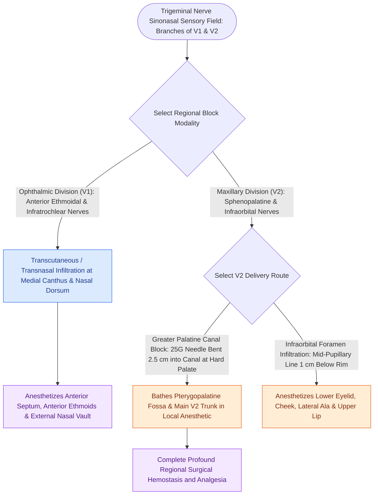

# Regional sensory nerve blocks of the nose and paranasal sinuses target branches of V1 and V2

## Active Recall

> [!question]- What neural branches provide sensory innervation to the external and internal nasal framework?
> *Answer / Clinical Rationale*: - **Ophthalmic Division ($V_1$)**: - *Infratrochlear & External Nasal (from Anterior Ethmoidal)*: Skin over the rhinion, nasal dorsum, and nasal tip. - *Internal Anterior Ethmoidal*: Anterior third of nasal septum and lateral nasal wall. - **Maxillary Division ($V_2$)**: - *Infraorbital*: Nasal alae, columella, and lower lateral cartilages. - *Nasopalatine (Long Sphenopalatine)*: Posterior-inferior two-thirds of the septum and anterior hard palate. - *Posterior Superior Lateral Nasal*: Middle and superior turbinates. - *Greater Palatine*: Hard palate and posterior inferior lateral nasal wall.

> [!question]- What are the technical anatomical steps to perform a trans-oral Greater Palatine Canal injection for sphenopalatine ganglion (SPG) block and maxillary hemostasis?
> *Answer / Clinical Rationale*: 1. Identify the **greater palatine foramen** on the hard palate opposite the second or third maxillary molar, $5\text{ mm}$ medial to the gingival margin. 2. Bend a 25-gauge or 27-gauge needle at a **$45^\circ\text{ to }60^\circ$ angle $2.5\text{ cm}$ from the tip**. 3. Advance gently into the greater palatine canal **no deeper than $2.0\text{–}2.5\text{ cm}$** to avoid entering the orbit via the inferior orbital fissure. 4. Aspirate to ensure no intravascular entry, then slowly inject $1.5\text{–}2.0\text{ mL}$ of $1\%$ lidocaine with $1:100,000$ epinephrine to bathe the pterygopalatine fossa, SPG, and maxillary artery branches.

> [!question]- How is an anterior ethmoid nerve block performed intranasally and externally?
> *Answer / Clinical Rationale*: - **Intranasal**: Place a neurosurgical pledget soaked in topical anesthetic/vasoconstrictor (e.g., $4\%$ cocaine or $1:1000$ epinephrine + tetracaine) high in the anterior nasal vault between the anterior middle turbinate and septal mucosa (the "nasal axilla"). - **External (Percutaneous)**: Inject at the medial orbital wall $1\text{ cm}$ superior to the medial canthus at the level of the frontoethmoidal suture, advancing $1.0\text{–}1.5\text{ cm}$ along the lamina papyracea.

## Core Clinical & Mechanistic Principles
Complete local anesthesia and mucosal vasoconstriction of the nasal cavity and paranasal sinuses requires targeted blockade of both [[Cranial nerve polyneuropathies of the skull base are localized by specific anatomical foramen involvement|V1 (ophthalmic) and V2 (maxillary) dermatomes]]:

### Safety Rules & Danger Zones
- **Orbital Penetration Hazard**: Never insert a needle $>25\text{ mm}$ into the greater palatine canal. Deep insertion risks direct injection into the orbit causing retrobulbar hematoma, proptosis, or transient amaurosis from central retinal artery spasm.
- **Topical Mucosal Uptake**: Tracheobronchial and nasal mucosal vascularity enables rapid systemic absorption mimicking intravenous administration; calculate maximum weight-based safe dosages before instillation.

## Connected Concepts & Graph Traversal
- **Epistaxis Anatomy**: [[The crista ethmoidalis guides endoscopic sphenopalatine artery ligation|Sphenopalatine Artery Topography]]
- **🔗 Local Anesthetic Safety (Laryngology)**: [[Local anesthetic systemic toxicity LAST is managed with airway stabilization and twenty percent intravenous lipid emulsion|LAST Resuscitation]]
- **🔗 Septorhinoplasty Craft (FPRS)**: [[Saddle nose deformity requires multi-tier dorsal and caudal structural reconstruction|Septal Support & L-Strut Principles]]
- **Maxillary Sinus Access**: [[Controlled middle meatal antrostomy enlargement preserves the anterior inferior fontanelle|Maxillary Sinus Antrostomy]]
- **🔗 Skull Base Foramina (Otology)**: [[Cranial nerve polyneuropathies of the skull base are localized by specific anatomical foramen involvement|Trigeminal Foramina Topography]]
