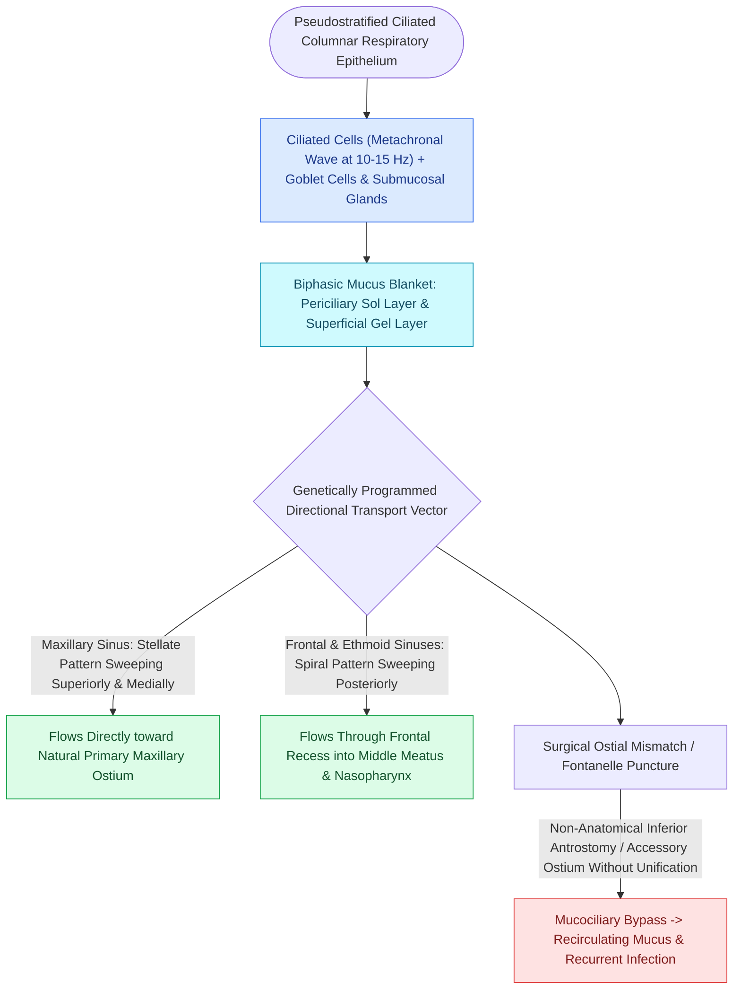

# Respiratory epithelium drives mucociliary clearance toward natural ostia

## Active Recall

> [!question]- Why does creating a surgical window in the inferior meatus fail to drain the maxillary sinus if the natural ostium is obstructed?
> *Answer / Clinical Rationale*: Ciliary transit in the maxillary sinus is genetically hardwired to transport the mucous blanket exclusively toward the **primary natural ostium** in the ethmoid infundibulum. Secretions will bypass an un-integrated inferior antrostomy, causing mucus to recirculate in an endless loop between the two openings.

> [!question]- What are the distinct physical characteristics and functions of the sol and gel layers of the sinonasal mucous blanket?
> *Answer / Clinical Rationale*: The **sol layer** is a thin, low-viscosity periciliary fluid that allows cilia to beat freely at 10–15 Hz. The overlying **gel layer** is a viscous, elastic glycoprotein sheet that traps foreign particles and is propelled forward by the tips of the beating cilia.

## Core Clinical & Mechanistic Principles
The sinonasal mucosa is lined by **pseudostratified ciliated columnar respiratory epithelium** populated by ciliated cells, non-ciliated columnar cells, goblet cells, and basal progenitor cells. Submucosal seromucinous glands and surface goblet cells produce a **biphasic mucous blanket**:

1. **Periciliary Layer (Sol Layer)**: Low-viscosity serous fluid directly bathing the ciliary shafts, allowing unrestricted ciliary propulsion.
2. **Superficial Gel Layer**: High-viscosity, elastic glycoprotein (mucin) matrix that traps inhaled particulates, pathogens, and environmental allergens.

### Metachronal Ciliary Propulsion & Messerklinger Principles
- **Beating Dynamics**: Cilia beat at **$10\text{–}15\text{ Hz}$** with a rapid forward effective stroke and a slow recovery stroke, creating a coordinated **metachronal wave**.
- **Genetically Determined Trajectories**: Walter Messerklinger demonstrated that mucociliary clearance pathways are genetically programmed to move secretions **exclusively toward the primary natural ostia**, regardless of gravity, head position, or surgically created non-anatomical fenestrations.
- **Sinus-Specific Clearance Patterns**:
  - **Maxillary Sinus**: Clearance originates on the sinus floor, spirals in a star-shaped pattern across the anterior, medial, lateral, and posterior walls, and converges on the **natural maxillary ostium** in the postero-superior infundibulum.
  - **Frontal Sinus**: Secretions ascend the interfrontal septum, loop laterally across the sinus roof, and descend along the medial and lateral walls into the **frontal sinus outflow tract (FSOT)**.
  - **Ethmoid & Sphenoid Sinuses**: Secretions drain posteriorly across the **sphenoethmoidal recess** into the nasopharynx.

## Critical Failure Modes & Error Traps
- **Mucociliary Recirculation**: Creating an isolated inferior meatal antrostomy without connecting it to the natural ostium causes mucus exiting the natural ostium to loop back into the inferior antrostomy, resulting in chronic recirculation and persistent sinusitis (see [[Separate inferior antrostomies cause recirculating mucus and recalcitrant sinusitis|Mucus Recirculation Phenomenon]]).
- **Secondary Ciliary Dyskinesia**: Severe chronic inflammation, bacterial biofilms (*Pseudomonas*, *S. aureus*), and mucosal stripping destroy ciliated architecture, replacing it with non-functional squamous metaplasia.

## Connected Concepts & Graph Traversal
- **Physiological Failure**: [[Separate inferior antrostomies cause recirculating mucus and recalcitrant sinusitis|Mucus Recirculation Phenomenon]]
- **Anatomical Outflow**: [[The uncinate process superior attachment dictates the frontal sinus drainage pathway|Uncinate Process & Frontal Drainage]]
- **Ostium Geometry**: [[The hiatus semilunaris and infundibulum form the primary drainage channel of the ostiomeatal complex|Hiatus Semilunaris & Infundibulum]]
- **Surgical Antrostomy**: [[Maxillary antrostomy requires incorporating accessory fontanelle ostia to prevent recirculation|Maxillary Antrostomy Craft]]
- **Anatomical Foundation**: [[Nitric oxide produced in the paranasal sinuses provides host defense and ciliary stimulation|Sinonasal Nitric Oxide (nNO)]]
- **Diagnostic Evaluation**: [[Olfactory neuroepithelium contains bipolar sensory neurons and basal stem cells|Olfactory Neuroepithelium]]
