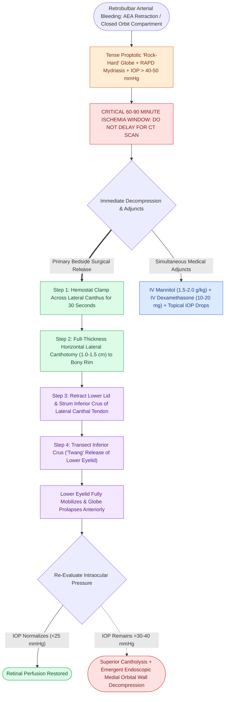

# Retrobulbar hematoma requires emergent bedside lateral canthotomy and cantholysis

## Active Recall

> [!question]- Why is obtaining a STAT CT scan strictly contraindicated when an acute retrobulbar hematoma is recognized?
> *Answer / Clinical Rationale*: Irreversible ischemic retinal necrosis occurs within **60–90 minutes**. Delaying decompression to transport the patient to radiology will result in permanent blindness. Lateral canthotomy must be performed immediately.

> [!question]- What critical anatomical structure must be divided after the initial horizontal lateral canthotomy incision to achieve orbital decompression?
> *Answer / Clinical Rationale*: The **inferior crus of the lateral canthal tendon**. Cutting this tendon releases the lower eyelid and periorbital sling, allowing the globe and orbital fat to prolapse forward, decompressing the orbit.

## Core Clinical & Mechanistic Principles
A **retrobulbar hematoma** is an acute surgical emergency causing **orbital compartment syndrome**. In FESS, it most commonly arises from transection and intraorbital retraction of the **anterior ethmoidal artery (AEA)** or injury to the posterior ethmoidal vessels and orbital venous plexus.

Because the orbit is a closed bony cone bounded anteriorly by the rigid tarsoligamentous sling, arterial bleeding rapidly elevates intraocular pressure ($IOP > 40\text{–}50\text{ mmHg}$), exceeding central retinal artery perfusion pressure. This causes irreversible retinal ganglion cell ischemia and **permanent blindness within 60 to 90 minutes**.

### Medical & Surgical Management Hierarchy
1. **Immediate Bedside Canthotomy/Cantholysis**: Must be performed **immediately in the OR or bedside without waiting for imaging or ophthalmology consultation**.
2. **Medical Decompression Adjuncts**:
   - **Intravenous Mannitol**: $1.5\text{–}2.0\text{ g/kg}$ IV over 30 minutes (draws fluid from intraocular compartments).
   - **Intravenous Dexamethasone**: $10\text{–}20\text{ mg}$ IV (reduces optic nerve edema).
   - **Topical IOP Drops**: Timolol 0.5% (beta-blocker) + Brimonidine 0.2% + Dorzolamide 2%.
3. **Secondary Orbital Decompression**: If IOP remains $>30\text{–}40\text{ mmHg}$ after complete cantholysis, perform endoscopic medial orbital wall decompression (resecting [[Draf IIb frontal sinusotomy extends from lamina papyracea to the nasal septum|lamina papyracea]] from orbit apex to lacrimal bone) and open periorbita.

## Connected Concepts & Graph Traversal
- **Vessel Origin**: [[Supraorbital ethmoid cells suspend the anterior ethmoidal artery below the skull base|AEA Mesentery & Injury]]
- **Orbital Danger**: [[Lamina papyracea dehiscence predisposes to orbital fat herniation and medial rectus injury|Lamina Papyracea Dehiscence]]
- **Ligation Technique**: [[The 24-12-6 rule governs anterior and posterior ethmoidal artery surgical localization|AEA Ligation]]
- **Complication Matrix**: [[High-stakes sinonasal complications require proactive landmarking and emergency rescue protocols|High-Stakes Sinonasal Complications]]
- **High-Stakes Safety**: [[Intraoperative ICA injury requires two-surgeon suction and crushed muscle patch hemostasis|Internal Carotid Artery Crisis Protocol]]
- **Anatomical Foundation**: [[Acute invasive fungal rhinosinusitis requires emergent surgical debridement and systemic amphotericin B|Acute Invasive Fungal Rhinosinusitis (AIFRS)]]
- **Surgical Craft**: [[Pituitary apoplexy causes acute chiasmatic compression and life-threatening panhypopituitarism|Pituitary Apoplexy Emergency]]
