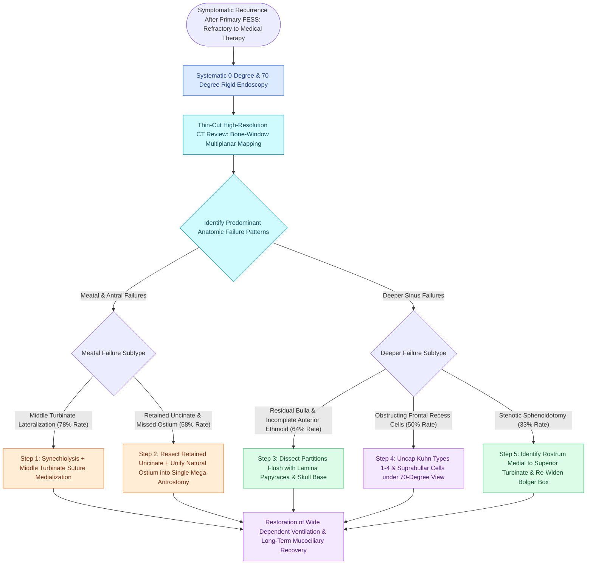

# Revision endoscopic sinus surgery systematically corrects recurrent middle turbinate lateralization, retained uncinate fragments, and persistent frontal recess cells to restore ostial patency

## Active Recall

> [!question]- In the landmark audit of revision endoscopic sinus surgery by Musy and Kountakis, what were the three most common anatomical causes of surgical failure?
> *Answer / Clinical Rationale*: (1) **Lateralization of the middle turbinate** ($78\%$), which obstructs the middle meatus and frontal recess; (2) **Incomplete anterior ethmoidectomy with retained ethmoid bulla** ($64\%$); and (3) **Retained uncinate process fragments with a missed natural maxillary ostium** ($58\%$), leading to recurrent sinusitis and mucus recirculation.

> [!question]- Why does creating a surgical antrostomy in the posterior fontanelle without unifying it with the natural ostium cause persistent maxillary sinusitis?
> *Answer / Clinical Rationale*: Maxillary mucociliary transport is genetically pre-programmed to sweep mucus strictly toward the **natural maxillary ostium**. Mucus exiting through the natural ostium immediately flows posteriorly and re-enters the maxillary sinus through the posterior fontanelle fenestration, creating a **circular mucus recirculation loop** of stagnant, contaminated secretions.

## Core Clinical & Mechanistic Principles
Primary functional endoscopic sinus surgery (FESS) achieves symptomatic relief and quality-of-life improvements in over $90\%$ of patients with medically refractory chronic rhinosinusitis. However, approximately $5\%\text{--}10\%$ of patients experience disease recidivism requiring revision sinus surgery. While recalcitrant inflammation may stem from host immunological dysfunction (severe Type 2 eosinophilic endotypes, cystic fibrosis, aspirin-exacerbated respiratory disease) or microbial biofilms, rigorous surgical audits confirm that the overwhelming majority of revision cases harbor **correctable anatomical and technical errors** from the primary operation.

The most catastrophic pathophysiology in revision maxillary surgery is the **missed natural ostium**. When a surgeon inadvertently creates an antrostomy in the posterior fontanelle while leaving the uncinate process and natural ostium unaddressed, the normal ciliated epithelium continues driving mucus toward the natural opening. The exiting mucus pool curls around the intervening mucosal bridge and is pulled directly back through the surgical defect, establishing **[[Separate inferior antrostomies cause recirculating mucus and recalcitrant sinusitis|mucus recirculation]]**. Definitive cure requires complete uncinate resection and surgical marsupialization connecting the fontanelle defect directly to the **[[Maxillary antrostomy requires incorporating accessory fontanelle ostia to prevent recirculation|natural maxillary ostium]]**.

### The Musy and Kountakis Anatomical Audit
In a landmark prospective evaluation of 168 consecutive patients undergoing revision FESS, Musy and Kountakis identified the precise distribution of anatomical failures:
1. **Lateralization of the Middle Turbinate ($78\%$)**: The single most common surgical failure. Inadvertent stripping of the middle turbinate lateral mucosa, destabilization of its sagittal root, or aggressive lateral packing causes the turbinate to lateralize and scar against the lamina papyracea, sealing the middle meatus and mechanically obstructing frontal sinus drainage.
2. **Incomplete Anterior Ethmoidectomy with Retained Ethmoid Bulla ($64\%$)**: Residual anterior ethmoidal partitions and incomplete uncapping of the ethmoid bulla leave diseased, hypoxic air cells that harbor persistent bacterial bioburden.
3. **Retained Uncinate Process / Missed Maxillary Ostium ($58\%$)**: Failure to resect the superior and anterior uncinate leaves a mechanical shield hiding the true ostium. Missed ostia cause chronic recirculation in up to $20\%$ of revision maxillary cases.
4. **Incomplete Frontal Recess Dissection ($50\%$)**: Obstructing agger nasi cells, suprabullar cells, and Kuhn cells left behind during primary surgery crowd the narrow frontal outflow tract.
5. **Stenotic Sphenoid Ostium ($33\%$)**: Inadequate ostial widening or entry into an Onodi cell rather than the true sphenoid sinus leads to ostial contracture and persistent sphenoiditis.

### Systematic Operative Strategy in Revision FESS
1. **Maximizing Surgical Field Visibility**:
   - Deployment of Total Intravenous Anesthesia (TIVA) with target-controlled propofol/remifentanil to maintain relative bradycardia and reduce mean arterial pressure (MAP).
   - Greater palatine canal infiltration with $1\%$ lidocaine with 1:100,000 epinephrine to induce sphenopalatine vasoconstriction; topical neurosurgical cottonoids soaked in 1:1,000 epinephrine or $4\%$ cocaine.
2. **Reconstructing the Middle Meatal Corridor**:
   - Adhesions between the middle turbinate and lateral nasal wall are sharply divided with through-cutting instruments.
   - The middle turbinate is mobilized medially. If unstable, a trans-septal mattress suture or controlled mucosal abrading against the septum is performed to secure medialization.
3. **Maxillary Unification**:
   - Under $30^\circ$ or $70^\circ$ endoscopic visualization, a curved probe palpates the posterior lip of the lacrimal bone to locate the natural ostium.
   - Retained uncinate bone is resected flush using a backbiter or microdebrider. The bridge between the fontanelle defect and natural ostium is divided, eliminating recirculation.
4. **Stepwise Posterior-to-Anterior Skull Base Clearance**:
   - The sphenoid sinus is re-identified using the superior turbinate as an invariant medial guide. The ostium is widened inferiorly and medially along the Bolger box coordinates.
   - Dissection then proceeds in a retrograde, posterior-to-anterior vector along the fovea ethmoidalis, unroofing residual ethmoid partitions flush with the skull base.
5. **Frontal Recess Clearance**:
   - Utilizing $45^\circ$ and $70^\circ$ endoscopes with curved curettes, obstructing agger nasi and Kuhn cells are sequentially uncapped along mucosal transition zones without denuding the posterior frontal beak bone.

## Connected Concepts & Graph Traversal
- **Middle Meatus Destabilization**: [[Middle turbinate lateralization causes secondary ostiomeatal obstruction and frontal sinus stenosis|Middle Turbinate Lateralization]]
- **Frontal Recess Anatomy**: [[The Kuhn classification stages frontal recess and frontal sinus air cells|Kuhn Cell Classification]]
- **Postoperative Wound Healing**: [[Postoperative FESS debridement timing and technique prevent crusting and synechiae formation|Postoperative FESS Debridement]]
- **Anatomical Boundary Anchor**: [[The ethmoid bulla serves as the principal anatomical anchor for anterior ethmoidectomy|Ethmoid Bulla Anchor]]
- **Sphenoid Safe Entry**: [[The sphenoid sinus ostium lies medial to the superior turbinate above the choana|Sphenoid Sinus Ostium]]
