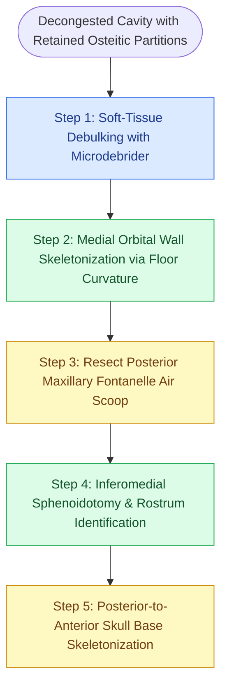

# Revision endoscopic sphenoethmoidectomy clears recalcitrant osteitic partitions via posterior-to-anterior skull base skeletonization and medial orbital wall navigation

## Active Recall

> [!question]- Why does a ratio of maxillary sinus height to posterior ethmoid height exceeding 2:1 increase skull base breach risk in revision sinus surgery?
> *Answer / Clinical Rationale*: In a hyperpneumatized maxillary sinus paired with a low posterior ethmoid ceiling (ratio > 2:1), the trajectory from the middle meatus is deceptively shifted superiorly. A surgeon attempting to enter what they presume to be the sphenoid sinus face will aim too high along an upward slope, penetrating the fovea ethmoidalis or cribriform plate rather than entering the sphenoid ostium, provoking cerebrospinal fluid (CSF) leakage or intracranial hemorrhage.
>
> [!question]- What surgical rule governs the safe removal of osteitic skull base partitions in scarred revision ethmoidectomy?
> *Answer / Clinical Rationale*: Partitions along the ethmoid skull base should only be resected when the surgeon can simultaneously "feel behind and see in front" of the bony partition using 45-degree through-cutting forceps. Dissection must proceed strictly in a posterior-to-anterior direction after identifying the sphenoid sinus roof, keeping instruments directed laterally against the skull base-lamina junction where bone is thicker, rather than medially near the fragile lateral lamella.

## Core Clinical & Mechanistic Principles

Revision completion sphenoethmoidectomy addresses persistent mucosal inflammation and severe recalcitrant polyposis driven by retained, neo-osteogenic bony partitions along the medial orbital wall and ethmoid skull base. Prior partial ethmoidectomies frequently leave behind residual agger nasi caps, retained uncinate remnants, lateralized middle turbinates, and un-opened posterior ethmoid pyramids. Under sustained inflammatory cascades, these retained bony lamellae undergo profound neo-osteogenesis and periosteal osteitis, acting as an infectious nidus that continually fuels overlying mucosal hyperplastic polyp formation.

Safe navigation through scarred, landmark-depleted revision cavities requires rigorous triplanar computed tomography review and dynamic [[Image-guided surgery registration and real-time tracking enhance navigation in distorted anatomy|image-guided navigation]]. The primary anatomical compass is the medial orbital wall: the surgeon follows the contiguous curvature of the orbital floor superiorly onto the [[Lamina papyracea dehiscence predisposes to orbital fat herniation and medial rectus injury|lamina papyracea]], which reliably defines the lateral boundary of the ethmoidal corridor. Powered microdebriders must be restricted strictly to soft-tissue polyp debulking under direct visual control, while all osteitic bony partitions are resected using manual through-cutting instruments and Kerrison punches to maintain continuous tactile feedback.

Once the natural or neo-ostium of the sphenoid sinus is identified and widely marsupialized, the sphenoid roof serves as the absolute planar baseline. From this landmark, [[Posterior ethmoidectomy requires dissecting along the skull base from posterior to anterior|posterior-to-anterior dissection]] systematically skeletonizes the fovea ethmoidalis, clearing scarred partitions forward toward the frontal recess while erring laterally toward the lamina to avoid the vulnerable cribriform plate and lateral lamella of the olfactory fossa.

### Step-by-Step Surgical Execution

1. **Medical Decongestion and Debulking**: Intensive preoperative oral corticosteroid therapy reduces intraoperative blood loss and polypoid volume. Intraoperatively, neurosurgical cottonoids soaked in 1:1,000 epinephrine or 4% topical cocaine are placed in the middle meatus. A straight microdebrider blade is deployed strictly to debulk intraluminal polyps without engaging bony walls.
2. **Revising the Maxillary Antrostomy**: The scarred natural ostium is identified. Retained uncinate process bone is resected flush to the lacrimal bone using a backbiting forceps. All allergic mucin and polypoid mucosa within the maxillary antrum are irrigated with high-volume saline using a curved olive-tip cannula.
3. **Resection of the Posterior Maxillary Air Scoop**: Incomplete prior antrostomies leave an osteitic shelf at the posterior fontanelle that acts as an "air scoop," channeling inspiratory airflow into stagnant recesses. Straight through-cutting forceps excise this fontanelle tissue flush with the posterior maxillary wall.
4. **Skeletonization of the Medial Orbital Wall**: Identifying the transition between the maxillary sinus roof (orbital floor) and the lamina papyracea provides a safe entry trajectory. Osteitic bony partitions abutting the orbit are fractured medially with 2-mm and 4-mm Kerrison punches or 45-degree through-cutters.
5. **Sphenoidotomy and Skull Base Transition**: The sphenoid face is entered at its natural ostium medial to the superior turbinate remnant. The sphenoidotomy is enlarged inferiorly with a Kerrison punch, taking care to push the overlying mucosa inferiorly to protect the posterior septal vascular pedicle.
6. **Posterior-to-Anterior Skull Base Skeletonization**: The thick, ivory-colored bone of the sphenoid roof is traced anteriorly onto the ethmoid roof. Working with 45-degree through-cutting forceps, residual partitions are palpated behind and visualized in front before division. Dissection errs laterally along the lamina papyracea where bone thickness is greatest.
7. **Caudo-Cranial Frontal Recess Completion**: Working anteriorly, the superior uncinate remnant is removed along the anteromedial orbital wall, restoring patency to the frontal recess.

### Danger Zones & Complication Avoidance

- **Maxillary-to-Posterior Ethmoid Height Discrepancy**: When the coronal CT shows a tall maxillary sinus and a low-lying ethmoid roof (height ratio > 2:1), upward trajectory leads directly into the anterior cranial fossa. Image guidance and horizontal trajectory tracking from the maxillary roof prevent skull base perforation.
- **Posterior Septal Artery Hemorrhage**: Inferior sphenoid face enlargement can divide the septal branch of the sphenopalatine artery, precipitating heavy arterial retraction into the sphenopalatine foramen. Mucosa over the inferior sphenoid rostrum must be elevated inferiorly prior to bone punch engagement.
- **Anterior Ethmoidal Artery Vulnerability**: In revision cavities with absent middle turbinate lamellae, the anterior ethmoidal artery canal may hang 2–5 mm below the skull base within a supraorbital ethmoid cell. Traction on scarred fibrous bands near the fovea ethmoidalis must be avoided to prevent arterial transection and retrobulbar hematoma.

## Connected Concepts & Graph Traversal
- **Radiological Assessment**: [[The CLOSE checklist systematically evaluates critical radiological danger zones|CLOSE Checklist Preoperative CT Review]]
- **Anatomical Aberration**: [[Onodi cells place the optic nerve and carotid artery at risk during posterior ethmoidectomy|Onodi Sphenoethmoidal Cell]]
- **Vascular Protection**: [[Posterior epistaxis from sphenopalatine artery arborization requires endoscopic ligation or embolization|Sphenopalatine Artery Septal Branch Protection]]
- **Postoperative Maintenance**: [[Postoperative FESS debridement timing and technique prevent crusting and synechiae formation|Postoperative Cavity Debridement]]
- **Surgical Instrumentation**: [[Powered microdebrider blade selection and suction irrigation maintain clean surgical optics|Microdebrider Mucosal Sparing]]
- **Distorted Anatomy Navigation**: [[Stereotactic image-guided navigation combines electromagnetic or optical tracking with CT-MRI fusion to maintain spatial orientation in distorted revision sinus and skull base surgery|Stereotactic Image-Guided Navigation]]
