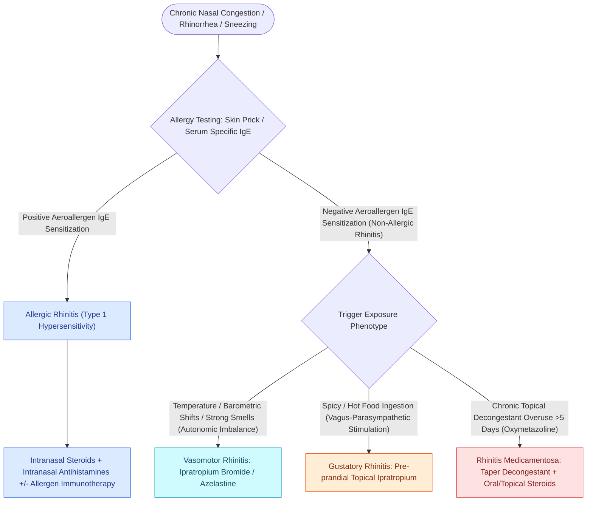

# Rhinitis subtypes are differentiated into allergic, vasomotor, gustatory, and rhinitis medicamentosa

## Active Recall

> [!question]- What is the pathophysiological cause of rhinitis medicamentosa, and what is the treatment?
> *Answer / Clinical Rationale*: Rebound vasodilation from **downregulation of alpha-adrenergic receptors following topical decongestant overuse ($>3\text{–}5\text{ days}$)**; treated by **immediate cessation of the spray, a short oral corticosteroid burst, and intranasal steroids**.

> [!question]- Which pharmacological agent specifically treats the profuse watery rhinorrhea of vasomotor and gustatory rhinitis?
> *Answer / Clinical Rationale*: Intranasal **Ipratropium bromide** (an anticholinergic agent).

## Core Clinical & Mechanistic Principles
**[[Allergen immunotherapy induces regulatory T cells and IgG4 blocking antibodies to modulate allergic rhinitis and prevent asthma progression|Rhinitis]]** is defined as inflammation of the nasal mucous membranes presenting with rhinorrhea, nasal congestion, sneezing, and pruritus, classified into distinct allergic and non-allergic phenotypes:
- **Major Rhinitis Subtypes**:
  1. **Allergic Rhinitis (IgE-Mediated)**:
     - Sensitization to aeroallergens (pollen, dust mites, animal dander); cross-linking of IgE on mast cells triggers histamine, leukotriene, and prostaglandin release.
     - *Signs*: Pale, boggy, bluish nasal mucosa, allergic shiners, transverse nasal crease.
     - *Testing*: Skin prick testing, serum allergen-specific IgE (ImmunoCAP).
     - *Therapy*: Intranasal corticosteroids (first-line), intranasal antihistamines (azelastine), sublingual/subcutaneous immunotherapy (SLIT/SCIT).
  2. **Non-Allergic Vasomotor Rhinitis (Autonomic Dysregulation)**:
     - Neurogenic imbalance characterized by **parasympathetic hyper-reactivity** triggered by temperature changes, cold air, dry air, strong odors, or emotional stress.
     - *Therapy*: Intranasal **Ipratropium bromide** (anticholinergic) or **posterior nasal nerve (PNN) cryoablation / radiofrequency ablation (RhinAer/ClariFix)**.
  3. **Gustatory Rhinitis**: Vagally mediated watery rhinorrhea triggered immediately upon consuming hot, spicy foods; highly responsive to pre-prandial ipratropium nasal spray.
  4. **Rhinitis Medicamentosa**:
     - Rebound nasal congestion caused by prolonged use ($>3\text{–}5\text{ days}$) of **topical vasoconstrictors (oxymetazoline / phenylephrine)**.
     - Chronic stimulation leads to alpha-adrenergic receptor downregulation and severe rebound venous engorgement; treated with immediate cessation, high-dose oral steroid burst, and intranasal steroid sprays.

### Infectious Rhinitis & Viral Etiology
- **Viral Rhinitis (The Common Cold / Acute URI)**:
  - **Rhinovirus** is overwhelmingly the **most common infectious etiology of acute rhinitis**, accounting for $>50\%$ of all viral upper respiratory infections.
  - Secondary viral pathogens include coronaviruses, influenza, parainfluenza, RSV, and adenoviruses.

### Allergic Rhinitis Epidemiology, Genetics & Aeroallergen Physics
- **Epidemiological Progression & Age Distribution**:
  - The prevalence and severity of allergic rhinitis typically **increase with age from early childhood through young adulthood**, peaking in the second to fourth decades of life before plateauing or gradually declining in late adulthood.
  - *Genetic Concordance*: Strong genetic predisposition; allergic rhinitis shows a high concordance rate of **$45–60\%$ in monozygotic twins** compared to $15–25\%$ in dizygotic twins. If both parents have atopic disease, the child has a $>50–70\%$ lifetime probability of developing allergic rhinitis.
- **Indoor Aeroallergen Physical Properties & Aerodynamics**:
  - *Dust Mite Allergens (Der p 1, Der f 1)*: Fecal pellets are relatively large ($10–40\ \mu\text{m}$), heavy particles. They become airborne only during active disturbance (vacuuming, bed-making) and **rapidly settle out of the air within 15 to 30 minutes**. Interventions focus on impermeable mattress/pillow encasements and hot water washing ($>130^\circ\text{F} / 55^\circ\text{C}$).
  - *Cat Dander Allergens (Fel d 1)*: Small, lightweight molecular complexes ($1–5\ \mu\text{m}$) produced by feline sebaceous and salivary glands. Due to their ultra-small size, Fel d 1 particles **remain suspended in ambient air for hours to days**, adhere tenaciously to carpets, upholstery, and walls, and are carried on clothing into pet-free environments (schools, hospitals). HEPA air filtration is significantly more effective for cat dander than for dust mites.

### Surgical Technique & Critical Safety Checks
- **Pregnancy Rhinitis**: Hormonally driven (estrogen/progesterone) mucosal hyperemia and edema; resolves spontaneously within 2 weeks postpartum.

## Connected Concepts & Graph Traversal
- **Type 2 Inflammatory Pathway**: [[Non-Type 2 CRS features neutrophilic inflammation associated with cystic fibrosis and ciliopathies|Allergic T2 Endotypes]]
- **Biologic Monoclonal Antibodies**: [[Biologic therapeutics in chronic rhinosinusitis target IgE, IL-4, IL-5, and IL-13 inflammatory pathways|Biologic Therapies in Rhinitis]]
- **Autonomic Parasympathetic Relay**: [[The sphenopalatine ganglion serves as the primary parasympathetic relay for the sinonasal cavity|Sphenopalatine Ganglion]]
- **Sensory Contact Headache**: [[Rhinogenic contact point headache arises from mucosal contact between the nasal septum and turbinates|Contact Point Headache]]
- **Allergy Quantification**: [[Intradermal dilutional testing IDT and modified quantitative testing MQT quantify allergic sensitization to guide safe immunotherapy escalation|IDT & MQT Allergy Testing]]
- **Biologic Therapy**: [[Allergen immunotherapy induces regulatory T cells and IgG4 blocking antibodies to modulate allergic rhinitis and prevent asthma progression|Allergen Immunotherapy]]
