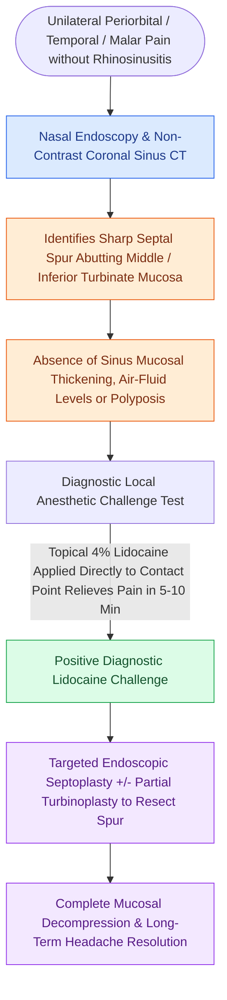

# Rhinogenic contact point headache arises from mucosal contact between the nasal septum and turbinates

## Active Recall

> [!question]- How is a rhinogenic contact point headache definitively diagnosed preoperatively?
> *Answer / Clinical Rationale*: By demonstrating **immediate pain relief within 5 to 10 minutes following topical application of local anesthetic (lidocaine) to the contact point**.

> [!question]- What two anatomical structures most commonly create a mucosal contact point headache?
> *Answer / Clinical Rationale*: A **deviated nasal septum / septal spur** contacting a **middle turbinate (or concha bullosa)** or inferior turbinate.

## Core Clinical & Mechanistic Principles
**Rhinogenic Contact Point Headache (Mucosal Contact Point Headache)** is a distinct secondary headache disorder (classified in ICHD-3) caused by physical mucosal contact and compression between the nasal septum and the lateral nasal wall:
- **Neuroanatomical Mechanism**:
  - Severe septal deviations, sharp **septal spurs**, or hypertrophic **[[Concha bullosa pneumatization of the middle turbinate can obstruct the ostiomeatal complex|concha bullosa]] / middle turbinates** create continuous mucosal contact.
  - Mechanical compression stimulates unmyelinated **trigeminal sensory nerve fibers (branches of CN V1 and V2)** within the nasal mucosa, triggering the release of substance P, CGRP, and neurokinin A.
  - Induces referred pain radiating to the periorbital, frontotemporal, or zygomatic facial regions.
- **Diagnostic Confirmation Protocol (Stammberger Criteria)**:
  1. High-resolution CT of the sinuses demonstrating sharp mucosal contact without active inflammatory mucosal disease.
  2. **The Topical Anesthetic Diagnostic Test (Pathognomonic)**: Placement of a 4% lidocaine or cocaine-soaked cotton pledget directly onto the mucosal contact point **aborts or significantly reduces headache pain within 5–10 minutes**.
- **Surgical Craft (Targeted Endoscopic Decompression)**:
  - Targeted **endoscopic septoplasty / spur resection** combined with **partial middle turbinate resection (turbinoplasty) or concha bullosa excision** to permanently eliminate mucosal contact.
  - Achieves headache relief in $>75\text{–}85\%$ of properly selected patients.

### Surgical Technique & Critical Safety Checks
- **Differential Diagnosis**: Must rule out primary migraine, cluster headache, and trigeminal neuralgia before surgical intervention.

## Connected Concepts & Graph Traversal
- **Ethmoidal Lamellar Partitions**: [[The basal lamella of the middle turbinate divides anterior from posterior ethmoid cells|Basal Lamella Partition]]
- **Radiological Danger Checklist**: [[The CLOSE checklist systematically evaluates critical radiological danger zones|CLOSE Checklist (Cribriform & Lamina)]]
- **Anatomical Turbinate Variant**: [[Concha bullosa pneumatization of the middle turbinate can obstruct the ostiomeatal complex|Concha Bullosa]]
- **Trigeminal Parasympathetic Pathway**: [[The sphenopalatine ganglion serves as the primary parasympathetic relay for the sinonasal cavity|Sphenopalatine Ganglion]]
- **Vasomotor Rhinitis Differential**: [[Rhinitis subtypes are differentiated into allergic, vasomotor, gustatory, and rhinitis medicamentosa|Vasomotor Rhinitis Differential]]
- **Differential Diagnosis**: [[Caudal septoplasty corrects caudal subluxation and external valve collapse through swinging-door relocation and L-strut preservation|Caudal Septoplasty]]
- **Precipitating Condition**: [[Endoscopic septoplasty enables targeted spur resection and improves middle meatal access while minimizing mucosal dissection|Endoscopic Septoplasty]]
