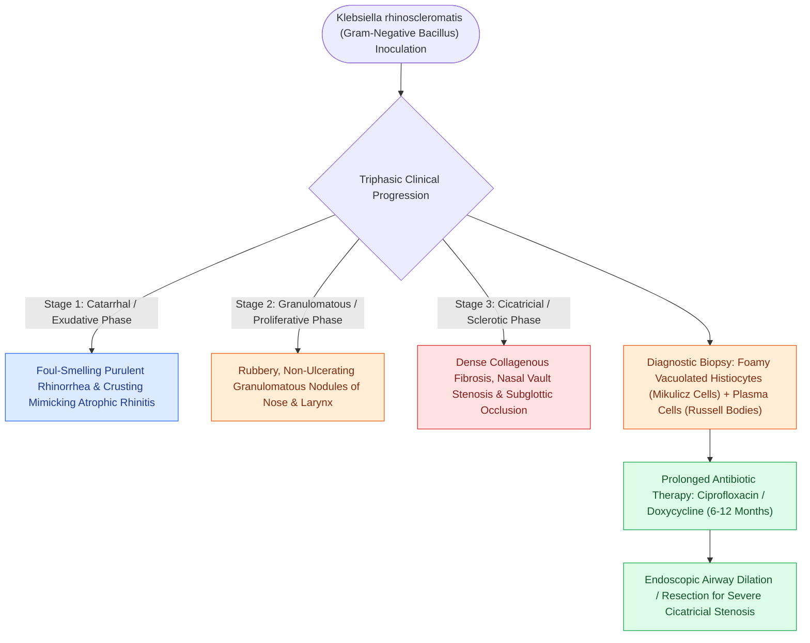

# Rhinoscleroma is a chronic granulomatous Klebsiella infection characterized by Mikulicz cells and Russell bodies

## Active Recall

> [!question]- What two microscopic histopathological findings are pathognomonic for rhinoscleroma?
> *Answer / Clinical Rationale*: **Mikulicz cells** (large foamy macrophages containing intracellular bacilli) and **Russell bodies** (eosinophilic plasma cell inclusions).

> [!question]- What is the causative microbiological organism of rhinoscleroma?
> *Answer / Clinical Rationale*: **Klebsiella pneumoniae subsp. rhinoscleromatis** (a Gram-negative bacillus).

## Core Clinical & Mechanistic Principles
**Rhinoscleroma** is a chronic, progressive, slowly destructive granulomatous infection of the upper respiratory tract caused by the Gram-negative diplobacillus **Klebsiella pneumoniae subsp. rhinoscleromatis**:
- **Endemic Geography & Transmission**:
  - Endemic in Central/South America, Egypt, Central Africa, and India; spread by direct person-to-person droplet contact in crowded, low-socioeconomic conditions.
- **Triphasic Pathological Progression**:
  1. **Catarrhal / Atrophic Stage**: Foul-smelling purulent rhinorrhea, mucosal crusting, and [[Nonallergic rhinitis with eosinophilia syndrome NARES features nasal eosinophilia without IgE sensitization and represents a precursor to Samter triad|atrophic rhinitis]] mimicking ozena.
  2. **Granulomatous / Nodular Stage**: Dense, bluish-red, painless [[Granulomatosis with polyangiitis presents with necrotizing sinonasal granulomas and saddle nose|granulomatous]] nodules infiltrate the nasal septum, inferior turbinates, and upper lip, causing marked external nasal widening (**"Hebra nose"**) and airway stenosis.
  3. **Cicatricial / Sclerotic Stage**: Extensive, rock-hard fibrous scar contracture causing complete nasal stenosis, subglottic narrowing, and soft palate distortion.
- **Pathognomonic Histopathological Features**:
  - **Mikulicz Cells**: Markedly enlarged, foamy, vacuolated histiocytes/macrophages packed with intracellular Gram-negative bacilli (demonstrated on Warthin-Starry silver or Giemsa stain).
  - **Russell Bodies**: Brightly eosinophilic plasma cells containing aggregated immunoglobulin globes.

### Surgical Technique & Critical Safety Checks
- **Pharmacotherapy**: Prolonged antimicrobial therapy ($3\text{ to }6\text{ months}$) with **ciprofloxacin, trimethoprim-sulfamethoxazole, or rifampin** until cultures and repeat biopsies confirm eradication; surgical dilation/debridement for cicatricial stenosis.

## Connected Concepts & Graph Traversal
- **Vasculitic Destructive Differential**: [[Granulomatosis with polyangiitis presents with necrotizing sinonasal granulomas and saddle nose|GPA Vasculitis]]
- **Non-Caseating Granulomas**: [[Sarcoidosis of the upper respiratory tract causes non-caseating granulomas and mucosal cobblestoning|Sinonasal Sarcoidosis]]
- **Fungal Angioinvasion Emergency**: [[Acute invasive fungal rhinosinusitis requires emergent surgical debridement and systemic amphotericin B|AIFRS Emergencies]]
- **Frontal Bone Osteomyelitis**: [[Pott's puffy tumor represents subperiosteal abscess and frontal bone osteomyelitis from sinusitis|Pott Puffy Tumor]]
- **Necrotizing EGPA Vasculitis**: [[Eosinophilic granulomatosis with polyangiitis causes asthma, peripheral eosinophilia, and necrotizing vasculitis|EGPA Vasculitis]]
