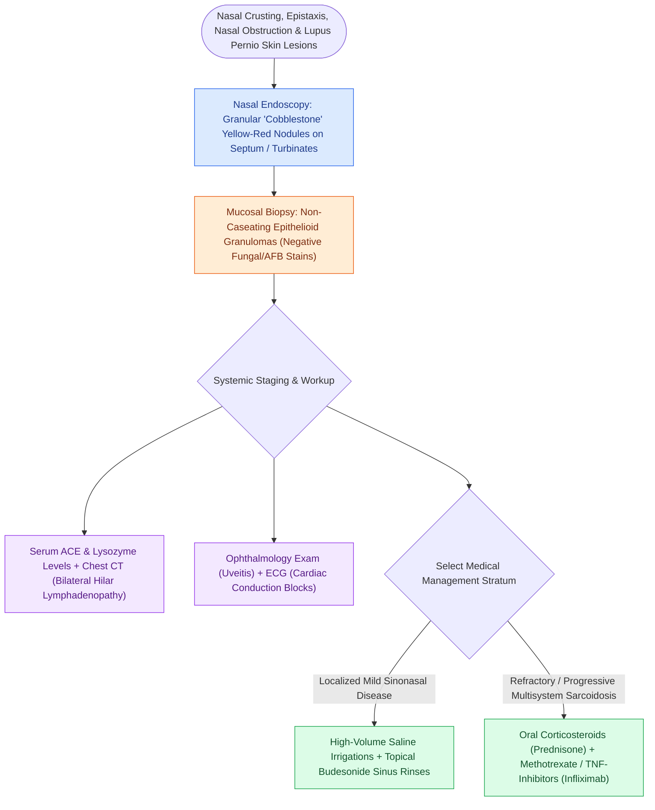

# Sarcoidosis of the upper respiratory tract causes non-caseating granulomas and mucosal cobblestoning

## Active Recall

> [!question]- What is the pathognomonic histological hallmark of sinonasal sarcoidosis?
> *Answer / Clinical Rationale*: **Non-caseating epithelioid granulomas** with multinucleated giant cells, lacking central necrosis and negative for fungal/mycobacterial organisms.

> [!question]- What cutaneous manifestation strongly correlates with upper respiratory tract involvement in sarcoidosis?
> *Answer / Clinical Rationale*: **Lupus pernio** (violaceous, indurated nodular plaques on the nose, cheeks, and ears).

## Core Clinical & Mechanistic Principles
**Sarcoidosis** is a multi-system, idiopathic [[Granulomatosis with polyangiitis presents with necrotizing sinonasal granulomas and saddle nose|granulomatous disorder]] characterized pathologically by the formation of **well-formed, non-caseating epithelioid granulomas**.

Upper respiratory tract involvement occurs in **$10\text{–}15\%$ of patients** and presents with distinct mucosal changes and potential osteolytic destruction.

### Diagnostic & Therapeutic Paradigm
- **Diagnostics**: Elevated **Serum Angiotensin-Converting Enzyme (ACE)** levels and hypercalcemia/hypercalciuria; bilateral hilar lymphadenopathy on chest imaging.
- **Therapy**: High-potency topical steroid irrigations (Budesonide); systemic Corticosteroids, Methotrexate, or TNF-$\alpha$ inhibitors (Infliximab) for refractory disease.

## Connected Concepts & Graph Traversal
- **Vasculitis Contrast**: [[Granulomatosis with polyangiitis presents with necrotizing sinonasal granulomas and saddle nose|GPA Vasculitis]]
- **Non-T2 Endotype**: [[Non-Type 2 CRS features neutrophilic inflammation associated with cystic fibrosis and ciliopathies|Non-Type 2 CRS]]
- **Staging**: [[The Lund-Kennedy endoscopic staging system tracks mucosal edema, polyps, and discharge|Lund-Kennedy Endoscopic Score]]
- **Anatomical Foundation**: [[Respiratory epithelium drives mucociliary clearance toward natural ostia|Mucociliary Clearance Physiology]]
- **Surgical Craft**: [[AERD manifests with asthma, nasal polyps, and severe aspirin-induced respiratory reactions|AERD Pathophysiology]]
