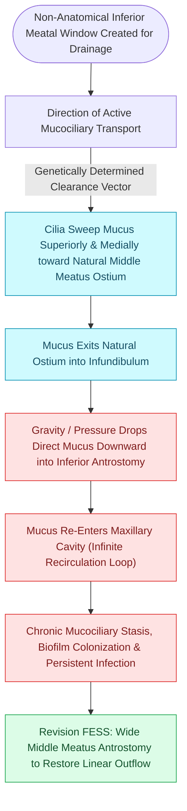

# Separate inferior antrostomies cause recirculating mucus and recalcitrant sinusitis

## Active Recall

> [!question]- Why does an isolated accessory fontanelle ostium frequently cause symptomatic maxillary sinusitis even in an unoperated patient?
> *Answer / Clinical Rationale*: Secretions propelled out of the natural ostium by ciliary action loop directly back into the maxillary sinus through the adjacent accessory fontanelle defect, creating a closed-loop recirculation cycle that leads to stagnant mucus and secondary infection.

> [!question]- What is the definitive surgical maneuver to correct the mucus recirculation phenomenon during revision FESS?
> *Answer / Clinical Rationale*: The intervening mucosal and bony bridge between the natural ostium and the accessory/inferior antrostomy must be completely excised, creating a **single continuous antrostomy**.

## Core Clinical & Mechanistic Principles
The **mucus recirculation phenomenon** occurs when two separate openings exist in the medial wall of the maxillary sinus that are not surgically unified into a single continuous antrostomy. 

Because mucociliary propulsion is genetically programmed to transport secretions toward the **natural maxillary ostium**, mucus exiting the natural ostium in the middle meatus is drawn by local pressure gradients and gravity back into the sinus cavity through the secondary opening (either an accessory ostium in the fontanelle or an isolated surgical inferior meatal antrostomy).

### Pathological Consequences
1. **Endless Circular Loop**: Mucus repeatedly cycles out of the natural ostium and back into the maxillary antrum through the accessory/inferior opening.
2. **Biofilm Accumulation**: Retained, recirculating mucus becomes hyper-viscous, colonized by bacterial biofilms (*Staphylococcus aureus*, *Pseudomonas aeruginosa*), and triggers chronic recalcitrant rhinosinusitis.
3. **Surgical Miss**: Patients continue to experience purulent post-nasal drip, facial pressure, and halitosis despite a widely patent secondary antrostomy.

## Step-by-Step Surgical Rescue
1. **Endoscopic Identification**: Use a $30^\circ$ or $70^\circ$ endoscope to visualize the middle meatus. Identify the natural ostium located postero-inferior to the lacrimal bulge and locate the separate accessory or inferior opening.
2. **Tissue Bridge Division**: Using through-cutting punch forceps, a backbiting forceps, or a [[Powered microdebrider blade selection and suction irrigation maintain clean surgical optics|microdebrider]], excise the intervening bridge of [[Controlled middle meatal antrostomy enlargement preserves the anterior inferior fontanelle|posterior fontanelle]] mucosa and bone.
3. **Unified Antrostomy Creation**: Form a single, widely patent **mega-antrostomy** uniting the natural ostium and the accessory opening, ensuring that exiting secretions flow directly into the posterior middle meatus without re-entering the antrum.

## Connected Concepts & Graph Traversal
- **Underlying Physiology**: [[Respiratory epithelium drives mucociliary clearance toward natural ostia|Mucociliary Clearance Mechanics]]
- **Surgical Execution**: [[Maxillary antrostomy requires incorporating accessory fontanelle ostia to prevent recirculation|Maxillary Antrostomy Technique]]
- **Ostium Anatomy**: [[The hiatus semilunaris and infundibulum form the primary drainage channel of the ostiomeatal complex|Ethmoid Infundibulum]]
- **Complication Matrix**: [[High-stakes sinonasal complications require proactive landmarking and emergency rescue protocols|High-Stakes Sinonasal Complications]]
- **Anatomical Foundation**: [[Chronic non-invasive fungal ball presents with dense maxillary mycetoma without tissue invasion|Sinonasal Fungal Ball]]
- **High-Stakes Safety**: [[Iatrogenic skull base cribriform leaks require immediate intraoperative multi-layer graft repair|Iatrogenic Skull Base Repair]]
- **Surgical Craft**: [[Middle turbinate lateralization causes secondary ostiomeatal obstruction and frontal sinus stenosis|Middle Turbinate Lateralization]]
- **Disease Mechanism**: [[Complete uncinectomy and posterior fontanelle resection unify the natural maxillary ostium with fontanelle defects to prevent mucus recirculation loops|Posterior Fontanelle Resection]]
