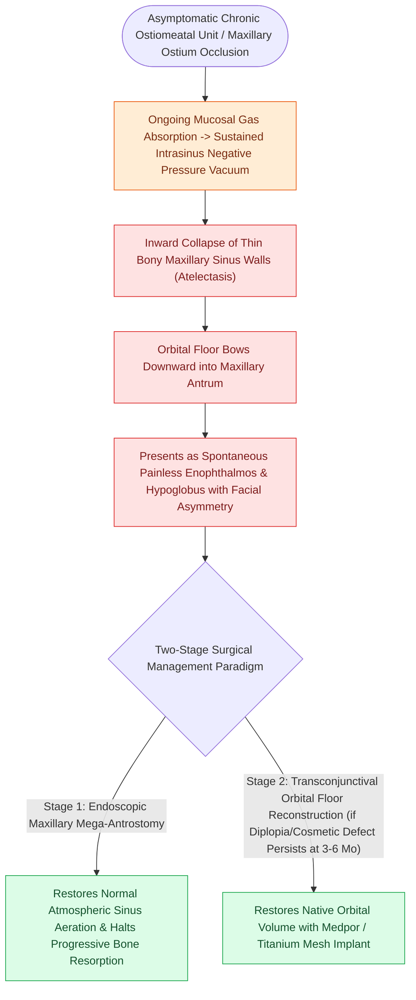

# Silent sinus syndrome presents with spontaneous enophthalmos and maxillary sinus atelectasis

## Active Recall

> [!question]- What is the underlying biomechanical cause of maxillary sinus atelectasis in silent sinus syndrome?
> *Answer / Clinical Rationale*: Chronic, persistent ostial occlusion leading to **mucosal gas absorption, chronic negative intraluminal pressure**, and osteoclast-mediated inward collapse of the thin bony walls.

> [!question]- Why is uncinectomy particularly dangerous in a patient with silent sinus syndrome?
> *Answer / Clinical Rationale*: Negative pressure sucks the **uncinate process and lamina papyracea laterally against the orbit**, putting the orbital fat and medial rectus muscle directly in the path of the incising blade.

## Core Clinical & Mechanistic Principles
**Silent Sinus Syndrome (Chronic Maxillary Atelectasis / Imploding Antrum)** is characterized by **spontaneous, painless, progressive enophthalmos and hypoglobus** secondary to subatmospheric negative pressure collapse of the maxillary sinus walls.

### Critical Surgical Hazard During Uncinectomy
- The uncinate process and [[Draf IIb frontal sinusotomy extends from lamina papyracea to the nasal septum|lamina papyracea]] are drawn **severely laterally**, directly abutting the medial rectus and orbital fat.
- Standard "blind" sickle knife uncinectomy carries an extreme risk of **orbital penetration, medial rectus laceration, and retrobulbar hemorrhage**. Dissection must be performed with backbiting forceps or under direct visual guidance from posterior to anterior.

## Connected Concepts & Graph Traversal
- **Orbit Danger**: [[Lamina papyracea dehiscence predisposes to orbital fat herniation and medial rectus injury|Lamina Papyracea Dehiscence]]
- **FESS Craft**: [[Incisive uncinectomy exposes the ethmoid infundibulum while protecting the nasolacrimal duct|Incisive Uncinectomy]]
- **Frontal Drainage**: [[The uncinate process superior attachment dictates the frontal sinus drainage pathway|Uncinate Attachments]]
- **High-Stakes Safety**: [[Separate inferior antrostomies cause recirculating mucus and recalcitrant sinusitis|Mucus Recirculation Phenomenon]]
- **Anatomical Foundation**: [[Nitric oxide produced in the paranasal sinuses provides host defense and ciliary stimulation|Sinonasal Nitric Oxide (nNO)]]
