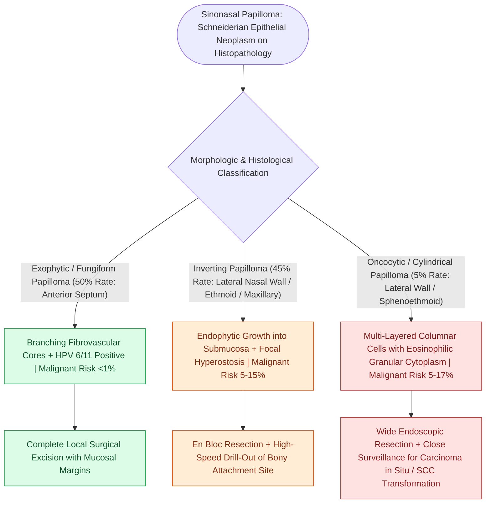

# Sinonasal exophytic and oncocytic papillomas differ from inverting papilloma in malignant potential

## Active Recall

> [!question]- What is the most common anatomical site of origin and viral association for exophytic (fungiform) papillomas?
> *Answer / Clinical Rationale*: The **anterior nasal septum**, strongly associated with **Human Papillomavirus (HPV) Types 6 and 11**.

> [!question]- Which two Schneiderian papilloma subtypes carry a 5% to 10% risk of malignant transformation to Squamous Cell Carcinoma?
> *Answer / Clinical Rationale*: **Inverting Papilloma** and **Oncocytic (Cylindrical Cell) Papilloma**.

## Core Clinical & Mechanistic Principles
The schneiderian membrane (ectodermally derived respiratory mucosa) gives rise to three distinct histological variants of **Schneiderian Papilloma**, each with unique anatomical predilections, viral associations, and malignant transformation risks.

### High-Yield Surgical Distinctions
- **Exophytic (Fungiform)**: Warty, cauliflower-like mass strictly on the **nasal septum**; HPV-driven; zero association with underlying hyperostosis; does not require bone drilling.
- **Oncocytic (Cylindrical)**: Becomes aggressive like inverting papilloma; requires complete subperiosteal excision and underlying [[Curved diamond and cutting burrs with continuous irrigation prevent frontal beak thermal osteonecrosis|bone drill-out]].

## Connected Concepts & Graph Traversal
- **Inverting Craft**: [[Sinonasal inverting papilloma requires subperiosteal excision and hyperostotic bone drill-out|Inverting Papilloma]]
- **Endoscopic Corridor**: [[Transpterygoid EEA exposes juvenile nasopharyngeal angiofibromas and lateral sphenoid defects|Transpterygoid EEA]]
- **Malignancy Contrast**: [[Sinonasal undifferentiated carcinoma exhibits aggressive neuroendocrine features requiring multimodal therapy|SNUC Oncology]]
- **Diagnostic Evaluation**: [[Esthesioneuroblastoma Kadish and Hyams staging determines craniofacial resection and adjuvant therapy|Esthesioneuroblastoma (ENB)]]
- **Anatomical Foundation**: [[Curved diamond and cutting burrs with continuous irrigation prevent frontal beak thermal osteonecrosis|Frontal Bone Drilling Craft]]
