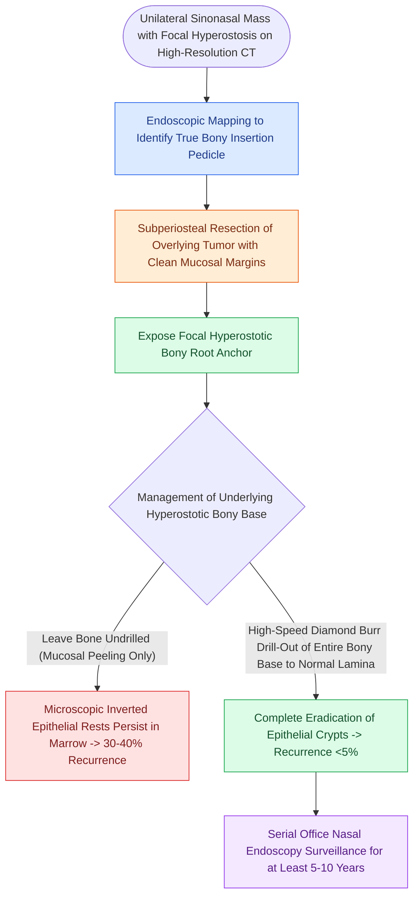

# Sinonasal inverting papilloma requires subperiosteal excision and hyperostotic bone drill-out

## Active Recall

> [!question]- Why is simple mucosal debulking strictly contraindicated in the management of sinonasal inverting papilloma?
> *Answer / Clinical Rationale*: Simple debulking carries a recurrence rate of $>40\text{–}70\%$ because microscopic neoplastic cells extend into the underlying periosteum and bone canaliculi. Complete subperiosteal excision and **hyperostotic bone drill-out** are required.

> [!question]- What is the incidence of synchronous or metachronous squamous cell carcinoma associated with inverting papilloma?
> *Answer / Clinical Rationale*: Approximately **$5\%\text{ to }10\%$**.

## Core Clinical & Mechanistic Principles
**Sinonasal [[Sinonasal exophytic and oncocytic papillomas differ from inverting papilloma in malignant potential|Inverting Papilloma]] (IP)** is a benign but locally aggressive epithelial neoplasm characterized by **endophytic invagination of non-keratinizing stratified squamous epithelium into the underlying stroma** with an intact basement membrane.

### The Krouse Staging System
- **T1**: Tumor confined to nasal cavity without extension into sinuses.
- **T2**: Tumor involving ethmoid labyrinth and/or medial maxillary wall.
- **T3**: Tumor involving lateral/inferior/anterior maxillary sinus, frontal sinus, or sphenoid sinus.
- **T4**: Tumor with intracranial, intraorbital, or infratemporal extension, or associated with **Squamous Cell Carcinoma**.

## Surgical Principles of Eradication
1. **Pedicle Identification**: Pre-operative CT demonstrates focal **hyperostosis (focal osteitis)** corresponding to the tumor origin site in $>80\%$ of cases.
2. **Subperiosteal Resection**: Simple mucosal stripping leaves microscopic tumor nests in underlying canaliculi. The tumor must be resected in a subperiosteal plane with a $5\text{-mm}$ margin of normal mucosa.
3. **Hyperostotic Bone Drill-Out**: The underlying cortical bone at the attachment site must be drilled down with a **diamond burr** until healthy non-inflamed bone is reached.

## Connected Concepts & Graph Traversal
- **Frontal Extension**: [[Draf III modified Lothrop unites both frontal sinuses into a common cavity|Draf III for Inverting Papilloma]]
- **Skull Base Corridor**: [[Transpterygoid EEA exposes juvenile nasopharyngeal angiofibromas and lateral sphenoid defects|Transpterygoid Corridor]]
- **Pathology Contrast**: [[Type 2 CRS exhibits eosinophilic inflammation responsive to targeted biologics|Inflammatory Polyposis]]
- **Diagnostic Evaluation**: [[Esthesioneuroblastoma Kadish and Hyams staging determines craniofacial resection and adjuvant therapy|Esthesioneuroblastoma (ENB)]]
- **Therapeutic Management**: [[Sinonasal undifferentiated carcinoma exhibits aggressive neuroendocrine features requiring multimodal therapy|Sinonasal Undifferentiated Carcinoma (SNUC)]]
- **Surgical Indication**: [[Endoscopic Denker approach removes the piriform aperture and ascending maxillary process to expose the anterior antral wall and infratemporal fossa|Endoscopic Denker Approach]]
- **Anatomical Foundation**: [[Endoscopic medial maxillectomy resects the lateral nasal wall flush with the nasal floor while preserving a mucosal flap to cover denuded bone|Endoscopic Medial Maxillectomy]]
