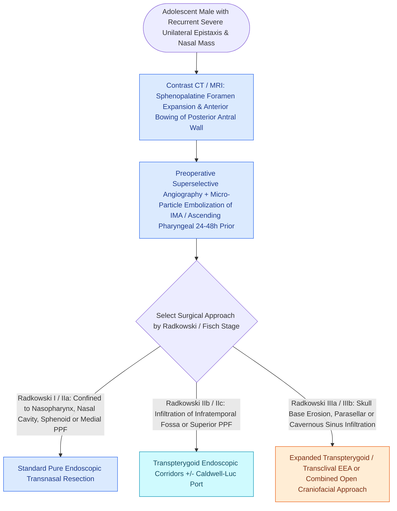

# Sinonasal juvenile angiofibroma staging by Radkowski and Fisch guides surgical approach

## Active Recall

> [!question]- Why is preoperative catheter embolization performed 24 to 48 hours prior to JNA resection?
> *Answer / Clinical Rationale*: To occlude the primary feeding branches of the **internal maxillary artery**, significantly reducing intraoperative blood loss and improving endoscopic visualization.

> [!question]- In what demographic and anatomical location does a JNA originate?
> *Answer / Clinical Rationale*: In **adolescent males**, originating at the **sphenopalatine foramen** and margin of the pterygoid canal.

> [!question]- How do the Fisch (I–IV) and Radkowski (Ia–IIIb) staging systems classify juvenile nasopharyngeal angiofibroma extension?
> *Answer / Clinical Rationale*: **Fisch Classification**: **Stage I** is limited to the nasal cavity and nasopharynx with no bone destruction; **Stage II** invades the pterygomaxillary fossa or paranasal sinuses with bone destruction; **Stage III** invades the infratemporal fossa, orbit, or parasellar region lateral to the cavernous sinus; **Stage IV** invades the cavernous sinus, optic chiasm, or pituitary fossa. **Radkowski Classification** refines extension into the pterygomaxillary fossa (**IIa** minimal, **IIb** full occupation/orbital erosion, **IIc** infratemporal fossa/cheek) and skull base/intracranial compartment (**IIIa** minimal middle fossa erosion, **IIIb** extensive intracranial/cavernous sinus invasion).

## Core Clinical & Mechanistic Principles
**Juvenile Nasopharyngeal Angiofibroma (JNA)** is a histologically benign, locally aggressive, highly vascular neoplasm occurring almost exclusively in **adolescent males** (testosterone-dependent androgen receptor expression).

It originates at the posterolateral margin of the nasal cavity at the **[[The crista ethmoidalis guides endoscopic sphenopalatine artery ligation|sphenopalatine foramen]] / vidian canal aperture** and expands through the [[Transpterygoid EEA exposes juvenile nasopharyngeal angiofibromas and lateral sphenoid defects|pterygopalatine fossa]], producing anterior bowing of the posterior maxillary sinus wall (**Holman-Miller sign**).

### Radkowski & Fisch Staging Systems
- **Fisch Classification (Stages I–IV)**:
  - **Stage I**: Tumor limited to the nasal cavity and nasopharynx without bone destruction.
  - **Stage II**: Tumor invading the pterygomaxillary fossa or maxillary, ethmoid, and sphenoid sinuses with bone destruction.
  - **Stage III**: Tumor invading the infratemporal fossa, orbit, or parasellar region remaining lateral to the cavernous sinus (**IIIa** without intracranial involvement; **IIIb** with extradural parasellar involvement).
  - **Stage IV**: Massive invasion of the cavernous sinus, optic chiasm, or pituitary fossa (**IVa** without intradural/ICA encasement; **IVb** with intradural/ICA/pituitary involvement).
- **Radkowski Classification (Stages Ia–IIIb)**:
  - **Stage Ia / Ib**: Confined to nose/nasopharyngeal vault (**Ia**) or extending into $\ge 1$ paranasal sinus (**Ib**).
  - **Stage IIa / IIb / IIc**: Minimal extension into pterygomaxillary fossa (**IIa**), full occupation of pterygomaxillary fossa displacing posterior maxillary wall anteriorly or eroding orbit (**IIb**), or extension into infratemporal fossa / posterior to pterygoid plates (**IIc**).
  - **Stage IIIa / IIIb**: Erosion of skull base with minimal middle cranial fossa extension (**IIIa**) vs extensive intracranial extension with or without cavernous sinus invasion (**IIIb**).

### Preoperative Embolization & Endoscopic Transpterygoid Resection
- **Preoperative Angiography & Embolization**: Performed **$24\text{–}48\text{ hours}$ preoperatively**; embolizes feeding vessels from the **internal maxillary artery** (and ascending pharyngeal artery) with polyvinyl alcohol (PVA) particles, reducing intraoperative blood loss by $>80\%$.
- **Endoscopic Transpterygoid Resection**: Gold standard for Stages I, II, and selected IIIa lesions without open facial incisions.

## Connected Concepts & Graph Traversal
- **Surgical Approach**: [[Transpterygoid EEA exposes juvenile nasopharyngeal angiofibromas and lateral sphenoid defects|Transpterygoid EEA]]
- **Arterial Supply**: [[The crista ethmoidalis guides endoscopic sphenopalatine artery ligation|Sphenopalatine Artery]]
- **Vascular Hemostasis**: [[Intraoperative ICA injury requires two-surgeon suction and crushed muscle patch hemostasis|ICA Injury Protocol]]
- **Benign Neoplasm Resection**: [[Sinonasal inverting papilloma requires subperiosteal excision and hyperostotic bone drill-out|Inverting Papilloma Resection]]
- **Papilloma Subtypes**: [[Sinonasal exophytic and oncocytic papillomas differ from inverting papilloma in malignant potential|Exophytic & Oncocytic Papillomas]]
