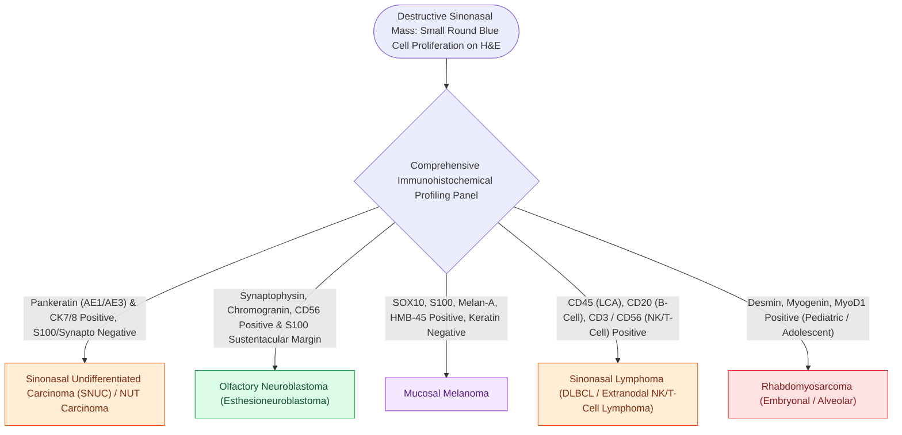

# Sinonasal small round blue cell tumors are differentiated by immunohistochemistry into SNUC, olfactory neuroblastoma, melanoma, lymphoma, and rhabdomyosarcoma

## Active Recall

> [!question]- What specific immunohistochemical (IHC) markers differentiate Esthesioneuroblastoma (ENB), Sinonasal Undifferentiated Carcinoma (SNUC), and Mucosal Melanoma?
> *Answer / Clinical Rationale*: - **Esthesioneuroblastoma (ENB)**: **Synaptophysin (+), Chromogranin (+)**, CD56 (+), **S100 (+) restricted to peripheral sustentacular cells** surrounding tumor nests/lobules, Cytokeratin (usually negative or weakly punctate). - **Sinonasal Undifferentiated Carcinoma (SNUC)**: **Pan-Cytokeratin (AE1/AE3) (+)**, EMA (+), **CK8/18 (+)**; **S100 (-), Synaptophysin / Chromogranin (- or focal weak)**, p63 (-), NUT protein (-). - **Sinonasal Mucosal Melanoma**: **S100 (diffuse strong +), HMB-45 (+), Melan-A / MART-1 (+), SOX10 (+)**; Cytokeratin (-), Neuroendocrine markers (-).

> [!question]- What distinctive IHC staining pattern identifies Sinonasal Rhabdomyosarcoma, NK/T-Cell Lymphoma, and NUT Midline Carcinoma?
> *Answer / Clinical Rationale*: - **Rhabdomyosarcoma**: **Desmin (+), Myogenin (nuclear +), MyoD1 (+)**; SMA (+/-). - **Extranodal NK/T-Cell Lymphoma (Nasal Type)**: **CD56 (+), CD3$\epsilon$ (cytoplasmic +)**, Cytotoxic molecules (Granzyme B, Perforin +), and **EBER in situ hybridization (+) for Epstein-Barr virus**. - **NUT Carcinoma**: **Nuclear speckled NUT protein IHC (+)** with **$BRD4\text{–}NUT$ gene rearrangement ($t(15;19)$)**; strongly CK (+), p63 (+).

> [!question]- Why is distinguishing SNUC from Esthesioneuroblastoma critical for initial therapeutic strategy?
> *Answer / Clinical Rationale*: High-grade **ENB** is primarily treated with **primary craniofacial / endoscopic transcribriform resection** followed by adjuvant radiation/chemotherapy. In contrast, **SNUC** is a fulminant systemic malignancy with high rates of early distant metastasis; modern protocols mandate **induction (neoadjuvant) chemotherapy** first to assess tumor biology: responders proceed to definitive concurrent chemoradiation or surgery, while non-responders require aggressive clinical trial salvage.

## Core Clinical & Mechanistic Principles

The sinonasal tract represents the most common site in the adult body where **small round blue cell tumors (SRBCTs)** present with indistinguishable primitive, monomorphic, basophilic histology on routine H&E staining, making a systematic **immunohistochemical algorithm** mandatory:

### Comprehensive Sinonasal SRBCT Immunohistochemical Matrix

### Pathological Subtypes & Rosette Architecture
- **Homer Wright Rosettes**: True pseudorosettes with tumor cells encircling a central tangle of eosinophilic neurofibrillary neuropil (pathognomonic for **[[Esthesioneuroblastoma Kadish and Hyams staging determines craniofacial resection and adjuvant therapy|Esthesioneuroblastoma]]** and Neuroblastoma).
- **Flexner-Wintersteiner Rosettes**: True rosettes with tumor cells surrounding a distinct central lumen (seen in Retinoblastoma and select high-grade ENB, contrasting with anaplastic [[Sinonasal undifferentiated carcinoma exhibits aggressive neuroendocrine features requiring multimodal therapy|SNUC]]).

## Connected Concepts & Graph Traversal
- **SNUC Oncology**: [[Sinonasal undifferentiated carcinoma exhibits aggressive neuroendocrine features requiring multimodal therapy|SNUC Multimodal Protocol]]
- **Esthesioneuroblastoma Staging**: [[Esthesioneuroblastoma Kadish and Hyams staging determines craniofacial resection and adjuvant therapy|Kadish & Hyams Staging]]
- **Inverted Papilloma**: [[Sinonasal inverting papilloma requires subperiosteal excision and hyperostotic bone drill-out|Inverted Papilloma & Malignant Transformation]]
- **Transcribriform EEA**: [[Transcribriform EEA provides access to olfactory groove meningiomas and esthesioneuroblastomas|Transcribriform Craniofacial Corridors]]
- **Olfactory Neuroepithelium**: [[Olfactory neuroepithelium contains bipolar sensory neurons and basal stem cells|Olfactory Basal Stem Cells]]
- **Sinonasal Teratocarcinosarcoma**: [[Sinonasal teratocarcinosarcoma is a highly aggressive malignant mixed tumor containing teratomatous, carcinomatous, and sarcomatous elements|Teratocarcinosarcoma Triphasic Matrix]]
