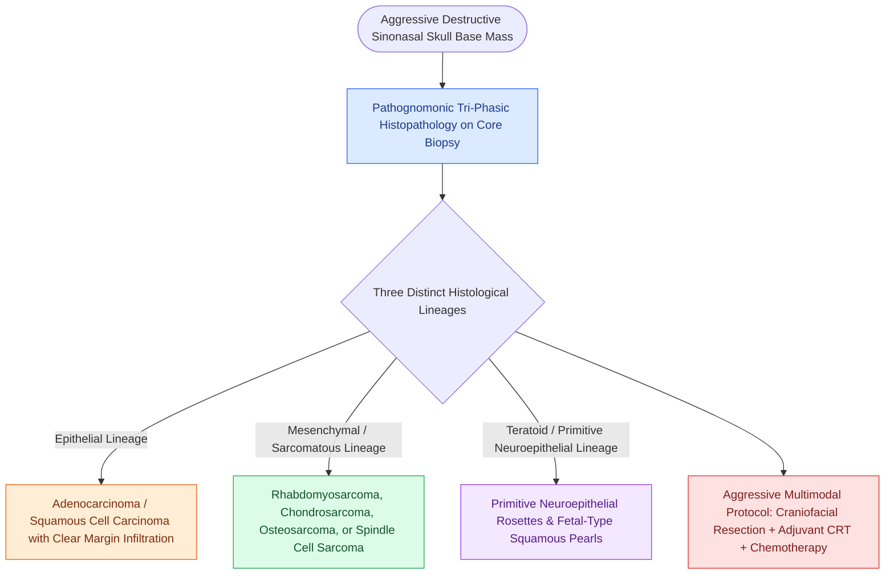

# Sinonasal teratocarcinosarcoma is a highly aggressive malignant mixed tumor containing teratomatous, carcinomatous, and sarcomatous elements

## Active Recall

> [!question]- What triphasic histological elements characterize sinonasal teratocarcinosarcoma (SNTS)?
> *Answer / Clinical Rationale*: SNTS exhibits an extraordinarily complex **triphasic histological composition**: - (1) **Epithelial / Carcinomatous elements**: Mature squamous epithelium with benign-appearing "fetal-type" clear cell squamous morules, and/or aggressive adenocarcinoma / squamous cell carcinoma. - (2) **Mesenchymal / Sarcomatous elements**: Malignant spindle cells, rhabdomyosarcomatous strap cells with cross-striations, chondrosarcoma, or osteosarcoma. - (3) **Immature Neuroepithelial / Teratomatous elements**: Primitive neuroectodermal blastema forming neural rosettes, neurofibrillary neuropil, and primitive small round blue cells.

> [!question]- Where does sinonasal teratocarcinosarcoma most commonly originate, and what is its typical biological behavior?
> *Answer / Clinical Rationale*: It almost exclusively arises in the **superior nasal cavity and ethmoid sinuses of adult males (average age 50–60 years)**. It is an extremely aggressive malignancy characterized by **rapid local osteolytic destruction of the cribriform plate and orbit**, early local recurrence ($>50\%$), and widespread metastasis to regional cervical lymph nodes and lungs ($30-40\%$), with a historical 3-year mortality rate exceeding $60\%$.

> [!question]- What is the definitive multidisciplinary treatment paradigm for sinonasal teratocarcinosarcoma?
> *Answer / Clinical Rationale*: Aggressive multimodality therapy: **Radical en bloc surgical resection with negative margins (via endoscopic transcribriform skull base resection or open craniofacial resection)** followed immediately by **high-dose adjuvant intensity-modulated radiation therapy (IMRT) combined with systemic platinum-based chemotherapy**.

## Core Clinical & Mechanistic Principles

**Sinonasal Teratocarcinosarcoma (SNTS)** (first described by Shanmugaratnam in 1983 and characterized by Heffner and Hyams in 1984) is a unique, true malignant mixed tumor restricted to the upper aerodigestive tract:

### Triphasic Histological Architecture

### Critical Differential Diagnosis Nuances
- **Distinction from Inverted Papilloma**: The benign squamous morules of SNTS can mimic benign [[Sinonasal inverting papilloma requires subperiosteal excision and hyperostotic bone drill-out|inverting papilloma]] on superficial punch biopsies; **deep representative tissue biopsy** is mandatory.
- **Distinction from Olfactory Neuroblastoma**: SNTS contains rhabdomyoblastic, glandular, and squamous elements that are completely absent in pure [[Esthesioneuroblastoma Kadish and Hyams staging determines craniofacial resection and adjuvant therapy|esthesioneuroblastoma]].
- **Distinction from Carcinosarcoma**: Carcinosarcoma lacks the immature blastematous neuroepithelial rosettes and fetal-type clear cell squamous morules.

## Connected Concepts & Graph Traversal
- **Small Round Blue Cell Differential**: [[Sinonasal small round blue cell tumors are differentiated by immunohistochemistry into SNUC, olfactory neuroblastoma, melanoma, lymphoma, and rhabdomyosarcoma|Sinonasal SRBCT Immunohistochemistry]]
- **Esthesioneuroblastoma**: [[Esthesioneuroblastoma Kadish and Hyams staging determines craniofacial resection and adjuvant therapy|Esthesioneuroblastoma Staging]]
- **SNUC Oncology**: [[Sinonasal undifferentiated carcinoma exhibits aggressive neuroendocrine features requiring multimodal therapy|SNUC Multimodal Protocol]]
- **Transcribriform EEA**: [[Transcribriform EEA provides access to olfactory groove meningiomas and esthesioneuroblastomas|Transcribriform Craniofacial Approaches]]
- **Inverted Papilloma**: [[Sinonasal inverting papilloma requires subperiosteal excision and hyperostotic bone drill-out|Inverting Papilloma]]
- **Skull Base Reconstruction**: [[The Hadad-Bassagasteguy nasoseptal flap is pedicled on the posterior septal artery|Hadad-Bassagasteguy Nasoseptal Flap]]
