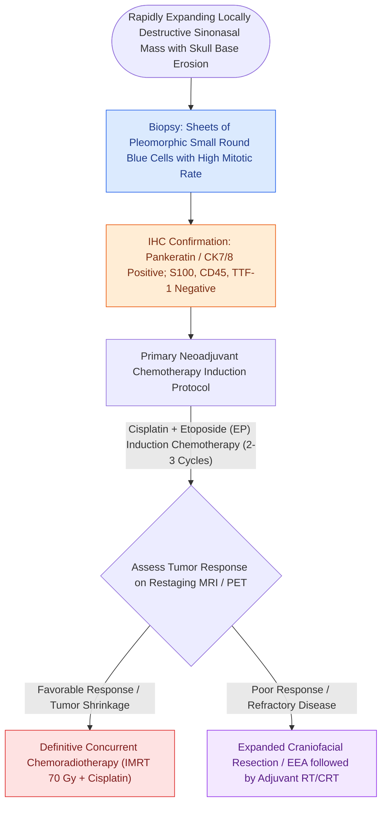

# Sinonasal undifferentiated carcinoma exhibits aggressive neuroendocrine features requiring multimodal therapy

## Active Recall

> [!question]- How is induction (neoadjuvant) chemotherapy utilized to direct definitive treatment in SNUC?
> *Answer / Clinical Rationale*: Patients who achieve a **favorable response to induction chemotherapy** proceed to definitive high-dose chemoradiation, whereas **non-responders** undergo radical surgical resection followed by adjuvant radiotherapy.

> [!question]- What histological features distinguish SNUC from olfactory neuroblastoma?
> *Answer / Clinical Rationale*: SNUC exhibits **diffuse sheets of highly pleomorphic anaplastic cells with marked vascular invasion, high mitotic rates, and extensive necrosis**, lacking the lobular architecture, neurofibrillary stroma, or rosettes seen in ENB.

## Core Clinical & Mechanistic Principles
**Sinonasal Undifferentiated Carcinoma (SNUC)** is a rare, highly aggressive, clinicopathologically distinct malignant neoplasm of the paranasal sinuses lacking squamous or glandular differentiation. It typically presents at an **advanced, extensive stage (T4)** with rapid invasion of the orbit and anterior cranial fossa.

### Chemosensitivity as a Prognostic Guide
- SNUC is highly chemosensitive and must be differentiated from [[Esthesioneuroblastoma Kadish and Hyams staging determines craniofacial resection and adjuvant therapy|esthesioneuroblastoma]] via immunohistochemistry. The modern standard of care uses **neoadjuvant (induction) chemotherapy** to assess tumor biology: tumor shrinkage predicts favorable response to definitive chemoradiation, sparing radical orbital exenteration or open [[Transcribriform EEA provides access to olfactory groove meningiomas and esthesioneuroblastomas|transcribriform resection]].

## Connected Concepts & Graph Traversal
- **Differential Pathology**: [[Esthesioneuroblastoma Kadish and Hyams staging determines craniofacial resection and adjuvant therapy|Esthesioneuroblastoma]]
- **Corridor**: [[Transcribriform EEA provides access to olfactory groove meningiomas and esthesioneuroblastomas|Transcribriform EEA]]
- **Complication Matrix**: [[High-stakes sinonasal complications require proactive landmarking and emergency rescue protocols|High-Stakes Skull Base Matrix]]
- **Pathological Mechanism**: [[Sinonasal inverting papilloma requires subperiosteal excision and hyperostotic bone drill-out|Inverting Papilloma Resection]]
- **Anatomical Foundation**: [[Sinonasal exophytic and oncocytic papillomas differ from inverting papilloma in malignant potential|Exophytic & Oncocytic Papillomas]]
