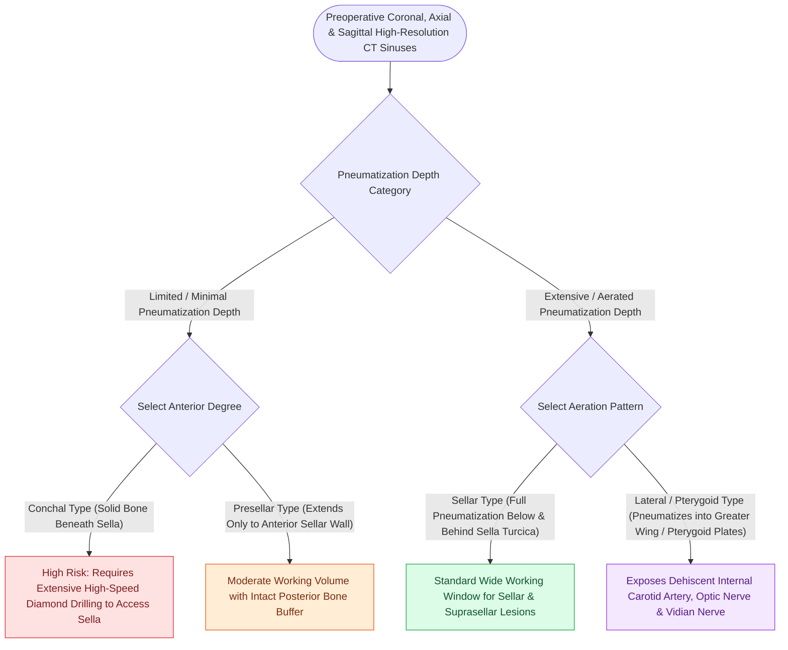

# Sphenoid sinus pneumatization patterns dictate carotid and optic canal exposure

## Active Recall

> [!question]- Why is wrenching an intersphenoid septum with forceps strictly contraindicated during sphenoidotomy?
> *Answer / Clinical Rationale*: The intersphenoid septum frequently inserts directly onto the bony covering of the **internal carotid artery**. Avulsing the septum can tear the carotid wall, resulting in lethal intraoperative arterial hemorrhage.

> [!question]- Which pneumatization pattern of the sphenoid sinus provides the ideal anatomical corridor for transsphenoidal pituitary surgery?
> *Answer / Clinical Rationale*: The **sellar type** ($\sim 70\%$), because pneumatization extends below and posterior to the sella turcica, thinning the sellar floor and providing direct midline access to the pituitary fossa.

## Core Clinical & Mechanistic Principles
The degree and direction of **sphenoid sinus pneumatization** dictate the surgical vulnerability of surrounding critical neurovascular structures, including the **internal carotid artery (ICA)**, **optic nerve (CN II)**, **maxillary nerve (V2)**, and **Vidian nerve**.

### Critical Radiological Variants & Exposure Hazards
1. **Carotid Canal Dehiscence**:
   - The bone overlying the internal carotid artery is dehiscent in up to **$20\text{–}25\%$** of patients.
   - The carotid artery bulges prominently into the postero-lateral sphenoid wall, separated from sinus mucosa by only a thin dural sheath.
2. **Intersphenoid Septa Inserting on Carotid Canal**:
   - In 10–15% of cases, a major [[Intersphenoid sinus septations frequently insert directly onto the internal carotid canal|intersphenoid septum]] inserts directly onto the carotid prominence.
   - **CRITICAL SURGICAL TRAP**: Avulsing this septum with grasping forceps transmits direct shearing forces to the carotid wall, causing an catastrophic arterial tear (see [[Intraoperative ICA injury requires two-surgeon suction and crushed muscle patch hemostasis|ICA Crisis Protocol]]). Septa must be drilled or gently divided with scissors, never wrenched.
3. **Lateral Pterygoid Recess Expansion**:
   - Pneumatization extends laterally between the Vidian canal inferiorly and foramen rotundum (V2) superiorly into the greater wing of the sphenoid.
   - Represents the primary corridor for [[Sternberg's canal in the lateral sphenoid recess acts as a conduit for spontaneous CSF leaks|lateral sphenoid encephaloceles]] (Sternberg’s canal defects) and expanded skull base approaches.

## Connected Concepts & Graph Traversal
- **Checklist Framework**: [[The CLOSE checklist systematically evaluates critical radiological danger zones|CLOSE Checklist]]
- **Surgical Access**: [[The sphenoid sinus ostium lies medial to the superior turbinate above the choana|Sphenoidotomy Technique]]
- **Carotid Crisis**: [[Intraoperative ICA injury requires two-surgeon suction and crushed muscle patch hemostasis|Carotid Artery Crisis Protocol]]
- **Pituitary Surgery**: [[Transsellar EEA provides direct access to pituitary adenomas and Rathke cleft cysts|Transsellar EEA Corridor]]
- **Diagnostic Imaging**: [[Supraorbital ethmoid cells suspend the anterior ethmoidal artery below the skull base|AEA Mesentery Anatomy]]
- **Anatomical Foundation**: [[Onodi cells place the optic nerve and carotid artery at risk during posterior ethmoidectomy|Onodi Cell Anatomy]]
- **Surgical Corridor Navigation**: [[Endoscopic optic nerve decompression achieves 180-degree intracanalicular bony release with superomedial sheath incision to avoid ophthalmic artery injury|Endoscopic Optic Nerve Decompression]]
