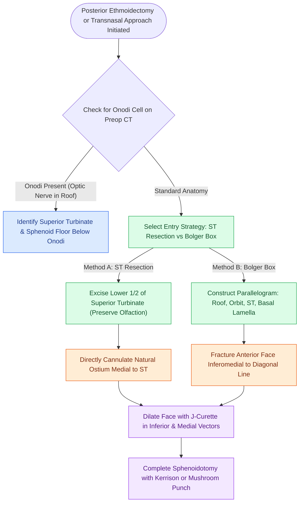

# Sphenoidotomy utilizes superior turbinate resection or the Bolger box parallelogram to identify the natural ostium while preventing Onodi cell injury

## Active Recall

> [!question]- What anatomical boundaries define the Bolger box parallelogram, and where within this box is sphenoid entry performed?
> *Answer / Clinical Rationale*: The Bolger box is bounded medially by the superior turbinate, laterally by the medial orbital wall (lamina papyracea), superiorly by the skull base (ethmoid roof), and inferiorly by the basal lamella of the superior turbinate. Entry is performed inferomedial to a diagonal line drawn across the parallelogram.

> [!question]- Why must resection of the superior turbinate be strictly restricted to its inferior half?
> *Answer / Clinical Rationale*: Olfactory neuroepithelium extends onto the superior portion of the superior turbinate and upper nasal septum. Resecting more than the lower half risks sensory avulsion of olfactory filaments, post-procedural hyposmia, and skull base traction injury.

> [!question]- What catastrophic anatomical error occurs when an Onodi cell posterior wall is mistaken for the anterior face of the sphenoid sinus?
> *Answer / Clinical Rationale*: Because an Onodi (sphenoethmoidal) cell pneumatizes superior or lateral to the sphenoid sinus, penetrating its posterior wall drives instruments directly into the orbital apex, optic canal, or optic chiasm, producing acute blindness or severe intracranial hemorrhage.

## Core Clinical & Mechanistic Principles
Sphenoidotomy may be executed via a transnasal or transethmoid approach depending on whether concurrent anterior and posterior ethmoid disease requires clearance. Crucially, [[The sphenoid sinus ostium lies medial to the superior turbinate above the choana]], typically $1.0\text{ to }1.5\text{ cm}$ superior to the choanal arch.

A major surgical pitfall in posterior sinonasal dissection is the presence of sphenoethmoidal pneumatization, where [[Onodi cells place the optic nerve and carotid artery at risk during posterior ethmoidectomy]]. Preoperative computed tomography must also evaluate the posterior wall and septal insertions because [[Intersphenoid sinus septations frequently insert directly onto the internal carotid canal]]. To ensure optimal mucosal hemostasis before sphenoid dissection, infiltration via [[TIVA and greater palatine canal blocks optimize surgical field visibility in FESS]] constricts the descending palatine and sphenopalatine vessels.

### Anatomic Landmarking and Operative Steps
1. **Transnasal Approach**:
   - Advance a $0^\circ$ endoscope medial to the middle turbinate along the sphenoethmoidal recess.
   - Locate the superior turbinate. Using a straight through-cutter, excise strictly the lower half of the superior turbinate.
   - The natural ostium is exposed medial and posterior to the resected turbinate stump.
2. **The Bolger Box Method (Transethmoid without Turbinate Resection)**:
   - Identifies an endoscopic parallelogram within the posterior ethmoid cavity:
     - *Superior Border*: Ethmoid roof (skull base).
     - *Inferior Border*: Basal lamella of the superior turbinate.
     - *Medial Border*: Superior turbinate.
     - *Lateral Border*: Lamina papyracea (medial orbital wall).
   - Draw an imaginary diagonal line across the box from superolateral to inferomedial.
   - Enter the anterior sphenoid face safely strictly **inferomedial to the diagonal line**, directly accessing the natural ostium while staying well away from the skull base and optic nerve.
3. **Safe Enlargement Rules**:
   - Insert a J-curette into the natural ostium and gently fracture the anterior sphenoid face **inferiorly and medially**.
   - Enlarge with a $2\text{ mm}$ or $4\text{ mm}$ Kerrison rongeur or mushroom punch.
   - *Absolute Contraindication*: Never bite superiorly or superolaterally where the cavernous sinus, carotid canal, and optic nerve reside.

## Connected Concepts & Graph Traversal
- **Preceding Dissection Corridor**: [[Posterior ethmoidectomy requires dissecting along the skull base from posterior to anterior|Posterior Ethmoidectomy]]
- **Pneumatization Traps**: [[Sphenoid sinus pneumatization patterns dictate carotid and optic canal exposure|Sphenoid Pneumatization]]
- **Midline Bilateral Corridors**: [[Transseptal sphenoidotomy provides wide bilateral midline access to the sphenoid rostrum|Transseptal Sphenoidotomy]]
- **Endoscopic Skull Base Recesses**: [[The lateral and medial opticocarotid recesses define critical anatomical corridors in endoscopic skull base surgery|Opticocarotid Recesses]]
- **Major Vascular Catastrophe**: [[Intraoperative ICA injury requires two-surgeon suction and crushed muscle patch hemostasis|Internal Carotid Artery Injury]]
