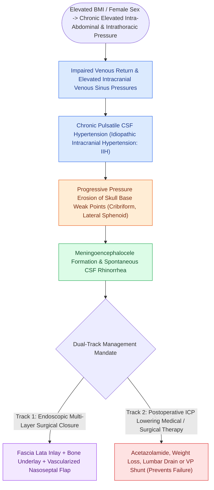

# Spontaneous CSF leaks are strongly associated with idiopathic intracranial hypertension and elevated BMI

## Active Recall

> [!question]- What radiographic findings on brain MRI suggest underlying Idiopathic Intracranial Hypertension in a patient with a spontaneous CSF leak?
> *Answer / Clinical Rationale*: **Empty or partially empty sella**, flattening of the posterior globes, distension of the perioptic subarachnoid space, and multiple skull base arachnoid pits.

> [!question]- Why is long-term medical management with acetazolamide or weight reduction mandatory after successful surgical closure of a spontaneous CSF fistula?
> *Answer / Clinical Rationale*: To reduce chronic elevated intracranial pressure and prevent **recurrent CSF leak at the repair site or at a secondary dehiscent skull base site**.

## Core Clinical & Mechanistic Principles
**[[Sternberg's canal in the lateral sphenoid recess acts as a conduit for spontaneous CSF leaks|Spontaneous sinonasal CSF leaks]]** (leaks occurring without prior trauma, surgery, or tumor) are now recognized as a physical manifestation of underlying **Idiopathic Intracranial Hypertension (IIH / Pseudotumor Cerebri)**.

The classic patient demographic is **middle-aged, obese females (BMI $>30\text{ kg/m}^2$)**.

### Mandatory Post-Repair ICP Management
- **High Recurrence Rate**: If elevated ICP is not actively treated postoperatively, repair failure and recurrent CSF fistulas occur in up to **$25\text{–}40\%$** of cases.
- **Therapeutic Protocol**: Postoperative lumbar puncture opening pressure measurement; long-term treatment with **Acetazolamide (Diamox)**, weight loss, or ventriculoperitoneal (VP) shunting.

## Connected Concepts & Graph Traversal
- **ICP Control**: [[Lumbar drain placement and ICP management lower the risk of postoperative CSF fistula recurrence|Lumbar Drain & ICP Protocol]]
- **Diagnostics**: [[Beta-2 transferrin and high-resolution CT localize sinonasal CSF fistulas|CSF Leak Diagnostics]]
- **Sphenoid Defect**: [[Sternberg's canal in the lateral sphenoid recess acts as a conduit for spontaneous CSF leaks|Sternberg's Canal]]
- **Surgical Craft**: [[CSF leak defect preparation requires circumferential bone de-mucosalization|CSF Defect Bed Preparation]]
- **Critical Safety / Complication**: [[Esthesioneuroblastoma Kadish and Hyams staging determines craniofacial resection and adjuvant therapy|Esthesioneuroblastoma (ENB)]]
