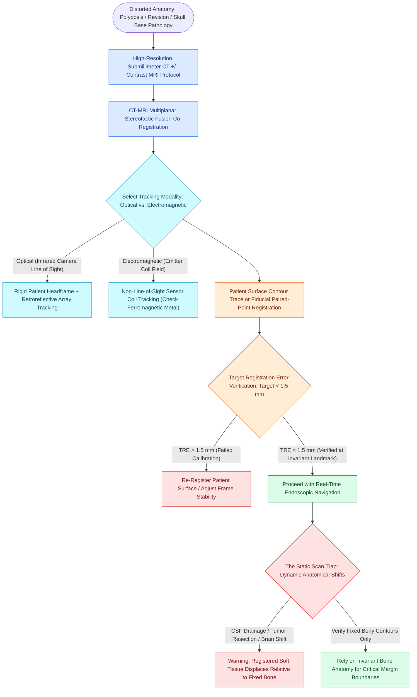

# Stereotactic image-guided navigation combines electromagnetic or optical tracking with CT-MRI fusion to maintain spatial orientation in distorted revision sinus and skull base surgery

## Active Recall

> [!question]- What are the seven clinical scenarios endorsed by the AAO-HNS consensus statement where intraoperative stereotactic computer-assisted navigation is indicated in sinus surgery?
> *Answer / Clinical Rationale*: (1) **Revision sinus surgery**; (2) **Distorted sinus anatomy** of developmental, postoperative, or traumatic origin; (3) **Extensive sinonasal polyposis**; (4) Pathology involving the **frontal, posterior ethmoid, or sphenoid sinuses**; (5) Disease abutting the **skull base, orbit, optic nerve, or internal carotid artery**; (6) **CSF rhinorrhea** or conditions with a skull base defect; and (7) Benign or malignant **sinonasal and skull base neoplasms**.

> [!question]- What physical vulnerability distinguishes electromagnetic (EM) navigation tracking from optical (infrared) tracking systems in endoscopic surgery?
> *Answer / Clinical Rationale*: Electromagnetic systems operate without requiring an uninterrupted optical line-of-sight, but they are vulnerable to **magnetic field distortions caused by ferromagnetic metals** (e.g., surgical drill handpieces, metal headrests, retractor blades, or dental hardware) adjacent to the sensor volume. Conversely, optical systems are immune to metal but fail whenever the **camera line-of-sight is physically obstructed** by surgical staff, drapes, or instruments.

## Core Clinical & Mechanistic Principles
Computer-assisted stereotactic navigation, or image-guided surgery (IGS), transforms volumetric preoperative diagnostic imaging into a real-time intraoperative navigational map. By registering surgical instruments to fine-cut multiplanar axial, coronal, and sagittal radiological datasets, IGS displays the instrument tip coordinate within $1.0–1.5\text{ mm}$ of spatial accuracy. Although IGS significantly reduces complication rates and enhances operative thoroughness in complex anatomical corridors, it remains a **navigational adjunct rather than a surrogate for anatomical knowledge**. Surgeons must systematically review high-risk anatomical danger zones preoperatively using the **[[The CLOSE checklist systematically evaluates critical radiological danger zones|CLOSE checklist]]** and confirm landmarks visually.

Accidental breach of attenuated bony barriers during endoscopic sinus surgery precipitates catastrophic injuries, including intraorbital hemorrhage from **[[Lamina papyracea dehiscence predisposes to orbital fat herniation and medial rectus injury|lamina papyracea]]** disruption, optic nerve injury, or tension pneumocephalus and dural breach along the fovea ethmoidalis. IGS serves as an essential safety layer to continuously correlate endoscopic visualization with bony landmarks.

### Physical Tracking Modalities: Optical vs. Electromagnetic
1. **Optical (Infrared) Navigation**:
   - *Mechanism*: Overhead dual infrared cameras emit and detect light reflected from passive retroreflective spheres or active LEDs mounted on the patient's rigid reference headframe and surgical instruments.
   - *Advantages*: Extremely stable calibration; completely immune to ferromagnetic interference from dental crowns, drill bodies, or surgical instruments.
   - *Vulnerabilities*: Requires an absolute, continuous line-of-sight between the camera overhead and the surgical field. Physical obstruction by the surgeon's arm, assistant, microscope, or drapes immediately blinds the system.
2. **Electromagnetic (EM) Navigation**:
   - *Mechanism*: An electromagnetic field generator placed adjacent to the patient's head establishes a low-intensity, high-frequency magnetic field. Miniature dual-sensor coils embedded within the tip of surgical instruments detect spatial coordinates within the field.
   - *Advantages*: Non-line-of-sight freedom; enables tracking of flexible, curved suction curettes, malleable probes, and balloon catheters without bulky optical tracking handles.
   - *Vulnerabilities*: Susceptible to electromagnetic interference and field distortions from ferromagnetic materials located within $20\text{ cm}$ of the field generator (e.g., surgical headrests, motorized microdebriders, dental amalgam, metallic retractor blades).

### Patient Registration & Target Registration Error (TRE)
- **Registration Techniques**:
  - *Paired-Point Registration*: Pairs distinct radiopaque adhesive fiducials or external anatomical landmarks (lateral canthi, tragi, nasion) identified on the scan with physical probe touches in the operating room.
  - *Surface-Matching (Laser/Contact Tracing)*: A laser or physical probe traces hundreds of continuous contour coordinates across the patient's forehead, bridge of the nose, and malar eminence, matching the cloud of points to the 3D reconstructed facial model.
- **Target Registration Error (TRE)**: Represents the true distance between the navigational display coordinate and the physical instrument tip. A TRE $<1.5\text{ mm}$ is mandatory for clinical sinus surgery, while skull base resections demand $<1.0\text{ mm}$.
- **Invariant Landmark Verification**: The surgeon must verify registration accuracy against known fixed anatomical landmarks (e.g., rhinion, anterior nasal spine, or inferior turbinate axilla) before entering the ethmoid labyrinth or skull base.

### CT-MRI Multimodal Image Fusion
Modern navigation suites automatically co-register high-resolution bone-algorithm CT scans ($0.625\text{ mm}$ non-contrast slices) with gadolinium-enhanced multiplanar T1/T2 MRI scans. CT accurately displays fine cortical landmarks (sphenoid rostrum, ethmoid roof, carotid canal), while MRI reveals soft-tissue boundaries, highlighting dura, optic apparatus, cavernous sinus expansion, and differentiating inspissated sinus secretions from neoplastic tissue.

### The Static Navigation Trap: "Brain Shift" and Tissue Resection
A critical safety principle of IGS is that **navigation tracks static preoperative data**. As surgery proceeds:
- Debulking of extensive sinonasal tumors, resection of bony partitions, and decompression of cerebrospinal fluid alter tissue geometry.
- In anterior skull base surgery, evacuation of CSF and gravity cause the frontal lobes and arachnoid to descend (the classic **"brain shift"**, which can reach 5–10 mm).
- While navigation remains accurate for fixed cortical bone, it becomes dangerously inaccurate for mobile soft-tissue interfaces and intracranial margins. Bony navigation must always be verified against invariant landmarks.

## Connected Concepts & Graph Traversal
- **Olfactory Fossa Metric**: [[The Keros classification stages olfactory fossa depth and lateral lamella vulnerability|Keros Classification]]
- **Optic & Carotid Danger Zone**: [[Onodi cells place the optic nerve and carotid artery at risk during posterior ethmoidectomy|Onodi Cell Anatomy]]
- **Vascular Crisis Management**: [[Intraoperative ICA injury requires two-surgeon suction and crushed muscle patch hemostasis|Carotid Artery Hemostasis]]
- **CT Severity Staging**: [[The Lund-Mackay CT scoring system quantifies sinonasal opacification and ostiomeatal occlusion|Lund-Mackay CT Staging]]
- **Skull Base Corridor**: [[The lateral and medial opticocarotid recesses define critical anatomical corridors in endoscopic skull base surgery|Opticocarotid Recesses]]
