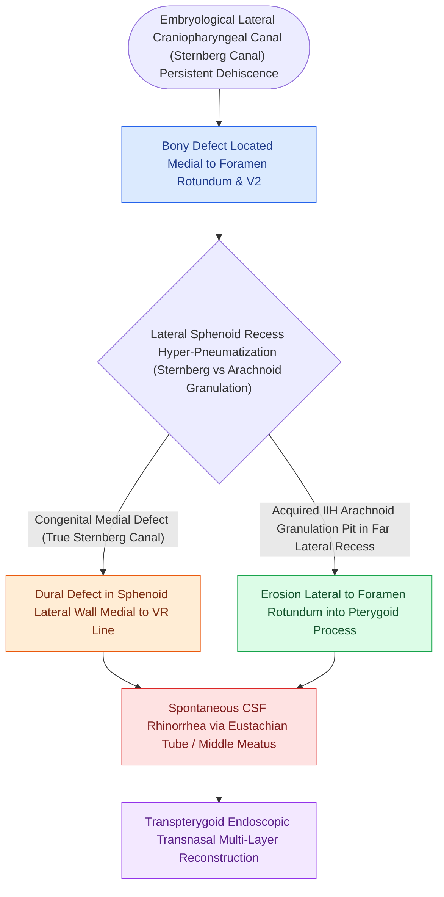

# Sternberg's canal in the lateral sphenoid recess acts as a conduit for spontaneous CSF leaks

## Active Recall

> [!question]- Where is Sternberg's canal anatomically located within the sphenoid sinus?
> *Answer / Clinical Rationale*: In the **lateral pterygoid recess of the sphenoid sinus**, lateral to the Vidian canal and foramen rotundum.

> [!question]- What expanded endoscopic approach is necessary to repair an encephalocele in the far lateral sphenoid recess?
> *Answer / Clinical Rationale*: An **endoscopic transpterygoid approach (EEA)**, which provides lateral line-of-sight past the pterygoid plates.

## Core Clinical & Mechanistic Principles
**Sternberg's Canal (Lateral Craniopharyngeal Canal)** is a congenital bony defect in the **lateral wall of the sphenoid sinus**, arising from incomplete fusion of the greater wings of the sphenoid (alisphenoid) with the presphenoid and basisphenoid bones.

It represents the classic anatomical portal for **spontaneous lateral sphenoid encephaloceles and CSF fistulas**, particularly in patients with **[[Spontaneous CSF leaks are strongly associated with idiopathic intracranial hypertension and elevated BMI|idiopathic intracranial hypertension]] (IIH)**.

### Surgical Access Nuance
- Standard transnasal sphenoidotomy cannot visualize or instrument the lateral recess due to the intervening pterygoid plates.
- Repair requires an **endoscopic transpterygoid approach**, drilling the pterygoid process and mobilizing the pterygopalatine fossa contents laterally.

## Connected Concepts & Graph Traversal
- **Surgical Approach**: [[Transpterygoid EEA exposes juvenile nasopharyngeal angiofibromas and lateral sphenoid defects|Transpterygoid EEA]]
- **Sphenoid Pneumatization**: [[Sphenoid sinus pneumatization patterns dictate carotid and optic canal exposure|Sphenoid Pneumatization Patterns]]
- **CSF Diagnostics**: [[Beta-2 transferrin and high-resolution CT localize sinonasal CSF fistulas|CSF Leak Diagnostics]]
- **Surgical Craft**: [[CSF leak defect preparation requires circumferential bone de-mucosalization|CSF Defect Bed Preparation]]
- **Critical Safety / Complication**: [[Esthesioneuroblastoma Kadish and Hyams staging determines craniofacial resection and adjuvant therapy|Esthesioneuroblastoma (ENB)]]
- **Anatomical Foundation**: [[Endoscopic transpterygoid repair of lateral sphenoid recess encephaloceles accesses Sternberg's canal by drilling the pterygoid base lateral to the vidian nerve|Transpterygoid Encephalocele Repair]]
