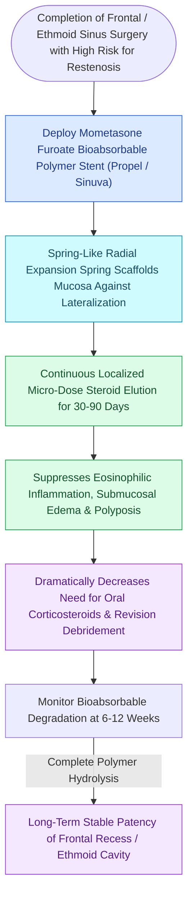

# Steroid-eluting sinus implants deliver localized anti-inflammatory therapy to prevent restenosis

## Active Recall

> [!question]- What steroid is eluted by bioabsorbable sinus implants such as Propel and Sinuva?
> *Answer / Clinical Rationale*: **Mometasone furoate**, chosen for its high topical potency and negligible systemic bioavailability ($<1\%$).

> [!question]- What dual mechanical and pharmacological actions do steroid-eluting implants provide?
> *Answer / Clinical Rationale*: They provide **mechanical spring-scaffold stenting** (preventing middle turbinate lateralization and stenosis) while delivering **sustained local anti-inflammatory steroid release** to suppress eosinophilic mucosal edema.

## Core Clinical & Mechanistic Principles
**Steroid-Eluting Sinus Implants (Propel, Sinuva)** are [[Middle turbinate lateralization causes secondary ostiomeatal obstruction and frontal sinus stenosis|bioabsorbable polymer stents]] (composed of poly-L-lactic-co-glycolic acid / PLGA) engineered to provide **sustained, localized delivery of mometasone furoate** directly to healing sinus mucosa over **$30\text{ to }90\text{ days}$**.

### Clinical Formats
- **Propel / Propel Mini / Propel Contour**: Placed intraoperatively at the conclusion of FESS in the ethmoid cavity, middle meatus, or frontal sinus outflow tract (dissolves over $30\text{–}45\text{ days}$).
- **Sinuva**: Larger in-office implant for recurrent polyposis in previously operated ethmoid cavities (delivers steroid over $90\text{ days}$; removed in clinic).

## Connected Concepts & Graph Traversal
- **Turbinate Stability**: [[Middle turbinate lateralization causes secondary ostiomeatal obstruction and frontal sinus stenosis|Middle Turbinate Lateralization]]
- **Debridement Schedule**: [[Postoperative FESS debridement timing and technique prevent crusting and synechiae formation|Postoperative Care]]
- **Type 2 Disease**: [[Type 2 CRS exhibits eosinophilic inflammation responsive to targeted biologics|Type 2 CRS Inflammation]]
- **Restenosis Prevention**: [[Balloon catheter sinus dilatation widens paranasal ostia via high-pressure microfracture remodeling while requiring transillumination or image guidance to prevent false passage|Balloon Catheter Dilatation]]
- **Anatomical Foundation**: [[Agger nasi cells form the anterior boundary of the frontal recess|Agger Nasi Cell Anatomy]]
