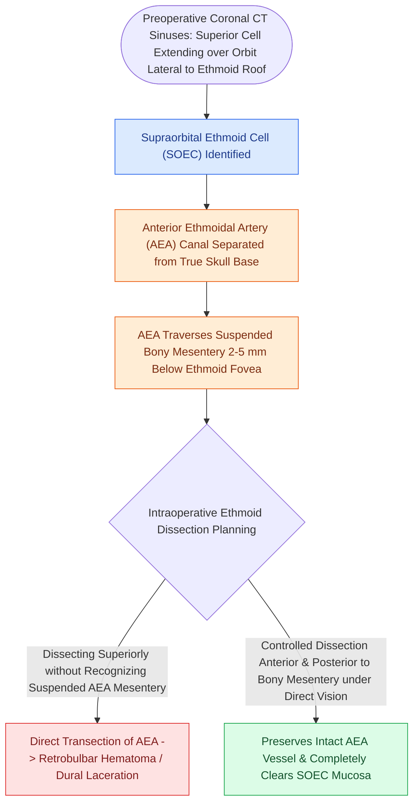

# Supraorbital ethmoid cells suspend the anterior ethmoidal artery below the skull base

## Active Recall

> [!question]- What anatomical air cell variant causes the anterior ethmoidal artery to hang on a free bony mesentery below the skull base?
> *Answer / Clinical Rationale*: A **supraorbital ethmoid cell (SOEC)**. Pneumatization of this cell over the orbital roof drops the AEA canal down into an open bony mesentery suspended $2\text{–}5\text{ mm}$ below the fovea ethmoidalis.

> [!question]- What catastrophic orbital complication occurs if an unrecognized hanging AEA is transected during ethmoidectomy?
> *Answer / Clinical Rationale*: The transected artery retracts laterally into the orbit, causing a rapid **retrobulbar hematoma** and acute orbital compartment syndrome, requiring immediate emergency lateral canthotomy and cantholysis.

## Core Clinical & Mechanistic Principles
The **Anterior Ethmoidal Artery (AEA)** is a terminal branch of the ophthalmic artery that exits the orbit through the anterior ethmoidal foramen, crosses the ethmoid roof, and enters the anterior cranial fossa via the cribriform plate.

The relationship of the AEA to the ethmoid roof (fovea ethmoidalis) is dictated by the presence of **supraorbital ethmoid cells (SOECs)** and the depth of the olfactory fossa:

### The "Hanging" AEA Mesentery
1. **Flush Canal (No SOEC)**: In a flat skull base without supraorbital cells, the AEA travels safely encased within the thick bony ethmoid roof.
2. **Hanging Mesentery (With SOEC)**: When a supraorbital ethmoid cell pneumatizes laterally over the orbit posterior to the frontal sinus, the AEA is displaced inferiorly into a **free bony or soft-tissue mesentery $2\text{–}5\text{ mm}$ below the skull base**.
3. **Surgical Vulnerability**: The suspended artery crosses directly through the open surgical field of the frontal recess and anterior ethmoid, appearing as an apparent "bony septum" that is easily transected by curettes or microdebriders.

## Critical Complication: Retracted AEA & Retrobulbar Hematoma
- **Arterial Retraction**: If the AEA is transected, the high-pressure vessel snaps and retracts into the intraorbital space.
- **Compartment Syndrome**: Continued arterial pumping into the closed bony orbit rapidly elevates intraocular pressure ($IOP > 40\text{ mmHg}$), inducing retinal ischemia and permanent blindness within **60–90 minutes** (see [[Retrobulbar hematoma requires emergent bedside lateral canthotomy and cantholysis|Retrobulbar Hematoma & Lateral Canthotomy]]).

## Connected Concepts & Graph Traversal
- **Checklist Framework**: [[The CLOSE checklist systematically evaluates critical radiological danger zones|CLOSE Checklist]]
- **Emergency Rescue**: [[Retrobulbar hematoma requires emergent bedside lateral canthotomy and cantholysis|Lateral Canthotomy Protocol]]
- **Ligation Technique**: [[The 24-12-6 rule governs anterior and posterior ethmoidal artery surgical localization|AEA 24-12-6 Localization]]
- **Frontal Anatomy**: [[The Kuhn classification stages frontal recess and frontal sinus air cells|Frontal Recess Cells]]
- **Diagnostic Imaging**: [[Onodi cells place the optic nerve and carotid artery at risk during posterior ethmoidectomy|Onodi Cell Anatomy]]
- **Anatomical Foundation**: [[Sphenoid sinus pneumatization patterns dictate carotid and optic canal exposure|Sphenoid Pneumatization Patterns]]
- **Danger Zone**: [[Endoscopic endonasal anterior ethmoidal artery ligation requires skull base skeletonization to prevent orbital fat prolapse and vessel retraction|Endonasal AEA Ligation]]
