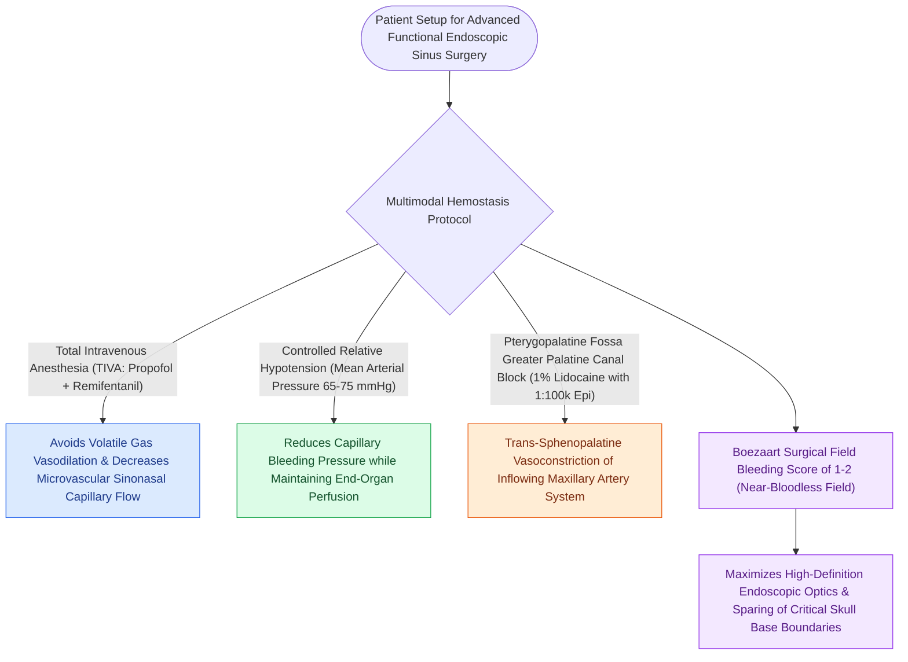

# TIVA and greater palatine canal blocks optimize surgical field visibility in FESS

## Active Recall

> [!question]- Why does TIVA with propofol and remifentanil produce a superior surgical field compared to inhalational volatile anesthetics?
> *Answer / Clinical Rationale*: Inhalational agents induce peripheral vasodilation and mucosal hyperperfusion, whereas TIVA preserves microvascular autoregulation and achieves controlled hypotension/bradycardia without dilating the sinonasal mucosal capillary bed.

> [!question]- What vascular territory is constricted by a transoral greater palatine canal block?
> *Answer / Clinical Rationale*: The **sphenopalatine artery (SPA)** system and internal maxillary terminal branches within the pterygopalatine fossa, providing profound hemostasis across the lateral nasal wall and posterior ethmoids.

## Core Clinical & Mechanistic Principles
Surgical precision and safety in Functional [[Diagnostic rigid nasal endoscopy utilizes a standardized three-pass examination sequence|Endoscopic]] Sinus Surgery (FESS) depend on maintaining an **immaculate, bloodless field** (Boezaart Bleeding Score $\le 2$). Mucosal bleeding obscures delicate skull base and orbital landmarks, dramatically increasing complication rates.

### Anesthetic & Pharmacological Mechanisms
1. **Total Intravenous Anesthesia (TIVA) vs Inhalational Gases**:
   - Inhalational agents (Sevoflurane, Isoflurane) cause systemic peripheral vasodilation, increasing mucosal capillary perfusion and venous engorgement.
   - **TIVA with Propofol and Remifentanil** preserves vascular autoregulation, blunts sympathetic surges, and lowers cardiac output, significantly improving the Boezaart surgical field score.
2. **Transoral Greater Palatine Canal (GPC) Block**:
   - The needle is bent at $2.5\text{ cm}$ at a 45° angle.
   - Inserted into the greater palatine foramen (opposite the 2nd/3rd maxillary molar) and advanced $1.5\text{–}2.0\text{ cm}$ up the pterygopalatine canal.
   - Injecting $1.5\text{–}2.0\text{ mL}$ of 1% lidocaine with 1:100,000 epinephrine directly bathes the **sphenopalatine artery (SPA)** and **pterygopalatine ganglion (PPG)**, inducing profound vasoconstriction across the entire lateral nasal wall.

## Connected Concepts & Graph Traversal
- **Surgical Step 1**: [[Incisive uncinectomy exposes the ethmoid infundibulum while protecting the nasolacrimal duct|Incisive Uncinectomy]]
- **Arterial Anatomy**: [[The crista ethmoidalis guides endoscopic sphenopalatine artery ligation|Sphenopalatine Artery Anatomy]]
- **Autonomic Block**: [[The Vidian nerve carries parasympathetic secretomotor and sympathetic vasomotor fibers|PPG & Autonomics]]
- **Diagnostic Evaluation**: [[Draf I frontal sinusotomy clears obstructing ethmoid cells without instrumenting the ostium|Draf I Frontal Sinusotomy]]
- **Anatomical Foundation**: [[Topical hemostatic matrix agents and nasal packing mitigate postoperative epistaxis and synechiae|Topical Hemostatic Matrices]]
- **Surgical Craft**: [[Entering the ethmoid bulla inferomedially avoids orbital and skull base penetration|Anterior Ethmoidectomy Technique]]
