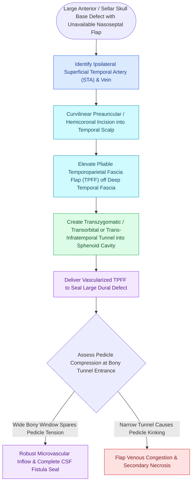

# Temporoparietal fascia free and pedicled flaps provide vascularized tissue when nasoseptal flaps fail

## Active Recall

> [!question]- What is the axial blood supply of the temporoparietal fascia flap?
> *Answer / Clinical Rationale*: The **superficial temporal artery (STA)** and its anterior (frontal) and posterior (parietal) branches.

> [!question]- Through what surgical corridor is a pedicled TPFF routed to reach the clivus endoscopically?
> *Answer / Clinical Rationale*: Through a **trans-infratemporal / transpterygoid tunnel** directly through the pterygopalatine fossa into the sphenoid sinus.

## Core Clinical & Mechanistic Principles
The **[[Vascularized nasoseptal and regional pedicled flaps provide robust skull base reconstruction for high-flow CSF leaks and large dural defects|Temporoparietal Fascia Flap (TPFF)]]** is an ultra-thin, highly pliable, robustly vascularized fascial sheet supplied by the **superficial temporal artery (STA)** and vein.

In endoscopic skull base reconstruction, it can be transposed as a **pedicled flap through the infratemporal and pterygopalatine fossae** to cover extensive clival and middle cranial fossa defects.

### Critical Surgical Safeguard: Frontal Branch Protection
- The **frontal branch of the facial nerve** runs directly within the sub-TPF layer. During flap harvest, dissection must preserve the branch if motor function is to be spared (see the zygomatic arch and temporal fascial planes).

## Connected Concepts & Graph Traversal
- **Reconstruction Hierarchy**: [[Multi-layer skull base reconstruction combines underlay, inlay, and overlay barriers|Multi-Layer Repair]]
- **Corridor**: [[Transpterygoid EEA exposes juvenile nasopharyngeal angiofibromas and lateral sphenoid defects|Transpterygoid EEA]]
- **Clival Reconstruction**: [[Transclival EEA provides midline access to clival chordomas and chondrosarcomas|Transclival EEA]]
- **Critical Safety / Complication**: [[Esthesioneuroblastoma Kadish and Hyams staging determines craniofacial resection and adjuvant therapy|Esthesioneuroblastoma (ENB)]]
- **Reconstruction**: [[Vascularized nasoseptal and regional pedicled flaps provide robust skull base reconstruction for high-flow CSF leaks and large dural defects|Regional Pedicled Flaps]]
