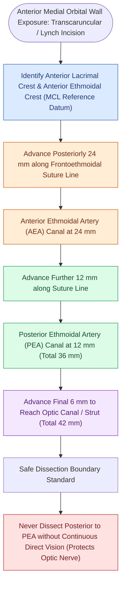

# The 24-12-6 rule governs anterior and posterior ethmoidal artery surgical localization

## Active Recall

> [!question]- What is the clinical significance of the '24-12-6 Rule' in medial orbital surgery?
> *Answer / Clinical Rationale*: It defines the constant distances from the anterior lacrimal crest to the **AEA (24 mm)**, from AEA to **PEA (12 mm)**, and from PEA to the **optic canal (6 mm)**, providing an absolute boundary to prevent optic nerve injury.

> [!question]- Why should subperiosteal dissection along the medial orbital wall never extend more than 6 mm posterior to the posterior ethmoidal foramen?
> *Answer / Clinical Rationale*: The **optic canal** lies approximately $6\text{ mm}$ posterior to the PEA; exceeding this distance risks direct optic nerve transection.

## Core Clinical & Mechanistic Principles
When performing open or external surgical ligation of the **Anterior Ethmoidal Artery (AEA)** and **Posterior Ethmoidal Artery (PEA)** (via a Lynch or transcaruncular incision), distance measurements along the **frontoethmoidal suture line** on the medial [[Lamina papyracea dehiscence predisposes to orbital fat herniation and medial rectus injury|orbital]] wall follow the classic **"24-12-6 Rule"**.

### The 24-12-6 Metric Progression
1. **Anterior Lacrimal Crest to AEA ($24\text{ mm}$)**:
   - Subperiosteal dissection along the medial orbital wall identifies the **frontoethmoidal suture line**.
   - The anterior ethmoidal foramen containing the AEA and nerve sits approximately **$24\text{ mm}$** posterior to the anterior lacrimal crest.
2. **AEA to PEA ($12\text{ mm}$)**:
   - Continuing subperiosteal dissection posteriorly along the suture line, the posterior ethmoidal foramen containing the PEA sits **$12\text{ mm}$** posterior to the AEA.
3. **PEA to Optic Canal ($6\text{ mm}$)**:
   - The optic foramen / optic nerve lies a mere **$6\text{ mm}$** posterior to the PEA.

## Critical Surgical Safety Rule
- **The 6-mm Optic Hazard**: The posterior ethmoidal artery is the **final safety boundary** of medial orbital dissection. 
- Dissecting deeper than $6\text{ mm}$ posterior to the PEA risks direct laceration or traction on the **optic nerve (CN II)** and ophthalmic artery, causing immediate permanent blindness.

## Connected Concepts & Graph Traversal
- **Anterior Skull Base Danger**: [[The Keros classification stages olfactory fossa depth and lateral lamella vulnerability|Keros Classification]]
- **Orbital Lamina Boundary**: [[Lamina papyracea dehiscence predisposes to orbital fat herniation and medial rectus injury|Lamina Papyracea]]
- **Ethmoidal Landmark Lamellae**: [[The four parallel ethmoidal lamellae guide systematic anterior-to-posterior endoscopic orientation|Four Parallel Ethmoidal Lamellae]]
- **Radiological Danger Matrix**: [[The CLOSE checklist systematically evaluates critical radiological danger zones|CLOSE Checklist (Ethmoidal Arteries)]]
- **Posterior Ethmoid Landmark**: [[Posterior ethmoidectomy requires dissecting along the skull base from posterior to anterior|Posterior Ethmoid Dissection]]
- **Anatomical Foundation**: [[Endoscopic endonasal anterior ethmoidal artery ligation requires skull base skeletonization to prevent orbital fat prolapse and vessel retraction|Endonasal AEA Ligation]]
- **Surgical Craft**: [[Transcaruncular and Lynch external approaches provide direct access to the frontoethmoidal suture line for anterior ethmoidal artery ligation in refractory epistaxis|Transcaruncular/Lynch Approach]]
