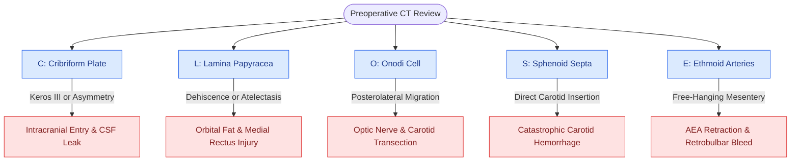

# The CLOSE checklist systematically evaluates critical radiological danger zones

## Active Recall

> [!question]- What specific anatomical risk is associated with a Keros Type III skull base on the CLOSE checklist?
> *Answer / Clinical Rationale*: Keros Type III features an elongated ($8\text{–}16\text{ mm}$), paper-thin lateral lamella of the cribriform plate, representing the thinnest bone in the anterior skull base and the highest risk site for [[Iatrogenic skull base cribriform leaks require immediate intraoperative multi-layer graft repair|iatrogenic CSF leak]] and intracranial entry.

> [!question]- Why must intersphenoid septations be evaluated with extreme caution on axial and coronal CT before sphenoidotomy?
> *Answer / Clinical Rationale*: An [[Intersphenoid sinus septations frequently insert directly onto the internal carotid canal|intersphenoid septum]] may insert directly onto the bony covering of the **internal carotid artery**. Avulsing the septum with instruments can tear the carotid wall, causing catastrophic arterial hemorrhage.

## Core Clinical & Mechanistic Principles
Prior to performing any functional endoscopic sinus surgery (FESS) or expanded skull base procedure, the surgeon must systematically review the high-resolution CT sinus scan in coronal, sagittal, and axial planes using the **CLOSE** mnemonic. This structured radiological review prevents catastrophic orbital penetration, optic nerve transection, intracranial entry, or [[Intraoperative ICA injury requires two-surgeon suction and crushed muscle patch hemostasis|internal carotid artery laceration]].

### The Five CLOSE Checkpoints
1. **C — Cribriform Plate / Lateral Lamella**:
   - Depth of the olfactory fossa graded by the [[The Keros classification stages olfactory fossa depth and lateral lamella vulnerability|Keros Classification]] (Type I: 1–3 mm, Type II: 4–7 mm, Type III: 8–16 mm).
   - Evaluate for **side-to-side roof height asymmetry** (the lower skull base is at extreme risk of inadvertent intracranial penetration).
2. **L — Lamina Papyracea**:
   - Assess for congenital dehiscence, post-traumatic disruption, or medial displacement/atelectasis seen in [[Lamina papyracea dehiscence predisposes to orbital fat herniation and medial rectus injury|Silent Sinus Syndrome]].
   - Identify [[Infraorbital Haller cells narrow the ethmoid infundibulum and maxillary ostium|Haller cells]] (infraorbital ethmoid cells) that narrow the infundibulum and distort the orbital floor.
3. **O — Onodi Cell (Sphenoethmoidal Cell)**:
   - Identify posterior ethmoid pneumatization extending superior and lateral to the sphenoid sinus (see [[Onodi cells place the optic nerve and carotid artery at risk during posterior ethmoidectomy|Onodi Cell Anatomy]]).
   - The **optic nerve** and **internal carotid artery** frequently course exposed along the lateral wall of an Onodi cell.
4. **S — Sphenoid Sinus Pneumatization**:
   - Type of pneumatization (conchal, presellar, sellar) and presence of lateral pterygoid recess expansion (see [[Sphenoid sinus pneumatization patterns dictate carotid and optic canal exposure|Sphenoid Sinus Pneumatization]]).
   - Evaluate for **intersphenoid septations inserting directly onto the carotid canal** or optic nerve canal.
5. **E — Ethmoidal Arteries (AEA & PEA)**:
   - Anterior Ethmoidal Artery (AEA) relationship to the ethmoid roof. If [[Supraorbital ethmoid cells suspend the anterior ethmoidal artery below the skull base|supraorbital ethmoid cells]] are present, the AEA travels in a bony mesentery $2\text{–}5\text{ mm}$ below the skull base.

## Connected Concepts & Graph Traversal
- **Cribriform Anatomy**: [[The Keros classification stages olfactory fossa depth and lateral lamella vulnerability|Keros Classification]]
- **Orbital Danger**: [[Lamina papyracea dehiscence predisposes to orbital fat herniation and medial rectus injury|Lamina Papyracea Dehiscence]]
- **Optic Nerve Risk**: [[Onodi cells place the optic nerve and carotid artery at risk during posterior ethmoidectomy|Onodi Cell Danger]]
- **Carotid Risk**: [[Sphenoid sinus pneumatization patterns dictate carotid and optic canal exposure|Sphenoid Sinus Pneumatization]]
- **Vascular Risk**: [[Supraorbital ethmoid cells suspend the anterior ethmoidal artery below the skull base|AEA Localization]]
- **Surgical Technique**: [[Endoscopic dacryocystorhinostomy bypasses nasolacrimal duct obstruction via lacrimal sac marsupialization into the middle meatus|Endoscopic DCR Lacrimal Approach]]
