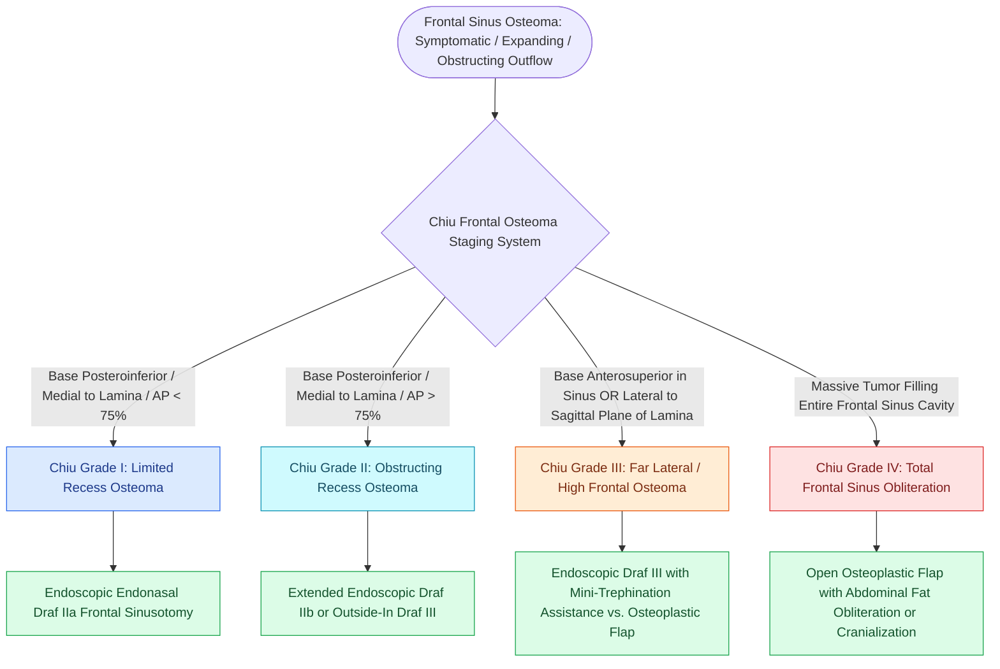

# The Chiu classification stages frontal sinus osteomas to dictate endoscopic endonasal resection versus open osteoplastic flap approaches based on tumor dimensions and attachment

## Active Recall

> [!question]- What three specific anatomical variables determine the Chiu grade for frontal sinus osteomas?
> *Answer / Clinical Rationale*: (1) The **location of the base of attachment** (posteroinferior along the frontal recess vs. anterosuperior within the frontal sinus proper); (2) The **lateral extent of the lesion relative to a sagittal plane passing through the lamina papyracea**; and (3) The **anteroposterior (AP) diameter of the osteoma relative to the AP dimension of the frontal recess** ($<75\%$ vs. $>75\%$).

> [!question]- Why does the eburnated (ivory) histopathologic subtype of osteoma pose unique technical challenges during endoscopic drill-out?
> *Answer / Clinical Rationale*: Eburnated osteomas consist of **dense, compact lamellar bone lacking Haversian canals**. This ultra-hard cortical bone rapidly dulls standard cutting burrs and requires high-speed diamond burrs with copious continuous irrigation to prevent thermal osteonecrosis and mechanical torque injury to the adjacent skull base and orbit.

## Core Clinical & Mechanistic Principles
Osteomas are the most common benign fibro-osseous neoplasms of the paranasal sinuses, with an overall radiological incidence of up to $3\%$ on computed tomography. The vast majority ($>80\%$) arise within the **frontal and frontoethmoidal sinuses**, followed by the ethmoid ($15\%$), maxillary ($5\%$), and sphenoid sinuses. They exhibit a distinct male predominance (male-to-female ratio 2:1 to 3:1) and present during the third through fifth decades of life. The presence of multiple craniofacial osteomas mandates a prompt workup for **Gardner syndrome**, an autosomal dominant disorder caused by mutations in the adenomatous polyposis coli (*APC*) tumor suppressor gene on chromosome 5q21, featuring multiple jaw and calvarial osteomas, soft tissue desmoids, epidermoid cysts, and obligate premalignant gastrointestinal adenomatous polyposis.

Most small frontal sinus osteomas are slow-growing and completely asymptomatic, discovered incidentally on neuroimaging. However, when an expanding osteoma mechanically impinges upon the narrow frontal sinus outflow tract, it triggers mucus stasis, chronic secondary sinusitis, and expansile **[[Frontal sinus mucoceles cause bony erosion, proptosis, and intracranial extension|frontal sinus mucocele]]** formation. Erosion through the thin orbital roof causes exophthalmos, diplopia, and epiphora, whereas expansion through the posterior table risks dural breach, pneumocephalus, cerebrospinal fluid fistula, meningitis, and frontal lobe abscess. While asymptomatic stable lesions can be monitored with serial annual CT imaging, symptomatic lesions or those demonstrating progressive expansion demand surgical excision, historically achieved via an **[[Osteoplastic flap with frontal sinus obliteration manages lateral frontal disease and osteomyelitis|osteoplastic flap]]**.

### Histopathologic Classification
1. **Eburnated (Ivory / Compact) Subtype**: Extremely hard, dense, mature lamellar bone completely devoid of Haversian canals and marrow spaces. Highly resistant to surgical dissection; requires dedicated curved diamond burrs and constant irrigation.
2. **Mature (Spongiosum / Cancellous) Subtype**: Composed of bony trabeculae lined by active osteoblasts and divided by vascularized fibrous stroma containing abundant collagen fibers and cellular elements. Softer consistency; easily mobilized with curettes and Kerrison rongeurs once skeletonized.
3. **Mixed Subtype**: Exhibits an outer dense ivory cortical shell encasing a central cancellous spongy core.

### The Chiu Classification and Surgical Algorithm
Alexander G. Chiu and colleagues established a landmark staging system for frontal sinus osteomas based upon three objective anatomical criteria on multiplanar CT:
- **Chiu Grade I**: Base of attachment is located posteroinferiorly along the frontal recess; tumor is situated entirely medial to a sagittal plane traversing the lamina papyracea; and its anteroposterior (AP) diameter occupies $<75\%$ of the AP dimension of the frontal recess.
  - *Surgical Execution*: Managed via standard **endoscopic endonasal Draf IIa** frontal sinusotomy. Angled curettes and $70^\circ$ diamond burrs drill the narrow pedicle off the posterior wall or middle turbinate axilla.
- **Chiu Grade II**: Base of attachment is posteroinferior along the frontal recess; tumor is medial to the sagittal plane of the lamina papyracea; but its AP diameter exceeds $>75\%$ of the frontal recess dimension.
  - *Surgical Execution*: Demands expanded endoscopic access via **Draf IIb** (resecting the middle turbinate sagittal attachment) or an outside-in **Draf III** modified endoscopic Lothrop procedure to create instrument space.
- **Chiu Grade III**: Base of attachment is located anteriorly or superiorly within the frontal sinus proper, OR the tumor extends lateral to the sagittal plane passing through the lamina papyracea.
  - *Surgical Execution*: Beyond the reliable reach of pure endonasal instrumentation. Addressed via **extended endoscopic Draf III combined with frontal mini-trephination** for multi-angle push-pull dissection, or an open osteoplastic flap.
- **Chiu Grade IV**: Massive osteoma completely filling the entire frontal sinus cavity.
  - *Surgical Execution*: Treated via an **open osteoplastic flap with coronal incision**, performing complete osteoma extirpation followed by mucosal de-epithelialization and autologous abdominal fat obliteration.

## Connected Concepts & Graph Traversal
- **Pathology & Surgical Threshold**: [[Frontal sinus osteomas require endoscopic Draf or open osteoplastic resection when obstructing outflow|Frontal Sinus Osteoma Management]]
- **Conservative Drainage Corridor**: [[Draf IIa frontal sinusotomy resects the sinus floor between middle turbinate and lamina|Draf IIa Frontal Sinusotomy]]
- **Extended Unilateral Resection**: [[Draf IIb frontal sinusotomy extends from lamina papyracea to the nasal septum|Draf IIb Frontal Sinusotomy]]
- **Bilateral Expanded Drill-Out**: [[Draf III modified Lothrop unites both frontal sinuses into a common cavity|Draf III Modified Lothrop]]
- **Mucosal Restenosis Prevention**: [[Nasal beak drill-out and mucosal grafting prevent neo-ostium restenosis in Draf III|Nasal Beak Drill-Out]]
