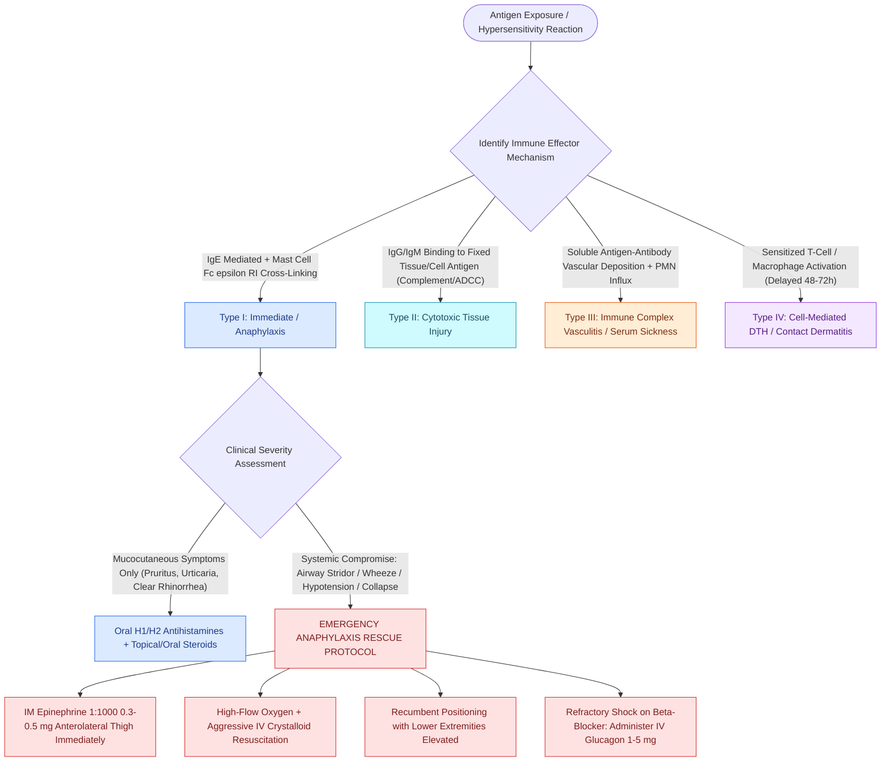

# The Gell and Coombs classification delineates four distinct immunologic hypersensitivity mechanisms underlying otolaryngic disease

## Active Recall

> [!question]- What molecular event initiates mast cell degranulation in Gell and Coombs Type I hypersensitivity, and what are the major preformed versus newly synthesized mediators?
> *Answer / Clinical Rationale*: Degranulation is initiated by **multivalent allergen cross-linking of adjacent antigen-specific IgE molecules bound to high-affinity FcεRI receptors** on mast cells and basophils, triggering Lyn/Syk tyrosine phosphorylation and intracellular calcium mobilization. **Preformed mediators** released in minutes include **histamine, tryptase, chymase, and heparin**. **Newly synthesized lipid mediators** produced in 15–30 minutes include **cysteinyl leukotrienes (LTC4, LTD4, LTE4), prostaglandin D2 (PGD2), and platelet-activating factor (PAF)**.
*(CummingsReview2017, Ch8, p.183–184)*

> [!question]- How do the pathophysiological mechanisms and diagnostic timelines differ among Gell and Coombs Types I, II, III, and IV hypersensitivity reactions?
> *Answer / Clinical Rationale*: **Type I (Immediate/Anaphylactic)**: IgE-mediated mast cell/basophil degranulation peaking within **15–30 minutes**. **Type II (Cytotoxic)**: IgG/IgM antibodies binding cell-surface or extracellular matrix antigens, activating complement-mediated lysis or ADCC (**hours to days**). **Type III (Immune Complex)**: Deposition of circulating antigen-antibody complexes in vessel walls activating complement and neutrophils (**6–12 hours**). **Type IV (Cell-Mediated / Delayed)**: Sensitized CD4+ and CD8+ T lymphocytes recruiting macrophages via cytokines (**48–72 hours**).
*(CummingsReview2017, Ch8, p.183–184)*

> [!question]- What is the definitive first-line pharmacological treatment for systemic anaphylaxis, and why is the intramuscular route in the anterolateral thigh mandatory?
> *Answer / Clinical Rationale*: **Intramuscular Epinephrine (1:1000 concentration, 0.3–0.5 mg in adults, 0.01 mg/kg in pediatrics)** injected into the **anterolateral thigh (vastus lateralis)**. The vastus lateralis achieves **significantly higher, faster peak plasma epinephrine levels** compared to deltoid or subcutaneous injection. Epinephrine provides alpha-1 vasoconstriction (reversing distributive hypotension and mucosal laryngeal edema), beta-1 positive inotropy/chronotropy, and beta-2 bronchodilation while halting further mast cell mediator exocytosis.
*(CummingsReview2017, Ch8, p.183–184)*

## Core Clinical & Mechanistic Principles
The **Gell and Coombs Classification** categorizes immune-mediated tissue injury into four distinct pathophysiological pathways. In otolaryngology, these mechanisms govern clinical entities ranging from common inhalant allergic rhinitis and drug eruptions to life-threatening systemic anaphylaxis, necrotizing vasculitides, and chronic granulomatous mucosal disorders.

### The Four Hypersensitivity Types
1. **Type I: Immediate / Anaphylactic Hypersensitivity (IgE-Mediated)**:
   - *Effector Mechanism*: Allergen binds to and cross-links membrane-bound IgE on the surface of tissue mast cells and circulating basophils via high-affinity **FcεRI receptors**.
   - *Time Course*: Immediate onset (**5 to 30 minutes**), followed by a secondary late-phase cellular inflammatory response (**4 to 8 hours**).
   - *Otolaryngic Manifestations*: Allergic rhinitis, allergic rhinoconjunctivitis, IgE-mediated acute urticaria, laryngeal angioedema, food-induced anaphylaxis, and Hymenoptera venom anaphylaxis.
2. **Type II: Cytotoxic / Antibody-Dependent Hypersensitivity (IgG/IgM-Mediated)**:
   - *Effector Mechanism*: Circulating IgG or IgM antibodies bind directly to fixed cell-surface antigens or extracellular matrix components. Target destruction occurs via three mechanisms:
     1. Classical complement pathway activation and assembly of the **membrane attack complex (C5b-9)**.
     2. Antibody-dependent cell-mediated cytotoxicity (ADCC) mediated by natural killer (NK) cells and macrophages via Fcγ receptors.
     3. Opsonization by C3b and IgG leading to phagocytic destruction.
   - *Clinical Examples*: Autoimmune hemolytic anemia, Goodpasture syndrome (anti-glomerular/alveolar basement membrane antibodies), pemphigus vulgaris (anti-desmoglein 3), bullous pemphigoid, and Rh hemolytic disease of the newborn.
3. **Type III: Immune Complex-Mediated Hypersensitivity (Antigen-Antibody Lattices)**:
   - *Effector Mechanism*: Soluble antigens combine with circulating antibodies (predominantly IgG or IgM) to form circulating **antigen-antibody complexes**. In conditions of antigen excess, these lattice complexes escape reticuloendothelial clearance and deposit in vascular endothelium, renal glomeruli, and synovium.
   - *Pathology*: Deposited complexes trigger classical complement cascade activation (**generating C3a and C5a anaphylatoxins**) and recruit polymorphonuclear neutrophils (PMNs). Neutrophils release lysosomal proteases and reactive oxygen species, producing necrotizing leukocytoclastic vasculitis.
   - *Time Course*: **6 to 12 hours** post-antigen challenge.
   - *Clinical Examples*: Systemic lupus erythematosus (SLE), serum sickness (post-antitoxin/antivenom or drug therapy), post-streptococcal glomerulonephritis, and the local Arthus reaction.
4. **Type IV: Cell-Mediated / Delayed-Type Hypersensitivity (DTH / T-Cell Mediated)**:
   - *Effector Mechanism*: Antibody-independent. Mediated by sensitized **CD4+ T helper cells (Th1 and Th17)** and **CD8+ cytotoxic T lymphocytes (CTLs)**.
   - *Pathology*: Upon secondary antigen recognition presented on MHC molecules, Th1 cells release IFN-γ and TNF-α, recruiting and activating tissue macrophages into epithelioid histiocytes and multinucleated giant cells. CD8+ CTLs induce target cell apoptosis via perforin and granzyme secretion.
   - *Time Course*: Delayed onset, peaking at **48 to 72 hours**.
   - *Otolaryngic Manifestations*: Allergic contact dermatitis (nickel jewelry, poison ivy / urushiol, topical neomycin or bacitracin), tuberculin purified protein derivative (PPD) cutaneous reaction, chronic solid organ transplant rejection, and sinonasal granulomatous diseases (e.g., granulomatosis with polyangiitis (GPA) and sarcoidosis).

### Type I Anaphylaxis: Biochemistry of Mast Cell Activation
- **The High-Affinity IgE Receptor (FcεRI)**:
  - Heterotetrameric complex consisting of one $\alpha$ subunit (binds IgE heavy chain $C\varepsilon3$ domain with high affinity, $K_a \approx 10^{10}\,\text{M}^{-1}$), one $\beta$ subunit (amplifies signaling), and two disulfide-linked $\gamma$ chains containing immunoreceptor tyrosine-based activation motifs (ITAMs).
  - Cross-linking of adjacent receptors by polyvalent antigen triggers Lyn and Syk protein tyrosine kinase cascades, activating phospholipase C-gamma (PLCγ). PLCγ cleaves membrane phosphatidylinositol 4,5-bisphosphate ($\text{PIP}_2$) into:
    1. **Inositol 1,4,5-trisphosphate ($\text{IP}_3$)**: Binds endoplasmic reticulum receptors, releasing stored intracellular calcium ($\text{Ca}^{2+}$).
    2. **Diacylglycerol (DAG)**: Activates protein kinase C (PKC), driving cytoskeletal assembly and fusion of preformed secretory granules with the plasma membrane.
- **Spectrum of Mast Cell Mediators**:
  - **Preformed Mediators (Exocytosis within minutes)**:
    - *Histamine*: Stimulates H1 receptors (smooth muscle contraction, bronchospasm, increased vascular permeability, sensory nerve pruritus) and H2 receptors (gastric acid secretion, peripheral vasodilation, cardiac chronotropy).
    - *Tryptase*: Neutral serine protease stored exclusively in mast cell secretory granules. Serves as the **definitive clinical biomarker of systemic mast cell activation**. Serum levels peak at **1 to 2 hours** post-reaction and remain elevated for up to 4–6 hours (half-life $\approx 2\text{ hours}$).
    - *Heparin & Chymase*: Proteoglycans and proteases promoting tissue remodeling and kinin generation.
  - **De Novo Synthesized Lipid Mediators (Synthesized within 15–30 minutes)**:
    - *Cysteinyl Leukotrienes ($\text{LTC}_4, \text{LTD}_4, \text{LTE}_4$)*: Synthesized via 5-lipoxygenase pathway from arachidonic acid. Formerly known as Slow-Reacting Substance of Anaphylaxis (SRS-A); **1000 times more potent than histamine** at inducing prolonged bronchoconstriction and microvascular permeability.
    - *Prostaglandin D2 ($\text{PGD}_2$)*: Cyclooxygenase product inducing marked vasodilation, cutaneous flushing, coronary vasoconstriction, and bronchospasm.
    - *Platelet-Activating Factor (PAF)*: Potent inducer of platelet aggregation, severe sustained systemic vasodilation, and fatal distributive vascular collapse.
  - **Late-Phase Cytokines & Chemokines (Synthesized over 4–24 hours)**:
    - TNF-α, IL-4, IL-5, IL-9, IL-13, and CXCL8 (IL-8), orchestrating delayed leukocyte infiltration and protracted eosinophilic mucosal injury.

### Diagnostic Criteria for Systemic Anaphylaxis & Resuscitation Protocol
- **Clinical Presentation**:
  - *Cutaneous (90%)*: Pruritus, flushing, diffuse urticaria, morbilliform rash, periorbital and perioral angioedema.
  - *Respiratory (70%)*: Laryngeal edema, stridor, globus sensation, dyspnea, bronchospasm, refractory wheezing.
  - *Gastrointestinal (45%)*: Severe cramping abdominal pain, nausea, projectile vomiting, explosive diarrhea.
  - *Cardiovascular (45%)*: Severe distributive shock, profound hypotension, syncope, tachycardia (or paradoxical bradycardia from Bezold-Jarisch reflex), cardiac arrest, and the characteristic psychological "sense of impending doom".
- **Immediate Stepwise Resuscitation Protocol**:
  1. **First-Line Pharmacotherapy**: **Intramuscular Epinephrine (1:1000, 1 mg/mL)**:
     - Adult dose: **$0.3\text{ to }0.5\text{ mg}$ IM**.
     - Pediatric dose: **$0.01\text{ mg/kg}$ IM (max $0.3\text{ mg}$)**.
     - Site: **Anterolateral thigh (vastus lateralis)**; repeat every **5 to 15 minutes** if symptoms fail to improve.
  2. **Patient Positioning**: Place the patient **strictly recumbent (supine) with lower extremities elevated** unless severe dyspnea dictates upright sitting. Sudden transition to an upright posture can cause fatal "empty heart syndrome" due to acute venous pooling and catastrophic loss of cardiac preload.
  3. **Airway & Oxygenation**: 100% high-flow supplemental oxygen via non-rebreather mask ($10\text{–}15\text{ L/min}$). Prepare for early endotracheal intubation or emergent surgical cricothyroidotomy if progressive laryngeal edema develops.
  4. **Aggressive Volume Expansion**: Place two large-bore peripheral IV lines ($14\text{–}16\text{ gauge}$) and rapidly infuse **1 to 2 liters of isotonic crystalloid** (normal saline or lactated Ringer's) in adults ($20\text{ mL/kg}$ bolus in children) to counteract massive fluid extravasation into the interstitial space.
  5. **Patients on Beta-Blocker Therapy**: Often refractory to epinephrine and risk severe paradoxical hypertension and bradycardia. The specific antidote is **IV Glucagon ($1\text{ to }5\text{ mg}$ IV over 5 minutes, followed by an infusion of $5\text{–}15\,\mu\text{g/min}$)**. Glucagon directly stimulates adenylate cyclase and bypasses blocked beta-adrenergic receptors, restoring cyclic AMP (cAMP) levels, myocardial inotropy, and chronotropy.
  6. **Second-Line Adjunctive Medications (Never delay epinephrine)**:
     - *H1-antihistamine*: Diphenhydramine $25\text{–}50\text{ mg}$ IV.
     - *H2-antihistamine*: Famotidine $20\text{ mg}$ IV.
     - *Inhaled beta-2 agonist*: Albuterol nebulization for refractory bronchospasm.
     - *Systemic Corticosteroids*: Methylprednisolone $125\text{ mg}$ IV (does not treat acute shock; primarily blunts biphasic late-phase reactions occurring in up to 20% of patients within 4–12 hours).
  7. **Monitoring Interval**: Mandatory minimum **4 to 8-hour observation** period (24 hours for severe presentations or in patients on beta-blockers) due to the risk of late-phase biphasic anaphylaxis.

Comprehensive physiological and surgical principles connect these findings directly to [[Complement activation cascades, MHC antigen presentation, and leukocyte adhesion molecules orchestrate mucosal innate and adaptive immunity|mucosal adaptive immunity]].

## Connected Concepts & Graph Traversal
- **Clinical Rhinitis Classification**: [[Rhinitis subtypes are differentiated into allergic, vasomotor, gustatory, and rhinitis medicamentosa|Rhinitis Subtypes]]
- **Allergy Quantification & Testing**: [[Intradermal dilutional testing IDT and modified quantitative testing MQT quantify allergic sensitization to guide safe immunotherapy escalation|Quantitative Allergy Testing]]
- **Fungal Allergic Phenotype**: [[Allergic fungal rhinosinusitis presents with eosinophilic mucin and Charcot-Leyden crystals|Allergic Fungal Sinusitis]]
- **Type III Necrotizing Vasculitis**: [[Granulomatosis with polyangiitis presents with necrotizing sinonasal granulomas and saddle nose|GPA Vasculitis]]
- **Type IV Chronic Granulomatous Disease**: [[Sarcoidosis of the upper respiratory tract causes non-caseating granulomas and mucosal cobblestoning|Sinonasal Sarcoidosis]]
