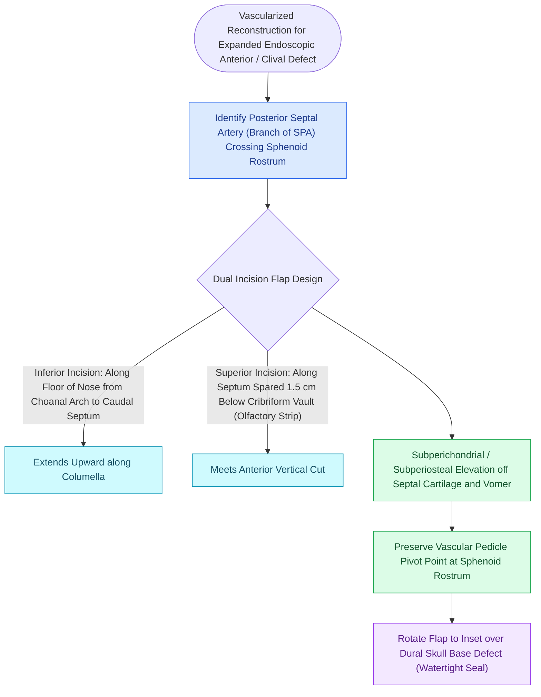

# The Hadad-Bassagasteguy nasoseptal flap is pedicled on the posterior septal artery

## Active Recall

> [!question]- What is the axial blood supply of the Hadad-Bassagasteguy nasoseptal flap?
> *Answer / Clinical Rationale*: The **posterior septal (nasopalatine) artery**, a major terminal branch of the **sphenopalatine artery (SPA)** that runs across the anterior face of the sphenoid sinus.

> [!question]- Why must the superior incision of the nasoseptal flap be placed 1.0 to 1.5 cm below the superior septal roof?
> *Answer / Clinical Rationale*: To preserve the **[[Olfactory neuroepithelium contains bipolar sensory neurons and basal stem cells|olfactory neuroepithelium]]** extending down onto the superior septum, avoiding permanent postoperative anosmia.

## Core Clinical & Mechanistic Principles
The **[[Temporoparietal fascia free and pedicled flaps provide vascularized tissue when nasoseptal flaps fail|Hadad-Bassagasteguy]] Nasoseptal Flap (NSF)** revolutionized endoscopic anterior skull base surgery by reducing postoperative high-flow CSF leak rates from $>20\text{–}30\%$ down to **$<5\%$**.

It is a vascularized mucoperichondrial and mucoperiosteal flap harvested from the nasal septum, based on the **posterior septal (nasopalatine) artery**, a terminal branch of the **sphenopalatine artery (SPA)**.

### Step-by-Step Surgical Harvest Craft
1. **Topical Decongestion & Infiltration**: Infiltrate the septal mucoperichondrium and posterior sphenoid face with 1% lidocaine with 1:100,000 epinephrine.
2. **Inferior Incision**: Along the junction of the nasal septum and nasal floor, extending from the posterior choana anteriorly to the caudal septal columella.
3. **Superior Incision**: Placed along the septal dorsum **$1.0\text{–}1.5\text{ cm}$ below the cribriform plate** to preserve olfactory sensory epithelium (see [[Preserving the superior septal mucosal strip prevents post-NSF anosmia|Preserving Olfactory Strip]]).
4. **Anterior Vertical Incision**: Connects the superior and inferior incisions at the caudal septum.
5. **Submucoperichondrial Elevation**: Elevate the flap in a clean subperichondrial/subperiosteal plane from anterior to posterior.
6. **Pedicle Release**: Release the vascular pedicle widely between the sphenoid ostium superiorly and the choanal arch inferiorly.
7. **Tucking**: Tuck the flap safely into the nasopharynx or maxillary sinus until skull base tumor resection is completed.

## Connected Concepts & Graph Traversal
- **Olfactory Preservation**: [[Preserving the superior septal mucosal strip prevents post-NSF anosmia|Olfactory Strip Protection]]
- **Arterial Source**: [[The crista ethmoidalis guides endoscopic sphenopalatine artery ligation|Sphenopalatine Artery Anatomy]]
- **Reconstruction Hierarchy**: [[Multi-layer skull base reconstruction combines underlay, inlay, and overlay barriers|Multi-Layer Skull Base Repair]]
- **Expanded Corridors**: [[Transcribriform EEA provides access to olfactory groove meningiomas and esthesioneuroblastomas|Transcribriform EEA]]
- **Anatomical Foundation**: [[Transclival EEA provides midline access to clival chordomas and chondrosarcomas|Transclival EEA]]
- **Flap Design**: [[Extended sphenoid antrostomy and drill-out resects the rostrum and intersinus septum with mini-nasoseptal flap lining to prevent osteitic restenosis|Extended Sphenoid Antrostomy]]
- **Surgical Craft**: [[Vascularized nasoseptal and regional pedicled flaps provide robust skull base reconstruction for high-flow CSF leaks and large dural defects|Regional Pedicled Flaps]]
