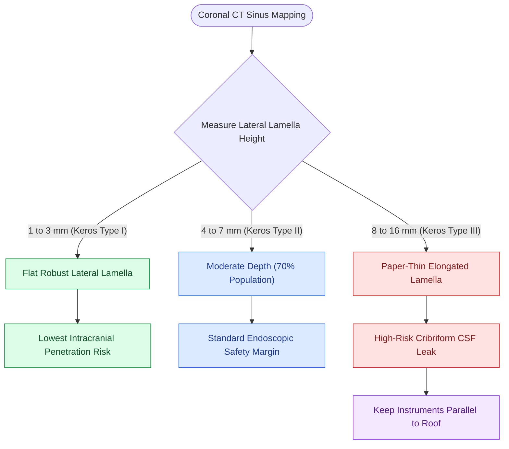

# The Keros classification stages olfactory fossa depth and lateral lamella vulnerability

## Active Recall

> [!question]- Why does a Keros Type III skull base carry an exponentially higher risk of intracranial entry during ethmoidectomy?
> *Answer / Clinical Rationale*: In Keros Type III, the lateral lamella is elongated up to $16\text{ mm}$ and extremely thin. Dissecting medial to the middle turbinate or applying superior force easily fractures this wafer-thin bone into the anterior cranial fossa.

> [!question]- What is the significance of recognizing skull base height asymmetry on preoperative coronal CT?
> *Answer / Clinical Rationale*: The side with the lower ethmoid roof is at extreme risk of inadvertent penetration because the surgeon may dissect to the expected height of the higher contralateral side.

## Core Clinical & Mechanistic Principles
The **Keros Classification** measures the vertical depth of the **olfactory fossa** on coronal CT, defined by the height of the **lateral lamella of the cribriform plate**. The lateral lamella connects the thin horizontal cribriform plate medially to the thicker fovea ethmoidalis (ethmoid roof) laterally. It represents the **thinnest, most fragile bone** in the entire anterior skull base ($<0.05\text{ mm}$ thick) and is the most common site of [[Iatrogenic skull base cribriform leaks require immediate intraoperative multi-layer graft repair|iatrogenic CSF leak]] during FESS.

### The Three Keros Types
1. **Keros Type I ($1\text{–}3\text{ mm}$ Depth)**:
   - The olfactory fossa is flat and shallow.
   - The lateral lamella is short and robust.
   - **Intraoperative Risk**: Lowest risk of intracranial entry.
2. **Keros Type II ($4\text{–}7\text{ mm}$ Depth)**:
   - Moderate depth of the olfactory fossa; most common pattern in the population ($\sim 70\%$).
   - Moderate length of the lateral lamella.
3. **Keros Type III ($8\text{–}16\text{ mm}$ Depth)**:
   - Deep olfactory fossa with an elongated, vertically oriented, paper-thin lateral lamella.
   - The ethmoid roof towers significantly above the cribriform plate.
   - **Intraoperative Risk**: Extreme vulnerability to perforation during anterior/posterior ethmoidectomy or uncinate removal.

### Skull Base Roof Asymmetry
- In up to 10–15% of patients, a significant **height asymmetry** exists between the right and left ethmoid roofs.
- The **lower skull base side** is at greatest surgical risk because the surgeon’s eye and instruments naturally expect a higher roof matching the contralateral side.

## Surgical Nuances & Prevention Protocol
- **Instrument Trajectory**: Always keep instruments oriented **parallel to the skull base** or pointed slightly inferiorly. Never direct force medially toward the junction of the middle turbinate and cribriform plate.
- **Middle Turbinate Preservation**: Do not avulse the middle turbinate superiorly; twisting forces can fracture the lateral lamella at its root, tearing the olfactory dura.

## Connected Concepts & Graph Traversal
- **Checklist Framework**: [[The CLOSE checklist systematically evaluates critical radiological danger zones|CLOSE Checklist]]
- **Surgical Danger**: [[Posterior ethmoidectomy requires dissecting along the skull base from posterior to anterior|Posterior Ethmoidectomy Dissection]]
- **Complication Matrix**: [[High-stakes sinonasal complications require proactive landmarking and emergency rescue protocols|High-Stakes Sinonasal Complications]]
- **CSF Repair**: [[Beta-2 transferrin and high-resolution CT localize sinonasal CSF fistulas|CSF Leak Diagnostics]]
- **Anatomical Foundation**: [[Concha bullosa resection requires lateral lamella excision to preserve medial cribriform attachment and middle turbinate stability|Concha Bullosa Resection]]
