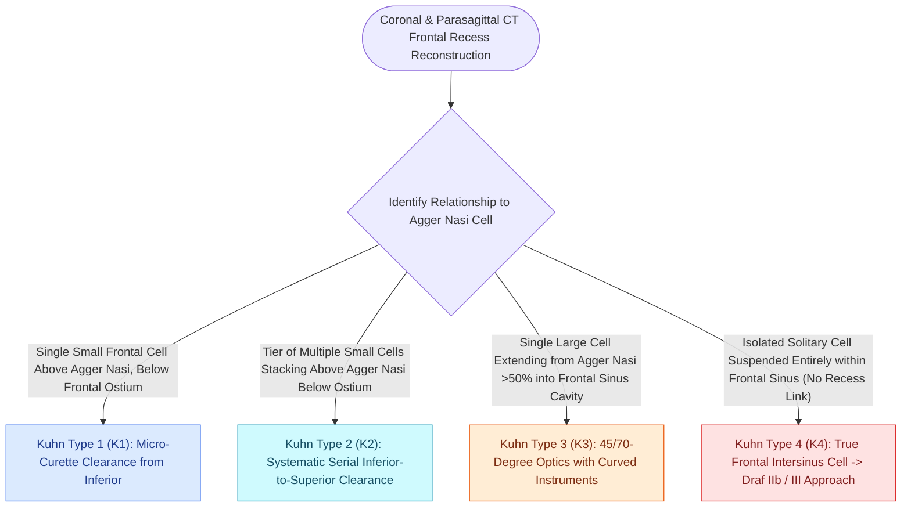

# The Kuhn classification stages frontal recess and frontal sinus air cells

## Active Recall

> [!question]- What distinguishes a Kuhn Type 3 from a Kuhn Type 4 frontal cell on sagittal CT?
> *Answer / Clinical Rationale*: A **Kuhn Type 3** cell originates above the agger nasi and extends through the frontal ostium into the sinus cavity ($>50\%$ height), maintaining continuity with the ethmoid labyrinth. A **Kuhn Type 4** cell is an isolated cell residing entirely within the frontal sinus without ethmoid contact.

> [!question]- Which Kuhn frontal cell type is typically managed with an extended Draf IIa or [[Draf IIb frontal sinusotomy extends from lamina papyracea to the nasal septum|Draf IIb]] frontal sinusotomy?
> *Answer / Clinical Rationale*: **Kuhn Type 3 and Type 4** cells frequently require a Draf IIa/IIb or [[Nasal beak drill-out and mucosal grafting prevent neo-ostium restenosis in Draf III|Draf III]] drill-out to adequately unroof the extensive intra-frontal bony walls and restore wide patency.

## Core Clinical & Mechanistic Principles
The **Kuhn Classification** categorizes frontoethmoidal air cells that encroach upon and obstruct the **frontal sinus outflow tract (FSOT)**. Accurate pre-operative identification of these cells on coronal and sagittal CT is essential for selecting the appropriate frontal sinusotomy approach ([[Draf I frontal sinusotomy clears obstructing ethmoid cells without instrumenting the ostium|Draf I]], IIa, IIb, or III).

### The Four Kuhn Frontal Cell Types
1. **Kuhn Type 1**:
   - A single frontoethmoidal air cell situated **above the agger nasi cell**, but remaining **below the frontal sinus ostium**.
2. **Kuhn Type 2**:
   - A vertical tier or cluster of **multiple cells** above the agger nasi cell, remaining below the frontal ostium.
3. **Kuhn Type 3**:
   - A single large frontoethmoidal cell originating above the agger nasi that **pneumatizes superiorly through the frontal ostium** directly into the frontal sinus cavity, occupying $>50\%$ of the vertical frontal sinus height.
4. **Kuhn Type 4**:
   - An **isolated, discrete air cell** residing entirely within the frontal sinus cavity, with no continuous contact with the agger nasi cell below.

### Associated Frontoethmoidal Cells
- **Agger Nasi Cell**: The constant anterior anchor cell (see [[Agger nasi cells form the anterior boundary of the frontal recess|Agger Nasi Cell]]).
- **Supraorbital Ethmoid Cell (SOEC)**: Pneumatizes over the orbital roof posterior to the frontal sinus (see [[Supraorbital ethmoid cells suspend the anterior ethmoidal artery below the skull base|Supraorbital Ethmoid Cells]]).
- **Frontal Bullar Cell**: Originates from the [[Entering the ethmoid bulla inferomedially avoids orbital and skull base penetration|ethmoid bulla]] and pneumatizes along the skull base into the posterior frontal recess.

## Connected Concepts & Graph Traversal
- **Frontal Recess Boundaries**: [[The frontal recess is bounded by the agger nasi, middle turbinate, and skull base|Frontal Recess Anatomy]]
- **Uncinate Drainage Driver**: [[The uncinate process superior attachment dictates the frontal sinus drainage pathway|Uncinate Attachments]]
- **Frontal Sinusotomy Tier IIb**: [[Draf IIb frontal sinusotomy extends from lamina papyracea to the nasal septum|Draf IIb Sinusotomy]]
- **Median Drainage Draf III**: [[Draf III modified Lothrop unites both frontal sinuses into a common cavity|Draf III Lothrop]]
- **Pneumatized Frontal Cell**: [[Agger nasi cells form the anterior boundary of the frontal recess|Agger Nasi Cells]]
- **Classification**: [[Frontal recess cell dissection requires systematic uncapping of agger nasi and Kuhn cells along mucosal transition zones to preserve drainage patency|Frontal Recess Cell Dissection]]
