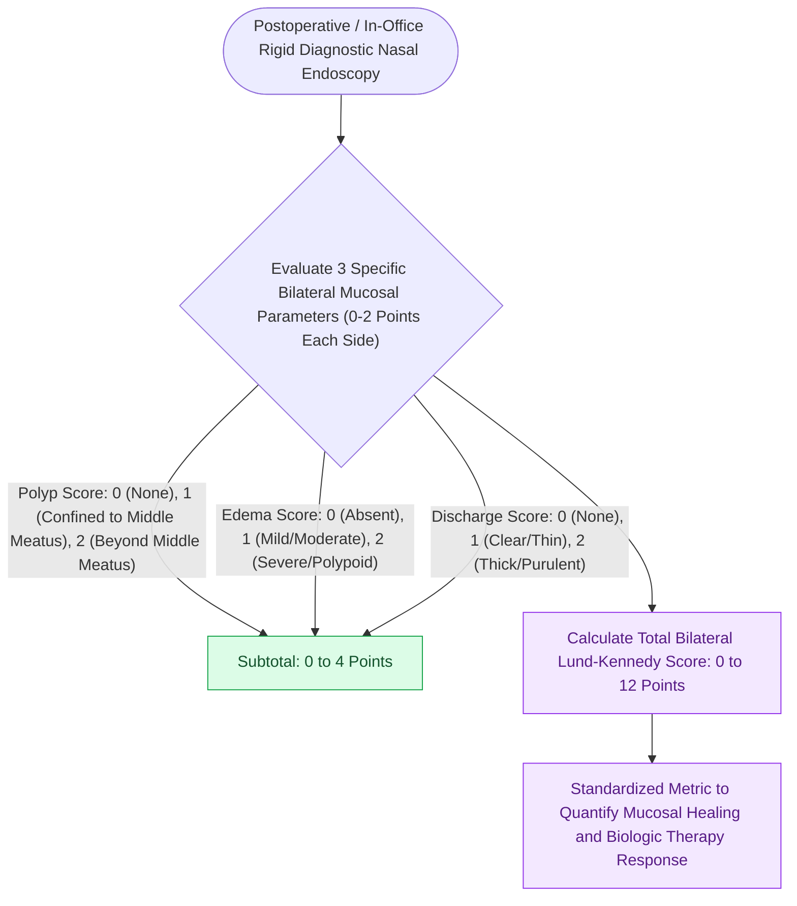

# The Lund-Kennedy endoscopic staging system tracks mucosal edema, polyps, and discharge

## Active Recall

> [!question]- What five parameters are evaluated in the classic Lund-Kennedy endoscopic scoring system?
> *Answer / Clinical Rationale*: **Polyps, discharge, edema, scarring/adhesions, and crusting** (each scored 0–2 per side).

> [!question]- What does a polyp score of 2 represent in the Lund-Kennedy system?
> *Answer / Clinical Rationale*: Polyps extending **beyond the middle meatus** into the main nasal cavity or obstructing the nasal fossa.

## Core Clinical & Mechanistic Principles
The **Lund-Kennedy (LK) [[Diagnostic rigid nasal endoscopy utilizes a standardized three-pass examination sequence|Endoscopic]] Staging System** provides a validated, objective quantification of sinonasal mucosal disease and surgical cavity healing during diagnostic nasal endoscopy.

### Postoperative Healing Tracking
- Used in clinical trials and routine follow-up to track response to topical steroids, biologics, and surgical debridement.
- A modified version (the **Modified Lund-Kennedy / MLK score**) focuses on polyps, edema, and discharge ($0\text{–}12$ scale).

## Connected Concepts & Graph Traversal
- **Radiological Staging Partner**: [[The Lund-Mackay CT scoring system quantifies sinonasal opacification and ostiomeatal occlusion|Lund-Mackay CT Scoring]]
- **Type 2 Biologic Response**: [[Biologic therapeutics in chronic rhinosinusitis target IgE, IL-4, IL-5, and IL-13 inflammatory pathways|Biologic Therapy Monitoring]]
- **Microdebrider Debridement**: [[Powered microdebrider blade selection and suction irrigation maintain clean surgical optics|Microdebrider Sinus Debridement]]
- **AERD Clinical Phenotype**: [[AERD manifests with asthma, nasal polyps, and severe aspirin-induced respiratory reactions|AERD Recalcitrant Disease]]
- **AFRS Mucin Staging**: [[Allergic fungal rhinosinusitis presents with eosinophilic mucin and Charcot-Leyden crystals|AFRS Staging]]
- **Antrochoanal Polyp Staging**: [[Antrochoanal polyps originate in the posterior maxillary sinus and extend through the accessory ostium into the choana requiring endoscopic surgical removal|Antrochoanal Polyps]]
