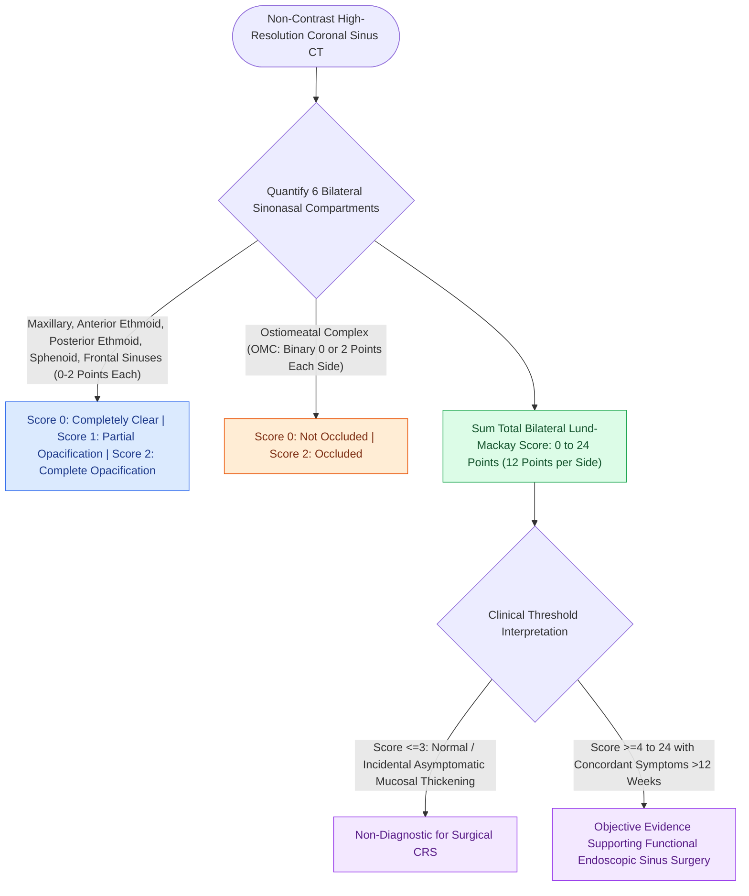

# The Lund-Mackay CT scoring system quantifies sinonasal opacification and ostiomeatal occlusion

## Active Recall

> [!question]- How is the ostiomeatal complex (OMC) specifically scored in the Lund-Mackay system?
> *Answer / Clinical Rationale*: The OMC is scored strictly as **0 (patent/not occluded) or 2 (occluded)**; there is no score of 1 for the OMC.

> [!question]- What is the maximum possible total score in the Lund-Mackay CT scoring system?
> *Answer / Clinical Rationale*: **24** (maximum of 12 points per side across 5 sinus pairs + 1 OMC pair).

## Core Clinical & Mechanistic Principles
Introduced in 1993, the **Lund-Mackay (LM) CT Scoring System** is the internationally recognized standard for radiologically staging the severity of chronic rhinosinusitis on non-contrast sinus CT.

### Clinical Correlation & Surgical Thresholds
- **Asymptomatic Baseline**: Healthy, asymptomatic individuals typically score **$\le 2\text{–}3$** total.
- **Surgical Cohorts**: Patients undergoing FESS for occlusion of the [[The hiatus semilunaris and infundibulum form the primary drainage channel of the ostiomeatal complex|ostiomeatal complex]] typically present with mean scores between **$9\text{ and }14$**.
- **Important Limitation**: LM scores correlate strongly with disease extent and eosinophilic tissue burden on [[The Lund-Kennedy endoscopic staging system tracks mucosal edema, polyps, and discharge|endoscopic staging]], but have **weak-to-moderate correlation with subjective patient-reported symptom scores (SNOT-22)**.

## Connected Concepts & Graph Traversal
- **Endoscopic Staging Partner**: [[The Lund-Kennedy endoscopic staging system tracks mucosal edema, polyps, and discharge|Lund-Kennedy Endoscopic Score]]
- **Ostiomeatal Complex Pathology**: [[The hiatus semilunaris and infundibulum form the primary drainage channel of the ostiomeatal complex|Ostiomeatal Complex]]
- **Radiological Safety Checklist**: [[The CLOSE checklist systematically evaluates critical radiological danger zones|CLOSE Danger Zone Checklist]]
- **Ethmoid Air Cell Anatomy**: [[The four parallel ethmoidal lamellae guide systematic anterior-to-posterior endoscopic orientation|Four Ethmoidal Lamellae]]
- **Frontal Recess Obstruction**: [[The Kuhn classification stages frontal recess and frontal sinus air cells|Kuhn Frontal Cells]]
