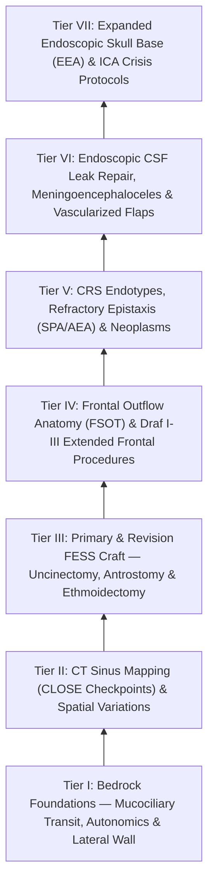

# The Rhinology and Skull Base Knowledge Graph provides a structured mastery curriculum

Welcome to the **Comprehensive Rhinology, Endoscopic Sinus & Anterior Skull Base Surgery Knowledge Graph**. This interconnected Obsidian wiki is structured as a **progressively load-bearing mastery framework** encompassing 104 granular knowledge nodes spanning mucociliary clearance, advanced 3D CT mapping, primary and revision FESS, frontal sinus Draf procedures, skull base reconstructive flaps, expanded endoscopic corridors (EEA), and internal carotid artery crisis management.

> [!NOTE] **Source Document**
> This graph was atomized from the [[Comprehensive Rhinology, Endoscopic Sinus & Anterior Skull Base Residency Mastery Curriculum & Self-Assessment Guide|original linear Sinus curriculum document]]. Refer to it for the complete linear syllabus and self-assessment checkpoints.

---

## 🗺️ Master Curriculum Navigation by Tier

### Tier I: Bedrock Foundations — Mucociliary Clearance, Autonomics, Olfaction & Lateral Nasal Wall
- **Epithelial Motility**: [[Respiratory epithelium drives mucociliary clearance toward natural ostia|Mucociliary clearance physiology]]
- **Pathological Recirculation**: [[Separate inferior antrostomies cause recirculating mucus and recalcitrant sinusitis|Mucus recirculation phenomenon]]
- **Uncinate Anatomy**: [[The uncinate process superior attachment dictates the frontal sinus drainage pathway|Uncinate process superior attachments]]
- **Ethmoid Bulla**: [[The ethmoid bulla serves as the principal anatomical anchor for anterior ethmoidectomy|Ethmoid bulla & sinus lateralis]]
- **Ground Lamella**: [[The basal lamella of the middle turbinate divides anterior from posterior ethmoid cells|Basal lamella of middle turbinate]]
- **Ostiomeatal Complex**: [[The hiatus semilunaris and infundibulum form the primary drainage channel of the ostiomeatal complex|Hiatus semilunaris & infundibulum]]
- **Autonomic Neuroanatomy**: [[The Vidian nerve carries parasympathetic secretomotor and sympathetic vasomotor fibers|Vidian nerve & autonomic control]]
- **Olfactory Neuroepithelium**: [[Olfactory neuroepithelium contains bipolar sensory neurons and basal stem cells|Olfactory neuroepithelium & basal stem cells]]
- **Nitric Oxide Host Defense**: [[Nitric oxide produced in the paranasal sinuses provides host defense and ciliary stimulation|Sinonasal nitric oxide & ciliary stimulation]]
- **Parasympathetic Relay**: [[The sphenopalatine ganglion serves as the primary parasympathetic relay for the sinonasal cavity|Sphenopalatine ganglion anatomy]]
- **Concha Bullosa**: [[Concha bullosa pneumatization of the middle turbinate can obstruct the ostiomeatal complex|Concha bullosa pneumatization]]
- **Paradoxical Turbinate**: [[Paradoxical middle turbinate curvature alters middle meatal airflow and surgical access|Paradoxical middle turbinate]]
- **Autonomic Nasal Cycle**: [[The nasal cycle provides alternating autonomic mucosal congestion and decongestion|The physiological nasal cycle]]
- **Epithelial Barrier**: [[Epithelial tight junctions and antimicrobial peptides form the primary sinonasal mucosal barrier|Epithelial tight junctions & AMPs]]
- **Orbital Complications**: [[Orbital complications of acute sinusitis staged by the Chandler classification dictate medical versus surgical drainage]]
- **Epistaxis Protocol**: [[Kiesselbach plexus anterior epistaxis is managed with cautery and anterior nasal packing]]
- **Chemosensory Testing**: [[UPSIT and CCCRC tests quantify olfactory thresholds and odor identification in chemosensory disorders|UPSIT & CCCRC Olfactory Evaluation]]
- **Gustatory Pathways**: [[Gustatory sensation is transmitted via the chorda tympani, greater superficial petrosal, glossopharyngeal, and superior laryngeal nerves|Gustatory Sensation & Central Pathways]]
- **Ethmoidal Lamellae**: [[The four parallel ethmoidal lamellae guide systematic anterior-to-posterior endoscopic orientation|Four Parallel Ethmoidal Lamellae]]
- **Diagnostic Endoscopy**: [[Diagnostic rigid nasal endoscopy utilizes a standardized three-pass examination sequence|Three-Pass Diagnostic Nasal Endoscopy]]
- **Olfaction**: [[Quantitative olfactory testing with the UPSIT differentiates conductive from sensorineural dysosmia and detects deliberate malingering through below-chance forced-choice scoring|Quantitative Olfactory Testing]]
- **Lacrimal**: [[Jones primary and secondary dye tests differentiate canalicular from nasolacrimal duct obstruction|Jones Dye Testing]]
- **Nasal Valve**: [[Acoustic rhinometry and rhinomanometry evaluate internal nasal valve geometry and dynamic airflow resistance through cross-sectional area and transnasal pressure measurements|Acoustic Rhinometry and Rhinomanometry]]

### Tier II: High-Resolution CT Sinus Mapping, Spatial Variations & The CLOSE Checkpoints
- **Master Checklist**: [[The CLOSE checklist systematically evaluates critical radiological danger zones|The CLOSE radiological checklist]]
- **C — Cribriform Depth**: [[The Keros classification stages olfactory fossa depth and lateral lamella vulnerability|Keros classification (Types I-III)]]
- **L — Lamina & Orbit**: [[Lamina papyracea dehiscence predisposes to orbital fat herniation and medial rectus injury|Lamina papyracea dehiscence & silent sinus]]
- **O — Onodi Cell**: [[Onodi cells place the optic nerve and carotid artery at risk during posterior ethmoidectomy|Onodi cell & optic nerve risk]]
- **S — Sphenoid & Carotid**: [[Sphenoid sinus pneumatization patterns dictate carotid and optic canal exposure|Sphenoid pneumatization & carotid dehiscence]]
- **E — Ethmoidal Arteries**: [[Supraorbital ethmoid cells suspend the anterior ethmoidal artery below the skull base|AEA hanging mesentery & SOEC]]
- **Frontal Recess Cells**: [[The Kuhn classification stages frontal recess and frontal sinus air cells|Kuhn classification (Types 1-4)]]
- **Anterior Boundary**: [[Agger nasi cells form the anterior boundary of the frontal recess|Agger nasi cells]]
- **Maxillary Narrowing**: [[Infraorbital Haller cells narrow the ethmoid infundibulum and maxillary ostium|Infraorbital Haller cells]]
- **Lund-Mackay CT Score**: [[The Lund-Mackay CT scoring system quantifies sinonasal opacification and ostiomeatal occlusion|Lund-Mackay CT scoring system]]
- **Lund-Kennedy Endoscopy**: [[The Lund-Kennedy endoscopic staging system tracks mucosal edema, polyps, and discharge|Lund-Kennedy endoscopic score]]
- **MRI Protocols**: [[MRI T1, T2, and contrast protocols differentiate sinonasal neoplasms from inspissated secretions|MRI tumor vs inspissated mucin]]
- **Silent Sinus Syndrome**: [[Silent sinus syndrome presents with spontaneous enophthalmos and maxillary sinus atelectasis|Silent sinus syndrome & atelectasis]]
- **IFAC Classification**: [[Frontoethmoidal cell classification by IFAC standardizes anterior and posterior frontal cells|IFAC frontal cell classification]]
- **Sternberg's Canal**: [[Sternberg's canal in the lateral sphenoid recess acts as a conduit for spontaneous CSF leaks|Sternberg's canal & lateral recess]]
- **Intersphenoid Septation**: [[Intersphenoid sinus septations frequently insert directly onto the internal carotid canal|Intersphenoid septum carotid risk]]
- **Opticocarotid Recess**: [[Opticocarotid recesses on coronal CT demarcate the paraclinoid ICA and optic strut|Opticocarotid recess (OCR) & optic strut]]
- **Revision Fess**: [[Revision endoscopic sinus surgery systematically corrects recurrent middle turbinate lateralization, retained uncinate fragments, and persistent frontal recess cells to restore ostial patency|Revision Endoscopic Sinus Surgery (Revision FESS)]]
- **Image Guided Surgery**: [[Stereotactic image-guided navigation combines electromagnetic or optical tracking with CT-MRI fusion to maintain spatial orientation in distorted revision sinus and skull base surgery|Stereotactic Image-Guided Surgery (IGS)]]
- **Pediatric Otolaryngology**: [[Pediatric endoscopic sinus surgery employs a stepwise escalation algorithm following adenoidectomy and preserves midfacial growth centers through conservative mucosal sparing dissection|Pediatric Functional Endoscopic Sinus Surgery (PESS)]]
- **Middle Turbinate**: [[Partial middle turbinectomy provides surgical access and prevents synechiae in selected polyposis or skull base cases while preserving superior attachments to protect olfaction and skull base stability|Middle Turbinectomy Indications]]

### Tier III: Primary Functional Endoscopic Sinus Surgery (FESS) Step-by-Step Execution
- **Hemostasis & TIVA**: [[TIVA and greater palatine canal blocks optimize surgical field visibility in FESS|TIVA & greater palatine blocks]]
- **Step 1 — Uncinectomy**: [[Incisive uncinectomy exposes the ethmoid infundibulum while protecting the nasolacrimal duct|Incisive uncinectomy & lacrimal safety]]
- **Step 2 — Maxillary Antrostomy**: [[Maxillary antrostomy requires incorporating accessory fontanelle ostia to prevent recirculation|Maxillary antrostomy & accessory ostia]]
- **Step 3 — Anterior Ethmoidectomy**: [[Entering the ethmoid bulla inferomedially avoids orbital and skull base penetration|Inferomedial bulla entry]]
- **Step 4 — Basal Lamella Fenestration**: [[Perforating the basal lamella inferomedially provides safe entry to posterior ethmoids|Basal lamella inferomedial fenestration]]
- **Step 5 — Posterior Ethmoidectomy**: [[Posterior ethmoidectomy requires dissecting along the skull base from posterior to anterior|Posterior-to-anterior skull base skeletonization]]
- **Step 6 — Sphenoidotomy**: [[The sphenoid sinus ostium lies medial to the superior turbinate above the choana|Sphenoidotomy & superior turbinate landmark]]
- **Emergency Orbital Rescue**: [[Retrobulbar hematoma requires emergent bedside lateral canthotomy and cantholysis|Retrobulbar hematoma & lateral canthotomy]]
- **Image-Guided Surgery**: [[Image-guided surgery registration and real-time tracking enhance navigation in distorted anatomy|Image-guided surgery (IGS)]]
- **Microdebrider Craft**: [[Powered microdebrider blade selection and suction irrigation maintain clean surgical optics|Powered microdebrider safety]]
- **Hemostatic Packing**: [[Topical hemostatic matrix agents and nasal packing mitigate postoperative epistaxis and synechiae|Hemostatic matrices & packing]]
- **Turbinate Lateralization**: [[Middle turbinate lateralization causes secondary ostiomeatal obstruction and frontal sinus stenosis|Middle turbinate lateralization]]
- **Controlled Antrostomy**: [[Controlled middle meatal antrostomy enlargement preserves the anterior inferior fontanelle|Controlled maxillary antrostomy]]
- **Transseptal Sphenoidotomy**: [[Transseptal sphenoidotomy provides wide bilateral midline access to the sphenoid rostrum|Transseptal binasal sphenoidotomy]]
- **Steroid Implants**: [[Steroid-eluting sinus implants deliver localized anti-inflammatory therapy to prevent restenosis|Steroid-eluting sinus implants]]
- **Post-Op Debridement**: [[Postoperative FESS debridement timing and technique prevent crusting and synechiae formation|Postoperative FESS debridement]]
- **Fess**: [[Complete uncinectomy and posterior fontanelle resection unify the natural maxillary ostium with fontanelle defects to prevent mucus recirculation loops|Complete Uncinectomy Protocol]]
- **Endoscopic Sinus Surgery**: [[Revision endoscopic sphenoethmoidectomy clears recalcitrant osteitic partitions via posterior-to-anterior skull base skeletonization and medial orbital wall navigation|Revision Completion Sphenoethmoidectomy]]
- **Orbital Surgery**: [[Balanced endoscopic orbital decompression removes the lamina papyracea and medial floor while sparing the inferomedial strut to prevent diplopia|Endoscopic Orbital Decompression]]
- **Maxillary Sinus**: [[Modified medial maxillectomy provides wide maxillary access while preserving the nasolacrimal duct and inferior turbinate head with a nasal floor mucosal flap|Modified Medial Maxillectomy]]
- **Nasal Polyp**: [[Antrochoanal polyps originate in the posterior maxillary sinus and extend through the accessory ostium into the choana requiring endoscopic surgical removal|Antrochoanal Polyp]]
- **Orbital Surgery**: [[Endoscopic dacryocystorhinostomy achieves lacrimal sac marsupialization via axillary osteotomy and bivalve mucosal flaps apposed to the agger nasi|Endoscopic DCR]]
- **Fess**: [[Endoscopic dacryocystorhinostomy bypasses nasolacrimal duct obstruction via lacrimal sac marsupialization into the middle meatus|Endoscopic DCR]]
- **Sphenoid Sinus**: [[Extended sphenoid antrostomy and drill-out resects the rostrum and intersinus septum with mini-nasoseptal flap lining to prevent osteitic restenosis|Extended Sphenoid Antrostomy]]
- **Fess**: [[Postoperative endoscopic sinus debridement requires staged removal of crusts and fibrin while strictly protecting the sphenopalatine foramen and skull base during mucosal recovery|Postoperative ESS Debridement Protocol]]
- **Fess**: [[Sphenoidotomy utilizes superior turbinate resection or the Bolger box parallelogram to identify the natural ostium while preventing Onodi cell injury|Bolger Box Sphenoidotomy]]
- **Fess**: [[Balloon catheter sinus dilatation widens paranasal ostia via high-pressure microfracture remodeling while requiring transillumination or image guidance to prevent false passage|Balloon Sinus Ostial Dilatation (BSOD)]]

### Tier IV: Frontal Sinus Outflow Tract (FSOT) Anatomy & Draf I–III Procedures
- **3D Boundaries**: [[The frontal recess is bounded by the agger nasi, middle turbinate, and skull base|Frontal recess 3D boundaries]]
- **Draf I**: [[Draf I frontal sinusotomy clears obstructing ethmoid cells without instrumenting the ostium|Draf I simple drainage]]
- **Draf IIa**: [[Draf IIa frontal sinusotomy resects the sinus floor between middle turbinate and lamina|Draf IIa extended unilateral sinusotomy]]
- **Draf IIb**: [[Draf IIb frontal sinusotomy extends from lamina papyracea to the nasal septum|Draf IIb total unilateral sinusotomy]]
- **Draf III**: [[Draf III modified Lothrop unites both frontal sinuses into a common cavity|Draf III modified Lothrop procedure]]
- **Restenosis Prevention**: [[Nasal beak drill-out and mucosal grafting prevent neo-ostium restenosis in Draf III|Nasal beak drill-out & mucosal grafting]]
- **Posterior Limit**: [[First olfactory filum marks the posterior limit of frontal drill-out to avoid CSF leak|First olfactory filum safety landmark]]
- **Frontal Mucoceles**: [[Frontal sinus mucoceles cause bony erosion, proptosis, and intracranial extension|Frontal sinus mucoceles & marsupialization]]
- **Osteoplastic Flap**: [[Osteoplastic flap with frontal sinus obliteration manages lateral frontal disease and osteomyelitis|Osteoplastic flap with obliteration]]
- **Fat Obliteration Craft**: [[Abdominal fat obliteration of the frontal sinus requires meticulous complete mucosal de-epithelialization|Abdominal fat obliteration]]
- **Frontal Trephination**: [[Frontal sinus trephination provides combined endoscopic and percutaneous visualization and irrigation|Frontal sinus trephination]]
- **Drilling Mechanics**: [[Curved diamond and cutting burrs with continuous irrigation prevent frontal beak thermal osteonecrosis|Curved high-speed drill mechanics]]
- **Pott's Puffy Tumor**: [[Pott's puffy tumor represents subperiosteal abscess and frontal bone osteomyelitis from sinusitis|Pott's puffy tumor & osteomyelitis]]
- **Frontal Osteomas**: [[Frontal sinus osteomas require endoscopic Draf or open osteoplastic resection when obstructing outflow|Frontal sinus osteomas & Gardner syndrome]]
- **Fess**: [[The frontal sinus rescue procedure utilizes a medially based middle turbinate mucosal flap to resurface denuded bone and prevent Draf IIb ostial restenosis|Frontal Sinus Rescue Procedure]]
- **Frontal Sinus**: [[Osteoplastic flap elevation utilizes a six-foot Caldwell radiographic template and beveled osteotomies for complete frontal sinus fat obliteration|Osteoplastic Flap with 6-Foot Caldwell Radiographic Template and Fat Obliteration]]
- **Frontal Sinus**: [[Frontal sinus mini-trephination provides above-and-below endoscopic visualization and catheter irrigation for refractory frontal disease|Frontal Sinus Mini-Trephination]]
- **Fess**: [[Draf IIb versus Draf III modified Lothrop procedures differentiate unilateral middle turbinate resection from bilateral interfrontal septectomy and sinus floor drill-out|Draf IIb vs Draf III Comparison]]
- **Frontal Sinus**: [[The Chiu classification stages frontal sinus osteomas to dictate endoscopic endonasal resection versus open osteoplastic flap approaches based on tumor dimensions and attachment|Frontal Sinus Osteoma Staging]]
- **Fess**: [[The outside-in Draf III modified endoscopic Lothrop procedure establishes anterior septal and olfactory boundaries before drilling the nasofrontal beak|Outside-In Modified Endoscopic Lothrop (MELP)]]
- **Fess**: [[Frontal recess cell dissection requires systematic uncapping of agger nasi and Kuhn cells along mucosal transition zones to preserve drainage patency|Frontal Recess Transition Zone Dissection]]

### Tier V: CRS Endotypes, Biologics, Epistaxis & Benign/Malignant Neoplasms
- **Type 2 Inflammation & Biologics**: [[Type 2 CRS exhibits eosinophilic inflammation responsive to targeted biologics|Type 2 CRS endotype & biologics]]
- **Allergy Testing & Titration**: [[Intradermal dilutional testing IDT and modified quantitative testing MQT quantify allergic sensitization to guide safe immunotherapy escalation|IDT and MQT Allergy Testing & Immunotherapy]]
- **AERD / Samter's Triad**: [[AERD manifests with asthma, nasal polyps, and severe aspirin-induced respiratory reactions|AERD pathophysiology & desensitization]]
- **AFRS / Bent-Kuhn**: [[Allergic fungal rhinosinusitis presents with eosinophilic mucin and Charcot-Leyden crystals|Allergic fungal rhinosinusitis (AFRS)]]
- **Non-Type 2 CRS**: [[Non-Type 2 CRS features neutrophilic inflammation associated with cystic fibrosis and ciliopathies|Non-Type 2 CRS & cystic fibrosis]]
- **Endoscopic SPA Ligation**: [[The crista ethmoidalis guides endoscopic sphenopalatine artery ligation|SPA ligation & crista ethmoidalis]]
- **Ethmoidal Artery Localization**: [[The 24-12-6 rule governs anterior and posterior ethmoidal artery surgical localization|The 24-12-6 rule for AEA/PEA]]
- **Inverting Papilloma**: [[Sinonasal inverting papilloma requires subperiosteal excision and hyperostotic bone drill-out|Inverting papilloma & bone drill-out]]
- **Granulomatosis with Polyangiitis**: [[Granulomatosis with polyangiitis presents with necrotizing sinonasal granulomas and saddle nose|GPA (Wegener's) & c-ANCA]]
- **Sinonasal Sarcoidosis**: [[Sarcoidosis of the upper respiratory tract causes non-caseating granulomas and mucosal cobblestoning|Sinonasal sarcoidosis & cobblestoning]]
- **Acute Invasive Fungi**: [[Acute invasive fungal rhinosinusitis requires emergent surgical debridement and systemic amphotericin B|Acute invasive fungal rhinosinusitis (AIFRS)]]
- **Sinonasal Fungal Ball**: [[Chronic non-invasive fungal ball presents with dense maxillary mycetoma without tissue invasion|Sinonasal fungal ball]]
- **Odontogenic Sinusitis**: [[Odontogenic sinusitis arises from periapical maxillary dental pathology and oroantral fistulas|Odontogenic sinusitis & OAF]]
- **HHT / Osler-Weber-Rendu**: [[Hereditary hemorrhagic telangiectasia manifests with mucosal AVMs and recurrent epistaxis|Hereditary hemorrhagic telangiectasia (HHT)]]
- **Vidian Neurectomy**: [[Transnasal endoscopic vidian neurectomy treats refractory non-allergic cholinergic rhinitis|Transnasal Vidian neurectomy]]
- **Juvenile Angiofibroma**: [[Sinonasal juvenile angiofibroma staging by Radkowski and Fisch guides surgical approach|Juvenile nasopharyngeal angiofibroma (JNA)]]
- **Papilloma Subtypes**: [[Sinonasal exophytic and oncocytic papillomas differ from inverting papilloma in malignant potential|Exophytic & oncocytic papillomas]]
- **Small Round Blue Cell Tumors**: [[Sinonasal small round blue cell tumors are differentiated by immunohistochemistry into SNUC, olfactory neuroblastoma, melanoma, lymphoma, and rhabdomyosarcoma|Sinonasal SRBCT IHC Diagnostic Panel]]
- **Sinonasal Teratocarcinosarcoma**: [[Sinonasal teratocarcinosarcoma is a highly aggressive malignant mixed tumor containing teratomatous, carcinomatous, and sarcomatous elements|Sinonasal Teratocarcinosarcoma (SNTS)]]
- **Maxillary Staging**: [[Ohngren line divides the maxillary sinus into anteroinferior and posterosuperior prognostic compartments|Ohngren's Line & Maxillary Prognosis]]
- **Allergy**: [[Allergen immunotherapy via subcutaneous injections or sublingual dosing induces regulatory T cells and allergen-specific IgG4 blocking antibodies to restore immune tolerance|Allergen Immunotherapy Mechanisms]]
- **Endoscopic Aea Ligation**: [[Endoscopic endonasal anterior ethmoidal artery ligation requires skull base skeletonization to prevent orbital fat prolapse and vessel retraction|Endoscopic AEA Ligation]]
- **Concha Bullosa**: [[Concha bullosa resection requires lateral lamella excision to preserve medial cribriform attachment and middle turbinate stability|Concha Bullosa Resection]]
- **Immunology**: [[Complement activation cascades, MHC antigen presentation, and leukocyte adhesion molecules orchestrate mucosal innate and adaptive immunity|Complement Cascades]]
- **Epistaxis**: [[Endoscopic sphenopalatine artery ligation requires crista ethmoidalis resection and systematic multi-branch control to prevent recurrent epistaxis|Endoscopic SPA Multi-Branch Ligation]]
- **Septoplasty**: [[Caudal septoplasty corrects caudal subluxation and external valve collapse through swinging-door relocation and L-strut preservation|Caudal Septoplasty Mechanics]]
- **Rhinitis**: [[Nonallergic rhinitis with eosinophilia syndrome NARES features nasal eosinophilia without IgE sensitization and represents a precursor to Samter triad|NARES Nonallergic Rhinitis with Eosinophilia]]
- **Middle Turbinate**: [[Middle turbinate suture medialization prevents lateralization and iatrogenic frontal sinus ostial obstruction following ethmoidectomy|Middle Turbinate Suture Medialization]]
- **Immunology**: [[The Gell and Coombs classification delineates four distinct immunologic hypersensitivity mechanisms underlying otolaryngic disease|Gell and Coombs Classification]]
- **Endoscopic Septoplasty**: [[Endoscopic septoplasty enables targeted spur resection and improves middle meatal access while minimizing mucosal dissection|Endoscopic Septoplasty]]
- **Allergy**: [[Allergen immunotherapy induces regulatory T cells and IgG4 blocking antibodies to modulate allergic rhinitis and prevent asthma progression|Allergen Immunotherapy]]
- **External Aea Ligation**: [[Transcaruncular and Lynch external approaches provide direct access to the frontoethmoidal suture line for anterior ethmoidal artery ligation in refractory epistaxis|External AEA Ligation]]
- **Endoscopic Medial Maxillectomy**: [[Endoscopic medial maxillectomy resects the lateral nasal wall flush with the nasal floor while preserving a mucosal flap to cover denuded bone|Endoscopic Medial Maxillectomy (EMM)]]
- **Choanal Atresia**: [[The endoscopic cross-over flap technique reconstructs congenital choanal atresia by covering denuded bone without circumferential stenting|Stamm Cross-Over Flap Technique]]
- **Inferior Turbinate**: [[Inferior turbinate submucosal resection with outfracture provides durable volume reduction while preserving ciliated mucosal function|Inferior Turbinate Submucosal Resection]]

### Tier VI: Endoscopic CSF Leak Repair, Meningoencephaloceles & Vascularized Flaps
- **Diagnostics**: [[Beta-2 transferrin and high-resolution CT localize sinonasal CSF fistulas|Beta-2 transferrin & high-res CT]]
- **Bed Preparation**: [[CSF leak defect preparation requires circumferential bone de-mucosalization|De-mucosalization of defect bed]]
- **Reconstruction Hierarchy**: [[Multi-layer skull base reconstruction combines underlay, inlay, and overlay barriers|Multi-layer skull base reconstruction]]
- **Nasoseptal Flap (NSF)**: [[The Hadad-Bassagasteguy nasoseptal flap is pedicled on the posterior septal artery|Hadad-Bassagasteguy nasoseptal flap]]
- **Olfactory Preservation**: [[Preserving the superior septal mucosal strip prevents post-NSF anosmia|Preserving olfactory strip]]
- **Intraoperative Dye**: [[Intrathecal fluorescein enables visual localization of occult dural defects|Intrathecal fluorescein protocol]]
- **Spontaneous Leaks & IIH**: [[Spontaneous CSF leaks are strongly associated with idiopathic intracranial hypertension and elevated BMI|Spontaneous CSF leaks & IIH]]
- **Lumbar Drainage**: [[Lumbar drain placement and ICP management lower the risk of postoperative CSF fistula recurrence|Lumbar drain & ICP management]]
- **Middle Turbinate Flap**: [[The middle turbinate vascularized flap provides an alternative rescue flap for skull base repair|Middle turbinate vascularized flap]]
- **Inferior Turbinate Flap**: [[The inferior turbinate flap pedicled on the inferior turbinate artery repairs anterior floor defects|Inferior turbinate flap]]
- **Pericranial Flap**: [[The endoscopic pericranial flap transposed through the nasion repairs large anterior skull base defects|Endoscopic pericranial flap]]
- **TPFF Skull Base Flap**: [[Temporoparietal fascia free and pedicled flaps provide vascularized tissue when nasoseptal flaps fail|Temporoparietal fascia flap (TPFF)]]
- **Iatrogenic Leak Repair**: [[Iatrogenic skull base cribriform leaks require immediate intraoperative multi-layer graft repair|Iatrogenic skull base repair]]
- **Csf Leak Repair**: [[Multi-layer underlay and overlay CSF leak closure employs a bath-plug technique with autologous fat and fascia lata to resist intracranial pressure pulsations|Bath-Plug CSF Leak Repair]]
- **Csf Rhinorrhea**: [[Endoscopic repair of cerebrospinal fluid rhinorrhea employs systematic biochemical confirmation, intrathecal fluorescein localization, and multilayer underlay dural reconstruction to achieve primary closure|Endoscopic CSF Rhinorrhea Repair]]
- **Skull Base Reconstruction**: [[Vascularized nasoseptal and regional pedicled flaps provide robust skull base reconstruction for high-flow CSF leaks and large dural defects|Hadad-Bassagasteguy Nasoseptal Flap Reconstruction]]

### Tier VII: Expanded Endoscopic Skull Base Surgery (EEA) & ICA Crisis Management
- **Opticocarotid Recesses**: [[The lateral and medial opticocarotid recesses define critical anatomical corridors in endoscopic skull base surgery|Lateral & Medial OCR Corridors]]
- **Transcribriform Corridor**: [[Transcribriform EEA provides access to olfactory groove meningiomas and esthesioneuroblastomas|Transcribriform EEA]]
- **Transplanum Corridor**: [[Transplanum and transtuberculum EEA corridors expose suprasellar craniopharyngiomas|Transplanum & transtuberculum EEA]]
- **Transsellar Corridor**: [[Transsellar EEA provides direct access to pituitary adenomas and Rathke cleft cysts|Transsellar EEA]]
- **Transpterygoid Corridor**: [[Transpterygoid EEA exposes juvenile nasopharyngeal angiofibromas and lateral sphenoid defects|Transpterygoid EEA & JNA]]
- **Transclival Corridor**: [[Transclival EEA provides midline access to clival chordomas and chondrosarcomas|Transclival EEA & chordomas]]
- **Internal Carotid Artery Crisis**: [[Intraoperative ICA injury requires two-surgeon suction and crushed muscle patch hemostasis|ICA crisis protocol & crushed muscle patch]]
- **Master Complication Matrix**: [[High-stakes sinonasal complications require proactive landmarking and emergency rescue protocols|High-stakes sinonasal complications matrix]]
- **Transodontoid Corridor**: [[Transodontoid EEA provides direct anterior access for basilar invagination and pannus decompression|Transodontoid EEA]]
- **Transorbital Approach**: [[Endoscopic transorbital approaches provide multi-portal access to the lateral skull base and orbit|Endoscopic transorbital approach (ETOA)]]
- **Pituitary Apoplexy**: [[Pituitary apoplexy causes acute chiasmatic compression and life-threatening panhypopituitarism|Pituitary apoplexy emergency]]
- **DI & SIADH Management**: [[Postoperative diabetes insipidus and SIADH require strict fluid balance and desmopressin titration|Postoperative DI & SIADH]]
- **Esthesioneuroblastoma**: [[Esthesioneuroblastoma Kadish and Hyams staging determines craniofacial resection and adjuvant therapy|Esthesioneuroblastoma staging]]
- **SNUC Oncology**: [[Sinonasal undifferentiated carcinoma exhibits aggressive neuroendocrine features requiring multimodal therapy|Sinonasal undifferentiated carcinoma (SNUC)]]
- **Endovascular ICA Salvage**: [[Endovascular parent vessel balloon occlusion and covered stenting manage pseudoaneurysms after ICA injury|Endovascular pseudoaneurysm management]]
- **Skull Base**: [[Pterygopalatine fossa dissection requires internal maxillary artery ligation and posterior antral wall resection to access the lateral sphenoid recess|Pterygopalatine Fossa Dissection]]
- **Skull Base**: [[Endoscopic optic nerve decompression achieves 180-degree intracanalicular bony release with superomedial sheath incision to avoid ophthalmic artery injury|Endoscopic Optic Nerve Decompression]]
- **Skull Base Surgery**: [[Transclival endoscopic corridors expose posterior fossa neoplasms between the paraclival carotids and basilar artery boundaries|Transclival Corridor Basilar Artery Boundaries]]
- **Skull Base**: [[Vidian canal identification at the junction of the sphenoid floor and pterygoid base differentiates the Vidian nerve from the inferomedial palatovaginal canal|Vidian Canal Surgical Identification]]
- **Skull Base**: [[Endoscopic craniofacial olfactory cleft resection achieves clear margins for anterior skull base malignancies while avoiding open craniotomy morbidity|Endoscopic Craniofacial Resection (CFR)]]
- **Sternbergs Canal**: [[Endoscopic transpterygoid repair of lateral sphenoid recess encephaloceles accesses Sternberg's canal by drilling the pterygoid base lateral to the vidian nerve|Sternberg's Canal Lateral Sphenoid Recess Encephaloceles]]
- **Orbital Surgery**: [[Endoscopic medial intraconal orbital tumor resection utilizes binarial four-handed dissection and dynamic medial rectus retraction below the plane of resectability|Endoscopic Orbital Tumor Resection]]
- **Skull Base Surgery**: [[Endoscopic transplanum and transtuberculum approaches expose suprasellar lesions by decompressing the optic chiasm and preserving the superior hypophyseal arteries|Transplanum and Transtuberculum EEA]]
- **Skull Base**: [[Endoscopic Denker approach removes the piriform aperture and ascending maxillary process to expose the anterior antral wall and infratemporal fossa|Endoscopic Denker Approach]]
