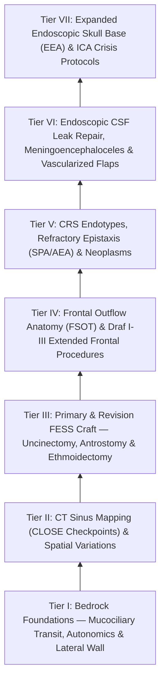

# The Rhinology and Skull Base Knowledge Graph provides a structured mastery curriculum

Welcome to the **Comprehensive Rhinology, Endoscopic Sinus & Anterior Skull Base Surgery Knowledge Graph**. This interconnected Obsidian wiki is structured as a **progressively load-bearing mastery framework** encompassing 104 granular knowledge nodes spanning mucociliary clearance, advanced 3D CT mapping, primary and revision FESS, frontal sinus Draf procedures, skull base reconstructive flaps, expanded endoscopic corridors (EEA), and internal carotid artery crisis management.

> [!NOTE] **Subspecialty Knowledge Cards Census & Curriculum Architecture**
> | Metric | Value | Details |
> | :--- | :--- | :--- |
> | **Atomic Cards (Notes)** | **175** | Granular single-concept clinical and surgical factoids |
> | **Source Coverage** | **175 / 175 (100%)** | Full attribution to authoritative surgical textbooks |
> | **Active Recall Questions** | **380 total (2.2/card)** | Integrated retrieval prompts with mechanistic rationales |
> | **Illustrated Cards** | **52 notes (82 figs)** | High-yield operative line drawings and anatomical diagrams |
> | **Personal Notes Guard** | **100% verified** | Cryptographically guarded resident notes region |
> | **Active Wiki-Links** | **1,392 links** | Bidirectional knowledge graph traversal web |
> | **Mastery Pyramid** | **7 Progressive Tiers** | From Bedrock Foundations to High-Stakes Complication Rescue |



---

## Tier I: Bedrock Foundations — Mucociliary Clearance, Autonomics & Lateral Nasal Wall Anatomy

### 📖 Tier I Clinical Foundations & Craft Nuances

### **1. Mucociliary Transit Pathways & Messerklinger Principles**

> * **[[Respiratory epithelium drives mucociliary clearance toward natural ostia|The Mucociliary Clearance Engine]]:** Pseudostratified [[Respiratory epithelium drives mucociliary clearance toward natural ostia|ciliated columnar epithelium]] with goblet cells and submucosal seromucinous glands. Cilia beat metachronously at 10–15 Hz, driving the overlying mucous blanket (gel layer) atop the periciliary fluid (sol layer) toward the natural ostia regardless of gravity or surgical fenestrations.  
> * **Specific Clearance Transit Trajectories:**  
>   * *Maxillary Sinus:* Originates in the sinus floor, sweeps in a star-shaped/spiral pattern along the anterior, medial, and posterior walls, and exits *exclusively* through the primary natural ostium in the superior-medial aspect of the [[The hiatus semilunaris and infundibulum form the primary drainage channel of the ostiomeatal complex|ethmoid infundibulum]]. If a separate surgical antrostomy is placed in the inferior meatus without connecting to the natural ostium, the **[[Separate inferior antrostomies cause recirculating mucus and recalcitrant sinusitis|mucus recirculation phenomenon]]** occurs, where secretions exit the natural ostium, re-enter the [[Separate inferior antrostomies cause recirculating mucus and recalcitrant sinusitis|inferior antrostomy]], and cause chronic recalcitrant infection.  
>   * *Frontal Sinus:* Ascends along the interfrontal septum, loops along the roof and lateral wall, and descends along the medial wall through the [[The frontal recess is bounded by the agger nasi, middle turbinate, and skull base|frontal sinus outflow tract (FSOT)]].  
>   * *Ethmoid & Sphenoid:* Drainage flows posteriorly across the sphenoethmoidal recess into the nasopharynx.

### **2. Lateral Nasal Wall 3D Architecture**

| Anatomical Landmark | Three-Dimensional Attachments & Boundaries | Spatial Significance in Endoscopic Navigation |
| :---- | :---- | :---- |
| **Uncinate Process** | Sickle-shaped bone. Anteriorly attached to posterior edge of lacrimal bone; inferiorly attached to inferior turbinate. Superior attachment is variable (Lamina Papyracea [80%], Skull Base [15%], or Middle Turbinate [5%]). | The primary "gateway" structure in FESS. Removal (uncinectomy) exposes the ethmoid infundibulum and the natural maxillary sinus ostium. |
| **Ethmoid Bulla** | Most constant and largest anterior ethmoid air cell. Lies posterior to uncinate, lateral to middle turbinate, and anterior to basal lamella. | Anterior landmark for anterior ethmoidectomy. Suprabullar and retrobullar recesses (sinus lateralis) wrap around it. |
| **Basal (Ground) Lamella of Middle Turbinate** | Divides into 3 planes: (1) Anterior 1/3 vertical (attaches to cribriform), (2) Middle 1/3 frontal (attaches to lamina papyracea), (3) Posterior 1/3 horizontal (attaches to lateral wall near SPA). | The definitive anatomical boundary separating the anterior ethmoids (drain to middle meatus) from posterior ethmoids (drain to superior meatus). |
| **Hiatus Semilunaris & Infundibulum** | *Hiatus semilunaris inferior:* 2D gap between posterior free margin of uncinate and anterior face of bulla. *Infundibulum:* 3D trough deep to uncinate. | Passageway where maxillary sinus and anterior ethmoid secretions transit toward the middle meatus. |

**Key Lateral Wall Links**: [[The uncinate process superior attachment dictates the frontal sinus drainage pathway|Uncinate Process Attachments]] · [[The ethmoid bulla serves as the principal anatomical anchor for anterior ethmoidectomy|Ethmoid Bulla & Sinus Lateralis]] · [[The basal lamella of the middle turbinate divides anterior from posterior ethmoid cells|Basal Lamella Tri-Planar Architecture]] · [[The hiatus semilunaris and infundibulum form the primary drainage channel of the ostiomeatal complex|Hiatus Semilunaris & Ethmoid Infundibulum]]

### **3. Autonomic Innervation & Sinonasal Vasomotor Control**

> * **[[The Vidian nerve carries parasympathetic secretomotor and sympathetic vasomotor fibers|The Vidian Nerve (Nerve of the Pterygoid Canal)]]:** Formed by the union of:  
>   1. *Greater Petrosal Nerve (Parasympathetic):* Preganglionic fibers from superior salivatory nucleus (CN VII) via geniculate ganglion  $\r\r\rightarrow$ synapse in Pterygopalatine Ganglion (PPG)  $\r\r\rightarrow$ postganglionic secretomotor fibers induce profuse watery rhinorrhea and mucosal vasodilation.  
>   2. *Deep Petrosal Nerve (Sympathetic):* Postganglionic fibers from superior cervical ganglion traveling around internal carotid artery  $\r\r\rightarrow$ pass through PPG without synapsing  $\r\r\rightarrow$ induce vasoconstriction and decongestion.  
> * **[[Transnasal endoscopic vidian neurectomy treats refractory non-allergic cholinergic rhinitis|Vidian Neurectomy]]:** Performed via transantral or transnasal endoscopic approach (drilling floor of sphenoid sinus lateral to vomer attachment) for intractable non-allergic [[Transnasal endoscopic vidian neurectomy treats refractory non-allergic cholinergic rhinitis|vasomotor rhinitis]].

### 🎯 Tier I Self-Assessment Checkpoint

> [!NOTE] **Self-Assessment Checkpoint: Tier I Foundations**
> 1. **Why does creating an isolated inferior meatal antrostomy fail to resolve chronic maxillary sinusitis?**  
>    - *Answer / Clinical Rationale*: Ciliary motility in the maxillary sinus is genetically hardwired to transport secretions toward the primary natural ostium in the ethmoid infundibulum. An un-integrated [[Separate inferior antrostomies cause recirculating mucus and recalcitrant sinusitis|inferior antrostomy]] does not intercept the mucociliary transit pathway, leading to the [[Separate inferior antrostomies cause recirculating mucus and recalcitrant sinusitis|mucus recirculation phenomenon]], persistent stasis, and ongoing bacterial bioburden.  
> 2. **How does the superior attachment of the uncinate process determine the drainage pathway of the frontal sinus?**  
>    - *Answer / Clinical Rationale*: If the uncinate attaches laterally to the [[Lamina papyracea dehiscence predisposes to orbital fat herniation and medial rectus injury|lamina papyracea]] ($\sim 80\%$), the infundibulum ends in a blind recessus terminalis, and the frontal sinus drains *medial* to the uncinate into the middle meatus. If the uncinate attaches superiorly to the skull base or middle turbinate, the frontal sinus drains *directly into* the ethmoid infundibulum (see [[The uncinate process superior attachment dictates the frontal sinus drainage pathway|Uncinate Superior Attachments]]).

---

## Tier II: High-Resolution CT Sinus Mapping, Spatial Variations & The CLOSE Checkpoints

### 📖 Tier II Clinical Foundations & Craft Nuances

### **1. The Systematic CLOSE Radiological Checklist**

Prior to any endoscopic instrumentation, every CT scan must be systematically evaluated using the **[[The CLOSE checklist systematically evaluates critical radiological danger zones|CLOSE Checklist]]** to prevent catastrophic skull base penetration, blindness, or fatal hemorrhage:

| CLOSE Checkpoint | Anatomical Staging & Classification | Intraoperative Hazard & Surgical Rule |
| :---- | :---- | :---- |
| **C: Cribriform Plate / Lateral Lamella** | **Keros Classification (Depth of Olfactory Fossa):** • Type I: $1\text{–}3\text{ mm}$ depth (flat skull base). • Type II: $4\text{–}7\text{ mm}$ depth (moderate). • Type III: $8\text{–}16\text{ mm}$ depth (high, paper-thin lateral lamella). | Keros Type III has an elongated, paper-thin lateral lamella of the cribriform plate. It is the most vulnerable site for intracranial entry and CSF leak during posterior ethmoid dissection. Always note side-to-side roof height asymmetry. |
| **L: Lamina Papyracea** | Assess for: (1) Congenital/traumatic dehiscence, (2) Medial displacement/atelectasis (silent sinus syndrome), (3) Haller cells (infraorbital ethmoid cells). | Dissecting lateral to a dehiscent lamina papyracea causes orbital fat herniation, medial rectus transection, and retrobulbar hematoma. *Fat floats in water; tissue does not.* |
| **O: Onodi Cell (Sphenoethmoidal)** | Most posterior ethmoid air cell pneumatizing superior and lateral to the sphenoid sinus. | The **optic nerve** and **internal carotid artery** course along the lateral wall of an Onodi cell, frequently dehiscent. Mistaking an Onodi cell for the sphenoid sinus leads to direct optic nerve transection. |
| **S: Sphenoid Sinus Pneumatization** | Pneumatization patterns: (1) Conchal (absent), (2) Presellar (anterior to sella), (3) Sellar (extends below/behind sella turcica). Lateral pterygoid recess expansion. | Carotid canal dehiscence (up to 25% of cases), Vidian canal protruding into the sinus floor, optic nerve canal dehiscence, and presence of intersphenoid septations inserting directly onto the carotid canal. |
| **E: Ethmoidal Arteries (AEA & PEA)** | Anterior Ethmoidal Artery (AEA) position relative to skull base. Assessed on coronal CT at the notch in the medial orbital wall (anterior ethmoidal foramen). | If supraorbital ethmoid cells are present, the AEA hangs on a bony mesentery $2\text{–}5\text{ mm}$ below the skull base. Transection causes arterial retraction into the orbit and rapid compressive retrobulbar hematoma. |

**Key CT Danger Zone Links**: [[The Keros classification stages olfactory fossa depth and lateral lamella vulnerability|Keros Classification]] · [[Lamina papyracea dehiscence predisposes to orbital fat herniation and medial rectus injury|Lamina Papyracea & Silent Sinus]] · [[Onodi cells place the optic nerve and carotid artery at risk during posterior ethmoidectomy|Onodi Cell Danger]] · [[Sphenoid sinus pneumatization patterns dictate carotid and optic canal exposure|Sphenoid Pneumatization & Carotid Dehiscence]] · [[Supraorbital ethmoid cells suspend the anterior ethmoidal artery below the skull base|AEA Mesentery & SOEC]] · [[Infraorbital Haller cells narrow the ethmoid infundibulum and maxillary ostium|Haller Cells]]

### **2. Frontal Recess Air Cell Classification (Kuhn / IFAC)**

> * **[[Agger nasi cells form the anterior boundary of the frontal recess|Agger Nasi Cell]]:** Most anterior ethmoid cell, situated anterior/superior to middle turbinate attachment; forms the anterior boundary of the frontal recess.  
> * **[[The Kuhn classification stages frontal recess and frontal sinus air cells|Kuhn Classification of Frontal Cells]]:**  
>   * *Type 1:* Single frontal cell above the [[Agger nasi cells form the anterior boundary of the frontal recess|agger nasi cell]], but below the frontal sinus ostium.  
>   * *Type 2:* Tier of multiple frontal cells above the [[Agger nasi cells form the anterior boundary of the frontal recess|agger nasi cell]], remaining below the frontal ostium.  
>   * *Type 3:* Single large frontal cell originating above [[Agger nasi cells form the anterior boundary of the frontal recess|agger nasi]] and extending pneumatized directly through the frontal ostium into the frontal sinus cavity ($>50\%$ of frontal sinus height).  
>   * *Type 4:* Isolated frontal cell residing entirely within the frontal sinus cavity without contact with the [[Agger nasi cells form the anterior boundary of the frontal recess|agger nasi cell]].  
> * **[[Supraorbital ethmoid cells suspend the anterior ethmoidal artery below the skull base|Supraorbital Ethmoid Cell (SOEC)]]:** Ethmoid cell pneumatizing laterally over the orbital roof posterior to the frontal sinus; drains into the posterior aspect of the frontal recess. Frequently associated with a "hanging" AEA mesentery.

### 🎯 Tier II Self-Assessment Checkpoint

> [!NOTE] **Self-Assessment Checkpoint: Tier II CT Mapping**
> 1. **What anatomical variant places the Anterior Ethmoidal Artery (AEA) on a free mesentery suspended below the ethmoid roof?**  
>    - *Answer / Clinical Rationale*: The presence of **[[Supraorbital ethmoid cells suspend the anterior ethmoidal artery below the skull base|supraorbital ethmoid cells (SOEC)]]** or extensive ethmoid roof pneumatization. In a flat skull base without supraorbital cells, the AEA runs flush within the bony ethmoid roof; when supraorbital cells expand above it, the canal drops into an open bony or soft-tissue mesentery below the skull base.  
> 2. **Why is an [[Intersphenoid sinus septations frequently insert directly onto the internal carotid canal|intersphenoid septum]] terminating on the lateral sphenoid wall dangerous during sphenoidotomy?**  
>    - *Answer / Clinical Rationale*: In up to 10–15% of cases, the [[Intersphenoid sinus septations frequently insert directly onto the internal carotid canal|intersphenoid septum]] inserts directly onto the thin bony covering (or dehiscent sheath) of the **internal carotid artery** (see [[Sphenoid sinus pneumatization patterns dictate carotid and optic canal exposure|Sphenoid Pneumatization]]). Avulsing this septum with forceful instruments can tear the carotid wall, causing catastrophic hemorrhage.

---

## Tier III: Primary Functional Endoscopic Sinus Surgery (FESS) Step-by-Step Execution

### 📖 Tier III Clinical Foundations & Craft Nuances

### **1. Operative Preparation & Hemostasis Optimization**

> * **Topical Decongestion:** Neurosurgical patties soaked in 1:1,000 epinephrine or 4% cocaine placed along middle meatus, sphenoethmoidal recess, and nasal floor for 10 minutes.  
> * **Infiltration:** 1% lidocaine with 1:100,000 epinephrine injected into the uncinate root, axil of middle turbinate, and [[TIVA and greater palatine canal blocks optimize surgical field visibility in FESS|greater palatine canal]] (transoral [[TIVA and greater palatine canal blocks optimize surgical field visibility in FESS|greater palatine block]] to vasoconstrict the sphenopalatine artery system).  
> * **[[TIVA and greater palatine canal blocks optimize surgical field visibility in FESS|Total Intravenous Anesthesia (TIVA)]]:** Propofol/Remifentanil target-controlled infusion maintaining mean arterial pressure (MAP) 65–70 mmHg and heart rate 50–60 bpm, minimizing mucosal venous bleeding (Boezaart Bleeding Scale $\le 2$).

### **2. Sequential Six-Step FESS Dissection Protocol**

> 1. **Step 1: [[Incisive uncinectomy exposes the ethmoid infundibulum while protecting the nasolacrimal duct|Incisive Uncinectomy]]:**  
>    * Palpate uncinate with a ball-tipped probe. Perform incisive [[Incisive uncinectomy exposes the ethmoid infundibulum while protecting the nasolacrimal duct|uncinectomy]] using a sickle knife (incising along anterior uncinate border from superior to inferior, avoiding deep penetration into the lacrimal bone or [[Lamina papyracea dehiscence predisposes to orbital fat herniation and medial rectus injury|lamina papyracea]]) or a backbiting forceps.  
>    * Grasp and remove uncinate remnant with a [[Powered microdebrider blade selection and suction irrigation maintain clean surgical optics|microdebrider]] or straight Takahashi forceps, widely exposing the ethmoid infundibulum and natural maxillary ostium.  
> 2. **Step 2: [[Maxillary antrostomy requires incorporating accessory fontanelle ostia to prevent recirculation|Maxillary Antrostomy]]:**  
>    * Identify the natural maxillary ostium posterior and inferior to the lacrimal duct bulge using a 30° or 70° endoscope.  
>    * Enlarge the ostium posteriorly into the [[Controlled middle meatal antrostomy enlargement preserves the anterior inferior fontanelle|posterior fontanelle]] and inferiorly. *Crucial rule:* Always visualize and connect any [[Maxillary antrostomy requires incorporating accessory fontanelle ostia to prevent recirculation|accessory ostia]] into the common antrostomy to prevent circular [[Separate inferior antrostomies cause recirculating mucus and recalcitrant sinusitis|mucus recirculation]].  
> 3. **Step 3: [[Entering the ethmoid bulla inferomedially avoids orbital and skull base penetration|Anterior Ethmoidectomy]]:**  
>    * Enter the [[The ethmoid bulla serves as the principal anatomical anchor for anterior ethmoidectomy|ethmoid bulla]] on its **inferomedial face** (where bone is thinnest and farthest from the orbit and skull base) using a straight curette or [[Powered microdebrider blade selection and suction irrigation maintain clean surgical optics|microdebrider]].  
>    * Clear anterior ethmoid cells, working strictly medial to the [[Lamina papyracea dehiscence predisposes to orbital fat herniation and medial rectus injury|lamina papyracea]] up to the ethmoid roof.  
> 4. **Step 4: [[Perforating the basal lamella inferomedially provides safe entry to posterior ethmoids|Basal Lamella Fenestration]]:**  
>    * Identify the vertical and junctional portions of the [[The basal lamella of the middle turbinate divides anterior from posterior ethmoid cells|basal lamella of the middle turbinate]].  
>    * Perforate the [[Perforating the basal lamella inferomedially provides safe entry to posterior ethmoids|basal lamella]] in its **inferomedial quadrant**, transitioning smoothly from the anterior ethmoid system into the posterior ethmoid complex.  
> 5. **Step 5: [[Posterior ethmoidectomy requires dissecting along the skull base from posterior to anterior|Posterior Ethmoidectomy]]:**  
>    * Examine posterior ethmoid cells (larger, fewer in number). Dissect skeletonized skull base from posterior to anterior, following the flat roof forward.  
>    * Identify the superior turbinate and the anterior face of the sphenoid sinus (ruling out [[Onodi cells place the optic nerve and carotid artery at risk during posterior ethmoidectomy|Onodi cells]]).  
> 6. **Step 6: [[The sphenoid sinus ostium lies medial to the superior turbinate above the choana|Sphenoidotomy]]:**  
>    * Locate the sphenoid ostium in the sphenoethmoidal recess $1.5\text{ cm}$ superior to the posterior choanal arch, medial to the superior turbinate.  
>    * Resect the inferior 1/3 of the superior turbinate for direct visualization; enlarge the ostium inferiorly and medially (avoiding lateral enlargement where the carotid artery and optic nerve reside).

### 🎯 Tier III Self-Assessment Checkpoint

> [!NOTE] **Self-Assessment Checkpoint: Tier III FESS Dissection**
> 1. **Why is entering the [[Entering the ethmoid bulla inferomedially avoids orbital and skull base penetration|ethmoid bulla]] on its inferomedial aspect the safest initial approach?**  
>    - *Answer / Clinical Rationale*: The lateral wall of the [[Entering the ethmoid bulla inferomedially avoids orbital and skull base penetration|ethmoid bulla]] is the [[Lamina papyracea dehiscence predisposes to orbital fat herniation and medial rectus injury|lamina papyracea]], and the superior wall may form part of the anterior skull base. Penetrating the bulla inferomedially directs the surgical force safely away from both the orbit and the cribriform plate into the hollow center of the bulla cavity (see [[Entering the ethmoid bulla inferomedially avoids orbital and skull base penetration|Inferomedial Bulla Entry]]).  
> 2. **What is the immediate bedside rescue protocol for an acute retrobulbar hematoma recognized during or after FESS?**  
>    - *Answer / Clinical Rationale*: Emergent **[[Retrobulbar hematoma requires emergent bedside lateral canthotomy and cantholysis|lateral canthotomy and inferior cantholysis]]** performed immediately without waiting for imaging or ophthalmology consultation to relieve elevated intraocular pressure and restore retinal perfusion.

---

## Tier IV: Frontal Sinus Outflow Tract (FSOT) Anatomy & Draf I–III Procedures

### 📖 Tier IV Clinical Foundations & Craft Nuances

### **1. Complex 3D Boundaries of the Frontal Recess**

> * **[[The frontal recess is bounded by the agger nasi, middle turbinate, and skull base|Anatomical Boundaries of the Frontal Recess]]:**  
>   * *Anterior Boundary:* [[Agger nasi cells form the anterior boundary of the frontal recess|Agger nasi cell]], uncinate process superior remnant, and internal nasal spine (beak of frontal bone).  
>   * *Posterior Boundary:* Anterior wall of the [[The ethmoid bulla serves as the principal anatomical anchor for anterior ethmoidectomy|ethmoid bulla]] (or suprabullar / bullar frontal cells) and skull base.  
>   * *Medial Boundary:* Middle turbinate vertical lamella.  
>   * *Lateral Boundary:* [[Lamina papyracea dehiscence predisposes to orbital fat herniation and medial rectus injury|Lamina papyracea]] / lacrimal bone.

### **2. Draf Classification of Frontal Sinusotomies**

| Draf Procedure | Surgical Resection Boundaries | Clinical Indications & Technical Pearls |
| :---- | :---- | :---- |
| **Draf I (Simple Drainage)** | Anterior ethmoidectomy clearing uncinate process and agger nasi cells without directly instrumenting the frontal ostium itself. | Mild uncomplicated frontal rhinosinusitis where clearing adjacent obstructing ethmoid cells restores natural ventilation. |
| **Draf IIa (Extended Unilateral)** | Resection of the frontal sinus floor between the middle turbinate medially and the lamina papyracea laterally (anterior to anterior skull base). | Recurrent frontal CRS, Kuhn Type 1–3 cells obstructing the outflow tract, simple frontal mucoceles. |
| **Draf IIb (Total Unilateral)** | Resection of frontal sinus floor from lamina papyracea laterally to the nasal septum medially, removing the anterior attachment of the middle turbinate. | Extensive frontal polyposis, frontal inverting papilloma, revision frontal stenosis, lateral frontal mucoceles. |
| **Draf III (Endoscopic Modified Lothrop)** | Complete bilateral resection of: (1) Bilateral frontal sinus floors from lamina to lamina, (2) Interfrontal septum, (3) Superior nasal septum anterior to olfactory fossa. | Failed prior Draf II, bilateral recalcitrant polyposis (AERD), osteomas, frontoethmoidal encephaloceles, skull base tumor access. Creates a single unified frontal cavity ("horseshoe"). |

**Key Frontal Procedure Links**: [[Draf I frontal sinusotomy clears obstructing ethmoid cells without instrumenting the ostium|Draf I Simple Drainage]] · [[Draf IIa frontal sinusotomy resects the sinus floor between middle turbinate and lamina|Draf IIa Extended Unilateral]] · [[Draf IIb frontal sinusotomy extends from lamina papyracea to the nasal septum|Draf IIb Total Unilateral]] · [[Draf III modified Lothrop unites both frontal sinuses into a common cavity|Draf III Modified Lothrop]] · [[Nasal beak drill-out and mucosal grafting prevent neo-ostium restenosis in Draf III|Restenosis Prevention & Mucosal Grafting]] · [[First olfactory filum marks the posterior limit of frontal drill-out to avoid CSF leak|Olfactory Filum Safety Limit]]

```
========================================================================================  
                 DRAF III (MODIFIED LOTHROP) STEP-BY-STEP DRILL-OUT  
========================================================================================  
1. BILATERAL EXPOSURE: Complete bilateral Draf IIb frontal sinusotomies with 70° scopes.  
2. SEPTAL WINDOW: Create superior anterior septal window (1.5 cm x 1.5 cm) preserving
   olfactory epithelium posteriorly (>1.5 cm below cribriform).  
3. NASAL BEAK DRILL-OUT: Using a 70° curved diamond/cutting burr, drill the dense bone of the   
   internal nasal spine / frontal beak anteriorly until the subcutaneous periosteum is reached.  
4. INTERFRONTAL DIVISION: Drill out the interfrontal septum, uniting both frontal cavities.  
5. LATERAL EXPANSION: Drill lateral floors bilaterally to the lamina papyracea.  
6. MUCOSAL GRAFTING: Place mucosal free grafts over exposed denuded frontal bone edges to   
   prevent circumferential osteoneogenesis and restenosis.  
========================================================================================
```

### 🎯 Tier IV Self-Assessment Checkpoint

> [!NOTE] **Self-Assessment Checkpoint: Tier IV Frontal Sinus**
> 1. **What posterior landmark defines the absolute posterior limit of drilling during a [[Draf III modified Lothrop unites both frontal sinuses into a common cavity|Draf III]] procedure to avoid intracranial entry?**  
>    - *Answer / Clinical Rationale*: The **[[First olfactory filum marks the posterior limit of frontal drill-out to avoid CSF leak|first olfactory neuron filum]]** and the posterior wall of the frontal sinus. Drilling must stay strictly anterior to the coronal plane of the anterior attachment of the middle turbinate and cribriform plate to prevent fracturing the thin cribriform and lacerating the olfactory dura.  
> 2. **Why is [[Nasal beak drill-out and mucosal grafting prevent neo-ostium restenosis in Draf III|mucosal grafting]] over exposed bone recommended following extensive [[Draf III modified Lothrop unites both frontal sinuses into a common cavity|Draf III]] drill-outs?**  
>    - *Answer / Clinical Rationale*: Denuded cortical bone responds to air exposure and chronic inflammation by developing vigorous osteitis, circular cicatricial scarring, and **osteoneogenesis**, which causes progressive neo-ostium stenosis in up to 30% of ungrafted patients (see [[Nasal beak drill-out and mucosal grafting prevent neo-ostium restenosis in Draf III|Nasal Beak Drill-Out & Mucosal Grafting]]).

---

## Tier V: CRS Endotypes, Biologics, Epistaxis (SPA/AEA) & Inverting Papilloma

### 📖 Tier V Clinical Foundations & Craft Nuances

### **1. Molecular Endotypes of Chronic Rhinosinusitis (CRS)**

| Inflammatory Endotype | Cytokine Profile & Cellular Drivers | Clinical Phenotype & Pathology | Targeted Biologic Therapies |
| :---- | :---- | :---- | :---- |
| **Type 2 (T2) High Eosinophilic** | IL-4, IL-5, IL-13, IgE, Eotaxin-3, Charcot-Leyden crystals, Major Basic Protein. | • CRSwNP (polyps). • AERD / Samter’s Triad (asthma, nasal polyps, ASA sensitivity). • AFRS (Bent-Kuhn criteria: allergic mucin with fungal hyphae). | • **Dupilumab:** Anti-IL-4R$\alpha$ (blocks IL-4/IL-13). • **Omalizumab:** Anti-IgE. • **Mepolizumab:** Anti-IL-5. • **Benralizumab:** Anti-IL-5R$\alpha$. |
| **Non-Type 2 (T1 / T3) Neutrophilic** | IFN-$\gamma$, TNF-$\alpha$, IL-8, IL-17A, Neutrophil elastase, Myeloperoxidase. | • CRSsNP (without polyps). • Cystic Fibrosis (CFTR mutation). • Primary Ciliary Dyskinesia (Kartagener). • Immunodeficiency (CVID, IgA def). | CFTR Modulators (Trikafta: Elexacaftor/Tezacaftor/Ivacaftor), Long-term low-dose macrolide anti-inflammatory therapy. |

**Key Endotype Links**: [[Type 2 CRS exhibits eosinophilic inflammation responsive to targeted biologics|Type 2 CRS Endotype & Biologics]] · [[AERD manifests with asthma, nasal polyps, and severe aspirin-induced respiratory reactions|AERD / Samter's Triad]] · [[Allergic fungal rhinosinusitis presents with eosinophilic mucin and Charcot-Leyden crystals|Allergic Fungal Rhinosinusitis (Bent-Kuhn Criteria)]] · [[Non-Type 2 CRS features neutrophilic inflammation associated with cystic fibrosis and ciliopathies|Non-Type 2 CRS & Cystic Fibrosis]]

### **2. Surgical Management of Refractory Epistaxis**

> * **[[The crista ethmoidalis guides endoscopic sphenopalatine artery ligation|Endoscopic Sphenopalatine Artery (SPA) Ligation]]:**  
>   1. Make vertical mucosal incision $1\text{ cm}$ anterior to the posterior attachment of the middle turbinate along the lateral nasal wall.  
>   2. Elevate subperiosteal flap posteriorly to identify the **crista ethmoidalis** (constant bony spine pointing directly to the sphenopalatine foramen).  
>   3. Dissect the SPA branches: the main posterior lateral nasal branches (exiting the SPF) and the **posterior septal artery** (which crosses across the anterior sphenoid face or lower SPF). *Must clip or bipolar cauterize ALL branches* to prevent persistent bleeding.  
> * **[[The 24-12-6 rule governs anterior and posterior ethmoidal artery surgical localization|Anterior Ethmoidal Artery (AEA) Ligation]]:** Indicated for persistent superior epistaxis or pre-skull base tumor resection. Approaches:  
>   * *Transcaruncular / Lynch Incision:* Subperiosteal dissection along the medial orbital wall; the frontoethmoidal suture line directs to the anterior ethmoidal foramen ($24\text{ mm}$ from anterior [[Incisive uncinectomy exposes the ethmoid infundibulum while protecting the nasolacrimal duct|lacrimal crest]], $12\text{ mm}$ anterior to posterior ethmoidal foramen, $6\text{ mm}$ anterior to optic canal — **The 24-12-6 Rule**). Clip and transect vessel.  
>   * *Endoscopic Transethmoidal:* Cauterize vessel within its bony mesentery along the skull base posterior to the [[Agger nasi cells form the anterior boundary of the frontal recess|agger nasi]] / frontal recess.

### **3. Sinonasal Inverting Papilloma (Krouse Staging & Resection)**

> * **Histopathology:** Benign neoplastic proliferation characterized by marked endocytic invagination of non-keratinizing stratified squamous epithelium into the underlying stroma with an intact basement membrane zone. Associated with synchronous or metachronous Squamous Cell Carcinoma in 5% to 10% of cases.  
> * **[[Sinonasal inverting papilloma requires subperiosteal excision and hyperostotic bone drill-out|Surgical Principles of Inverting Papilloma Eradication]]:** Pure mucosal stripping leads to high recurrence ($>40\%$). Complete eradication requires:  
>   1. Identifying the precise bony origin/pedicle of the lesion (focal hyperostosis on CT).  
>   2. Subperiosteal resective margin of normal surrounding mucosa.  
>   3. **Drill-out of underlying hyperostotic cortical bone** using a diamond burr to eradicate microscopic tumor nests entrapped within the bony canaliculi.

### 🎯 Tier V Self-Assessment Checkpoint

> [!NOTE] **Self-Assessment Checkpoint: Tier V Endotypes & Epistaxis**
> 1. **What is the anatomical '24-12-6 Rule' in medial orbital wall dissection for AEA ligation?**  
>    - *Answer / Clinical Rationale*: From the anterior [[Incisive uncinectomy exposes the ethmoid infundibulum while protecting the nasolacrimal duct|lacrimal crest]], moving posteriorly along the frontoethmoidal suture line: the **anterior ethmoidal foramen** is $24\text{ mm}$ away; the **posterior ethmoidal foramen** is an additional $12\text{ mm}$ posterior; and the **optic canal** lies another $6\text{ mm}$ posterior to the PEA (see [[The 24-12-6 rule governs anterior and posterior ethmoidal artery surgical localization|The 24-12-6 Rule]]). Never dissect deeper than the PEA without identifying the optic nerve.  
> 2. **Why is the crista ethmoidalis the single most reliable surgical landmark during endoscopic SPA ligation?**  
>    - *Answer / Clinical Rationale*: The [[The crista ethmoidalis guides endoscopic sphenopalatine artery ligation|crista ethmoidalis]] is a sharp, consistent bony projection on the lateral nasal wall that sits immediately anterior to the sphenopalatine foramen, directing the surgeon directly to the emerging arterial trunks.

---

## Tier VI: Endoscopic CSF Leak Repair, Meningoencephaloceles & Vascularized Flaps

### 📖 Tier VI Clinical Foundations & Craft Nuances

### **1. Diagnostic Verification & Defect Preparation**

> * **[[Beta-2 transferrin and high-resolution CT localize sinonasal CSF fistulas|Biochemical Confirmation]]:** $\beta$-2 transferrin (highly sensitive and specific for CSF; absent in tears/mucus) or $\beta$-trace protein.  
> * **Radiographic Localization:** High-resolution thin-cut ($0.5\text{–}0.75\text{ mm}$) CT of the skull base; T2-weighted high-resolution MR cisternography (CISS/FIESTA).  
> * **[[Intrathecal fluorescein enables visual localization of occult dural defects|Intrathecal Fluorescein Protocol]]:** $0.1\text{ mL}$ of 10% preservative-free fluorescein diluted in $10\text{ mL}$ of autologous CSF slowly injected via lumbar puncture over 10 minutes (off-label; inspect with blue-light filter to localize microscopic dural fistulas).  
> * **[[CSF leak defect preparation requires circumferential bone de-mucosalization|Defect Site Preparation]]:** Bipolar cauterization and reduction of non-functional herniated encephalocele tissue back to the osseous rim. **De-mucosalize bone for $4\text{–}5\text{ mm}$ circumferentially** around the bony defect to allow direct adherence of reconstructive grafts.

### **2. Multi-Layer Skull Base Reconstruction Hierarchy**

The **[[Multi-layer skull base reconstruction combines underlay, inlay, and overlay barriers|Multi-Layer Skull Base Reconstruction Hierarchy]]** provides durable watertight closure:

| Layer Plane | Graft / Biomaterial Options | Technical Position & Mechanical Function |
| :---- | :---- | :---- |
| **Underlay (Subdural / Intradural)** | Autologous Fascia Lata, Temporalis Muscle Fascia, Acellular Dermal Matrix. | Tucked subdurally between the brain parenchyma and inner dural leaf; acts as initial watertight barrier. |
| **Inlay (Epidural / Intrabony)** | Cartilage (Septal / Conchal) or Bone (Septal / Vomer / Medial Turbinate). | Placed epidurally against the bony margins to provide rigid structural support resisting intracranial pressure pulsation (crucial in large defects $>1\text{ cm}$). |
| **Overlay (Extracranial / Luminal)** | Vascularized Hadad-Bassagasteguy Nasoseptal Flap, Free Mucosal Graft. | Draped over the denuded skull base bony edges, completely covering the defect and graft interfaces; secured with fibrin glue and dissolvable packing. |

### **3. Hadad-Bassagasteguy Nasoseptal Flap (NSF) Craft**

> 1. **[[The Hadad-Bassagasteguy nasoseptal flap is pedicled on the posterior septal artery|Vascular Pedicle]]:** Based on the **posterior septal artery** (terminal branch of the sphenopalatine artery) running across the anterior face of the sphenoid sinus below the ostium.  
> 2. **Incisions:**  
>    * *Inferior Incision:* Along the junction of the nasal septum and nasal floor, extending from the posterior choanal rim forward to the mucocutaneous junction.  
>    * *Superior Incision:* Along the septal dorsum **$1.0\text{–}1.5\text{ cm}$ below the cribriform plate** to [[Preserving the superior septal mucosal strip prevents post-NSF anosmia|protect olfactory epithelium]], extending anteriorly to the columella.  
>    * *Anterior Vertical Incision:* Connecting the superior and inferior incisions at the caudal septum.  
> 3. **Pedicle Release & Tucking:** Elevate the mucoperichondrial and mucoperiosteal flap from anterior to posterior. Release the pedicle widely around the sphenoid ostium; tuck the flap safely into the nasopharynx or maxillary antrum until skull base resection is completed.

### 🎯 Tier VI Self-Assessment Checkpoint

> [!NOTE] **Self-Assessment Checkpoint: Tier VI CSF Leak & Reconstruction**
> 1. **Why must mucosa be completely stripped from the bony skull base surrounding a CSF leak defect before laying an overlay graft or flap?**  
>    - *Answer / Clinical Rationale*: Grafts and vascularized flaps will not adhere or revascularize over [[Respiratory epithelium drives mucociliary clearance toward natural ostia|respiratory epithelium]]. Placing a flap over intact mucosa creates a mucous-secreting epithelial interface, preventing seal formation and inducing iatrogenic mucocele or persistent fistula formation (see [[CSF leak defect preparation requires circumferential bone de-mucosalization|De-Mucosalization Protocol]]).  
> 2. **Why is the superior incision of the [[Temporoparietal fascia free and pedicled flaps provide vascularized tissue when nasoseptal flaps fail|Hadad-Bassagasteguy]] nasoseptal flap placed at least 1.0 to 1.5 cm below the superior septal roof?**  
>    - *Answer / Clinical Rationale*: The uppermost $1.0\text{–}1.5\text{ cm}$ of the nasal septal mucosa contains primary [[Olfactory neuroepithelium contains bipolar sensory neurons and basal stem cells|olfactory sensory neurons]] extending down from the cribriform plate. Preserving this strip prevents permanent post-operative anosmia (see [[Preserving the superior septal mucosal strip prevents post-NSF anosmia|Olfactory Strip Preservation]]).

---

## Tier VII: Expanded Endoscopic Skull Base Surgery (EEA) & Internal Carotid Artery (ICA) Crisis Management

### 📖 Tier VII Clinical Foundations & Craft Nuances

### **1. Expanded Endoscopic Approaches (EEA Corridors)**

| EEA Anatomical Corridor | Surgical Bony Resection Limits | Pathologic Target Entities |
| :---- | :---- | :---- |
| **Transcribriform** | Cribriform plate, crista galli, planum sphenoidale back to tuberculum sellae. Bilateral anterior/posterior ethmoidal arteries ligated. | Olfactory groove meningioma, Esthesioneuroblastoma (Kadish/Hyams stage), sinonasal undifferentiated carcinoma (SNUC). |
| **Transplanum / Transtuberculum** | Planum sphenoidale, chiasmatic sulcus, tuberculum sellae, and unroofing of the optic canals bilaterally. | Suprasellar craniopharyngiomas, tuberculum sellae meningiomas, optic nerve decompression. |
| **Transsellar** | Sellar floor, intercavernous sinus management, opening of periosteal and meningeal dura overlying pituitary gland. | Pituitary adenomas (functioning vs non-functioning), Rathke cleft cysts, pituitary apoplexy. |
| **Transpterygoid / Infratemporal** | Posterior maxillary wall resection, sphenopalatine foramen, pterygoid plates, V2/V3 nerve identification, foramen rotundum/ovale. | Juvenile Nasopharyngeal Angiofibroma (JNA), trigeminal schwannomas, Sternberg’s canal lateral sphenoid encephaloceles. |
| **Transclival (Upper, Mid, Lower)** | Dorsum sellae, posterior clinoids, clival bone down to foramen magnum / odontoid peg between paraclival ICAs. | Clival chordomas, petroclival chondrosarcomas, basilar invagination. |

**Key Expanded Corridor Links**: [[Transcribriform EEA provides access to olfactory groove meningiomas and esthesioneuroblastomas|Transcribriform Corridor]] · [[Transplanum and transtuberculum EEA corridors expose suprasellar craniopharyngiomas|Transplanum & Transtuberculum Corridor]] · [[Transsellar EEA provides direct access to pituitary adenomas and Rathke cleft cysts|Transsellar Corridor]] · [[Transpterygoid EEA exposes juvenile nasopharyngeal angiofibromas and lateral sphenoid defects|Transpterygoid Corridor & JNA]] · [[Transclival EEA provides midline access to clival chordomas and chondrosarcomas|Transclival Corridor & Chordomas]]

### **2. High-Stakes Internal Carotid Artery (ICA) Crisis Protocol**

The **[[Intraoperative ICA injury requires two-surgeon suction and crushed muscle patch hemostasis|Internal Carotid Artery Crisis Protocol]]** outlines the emergency sequence for high-velocity arterial tears:

```
========================================================================================  
                  INTRAOPERATIVE INTERNAL CAROTID ARTERY INJURY CRISIS  
========================================================================================  
1. IMMEDIATE SUCTION & VISUALIZATION (Two-Surgeon / Four-Hands Technique):  
   - Place TWO large-bore suction catheters (Fr 10–12) directly over the bleeding site.  
   - Continuous high-volume warm saline irrigation to clear optical lens.  
2. DIRECT MECHANICAL PRESSURE:  
   - Apply localized direct pressure with a firm cottonoid patty against the bony injury site.  
   - DO NOT perform blind bipolar cautery or packing with hard instruments (risks pseudoaneurysm).  
3. SYSTEMIC RESUSCITATION & ANESTHETIC COORDINATION:  
   - Call for immediate blood transfusion protocol (Massive Transfusion Protocol - MTP).  
   - Maintain MAP to ensure cerebral perfusion through Circle of Willis (MAP >= 70–80 mmHg).  
4. DEFINITIVE ENDOSCOPIC HEMOSTASIS (The Muscle Patch Technique):  
   - Harvest autologous skeletal muscle graft from vastus lateralis, sternocleidomastoid, or temporalis.  
   - Crush muscle graft in a Cottle clamp to release active tissue factor/thromboplastin.  
   - Replace cottonoid with the crushed muscle patch under direct endoscopic suction control.  
   - Maintain continuous direct pressure over muscle graft for 10–15 minutes until biological seal.  
5. POST-STABILIZATION: Immediate transfer to Interventional Neuroradiology for angiography,   
   stenting, or endovascular balloon occlusion.  
========================================================================================
```

### 🎯 Tier VII Self-Assessment Checkpoint

> [!NOTE] **Self-Assessment Checkpoint: Tier VII Skull Base Surgery**
> 1. **What are the anatomical boundaries of the Transclival corridor between the internal carotid arteries?**  
>    - *Answer / Clinical Rationale*: The paraclival internal carotid arteries form the lateral borders. The superior border is the floor of the sella and dorsum sellae/posterior clinoid processes; the inferior border is the foramen magnum and basion (see [[Transclival EEA provides midline access to clival chordomas and chondrosarcomas|Transclival EEA]]). Dissection in this corridor requires continuous micro-Doppler tracking of both paraclival ICAs.  
> 2. **Why is the [[Intraoperative ICA injury requires two-surgeon suction and crushed muscle patch hemostasis|crushed muscle patch]] biologically superior to synthetic hemostatics during a catastrophic ICA laceration?**  
>    - *Answer / Clinical Rationale*: Crushed skeletal muscle releases concentrated **Tissue Factor (Factor III)** directly onto the high-flow arterial tear, rapidly initiating the extrinsic coagulation cascade while providing a pliable, conformable physical barrier that adheres tenaciously to the vessel wall under sustained pressure without dislodging (see [[Intraoperative ICA injury requires two-surgeon suction and crushed muscle patch hemostasis|ICA Hemostasis]]).

---

## Operative Verification & High-Stakes Sinonasal Complication Matrix

For complete landmarking, failure modes, and systematic rescue drills across all seven tiers, refer to the master procedural safety note: **[[High-stakes sinonasal complications require proactive landmarking and emergency rescue protocols|High-Stakes Sinonasal Complications & Rescue Protocols Matrix]]**.

| Tier | Procedural Milestone | Key Anatomical / Technical Landmark | Failure Mode to Anticipate | Rescue / Prevention Maneuver |
| :---- | :---- | :---- | :---- | :---- |
| **I** | Uncinectomy & Maxillary Antrostomy | Lacrimal bone; natural ostium in infundibulum | Nasolacrimal duct transection or creation of separated accessory window causing recirculation | Keep antrostomy posterior to the lacrimal line; always connect accessory antrostomy into the primary natural ostium. |
| **II** | CT Checkpoint Evaluation | Keros Type III; Onodi cell; dehiscent carotid canal | Optic nerve transection within Onodi cell mistaken for sphenoid | Identify sphenoid natural ostium medially first; review coronal CT for horizontal Onodi dividing septations. |
| **III** | Ethmoidectomy | Lamina papyracea; Lateral lamella of cribriform | Orbital fat entry with medial rectus injury or lateral lamella CSF fistula | Palpate orbit to check for transmitted globe pulsations; maintain instruments pointing parallel to skull base. |
| **IV** | Draf III Drill-Out | Nasal beak; first olfactory filum; interfrontal septum | Intracranial entry anterior to olfactory fossa or circumferential neo-ostium restenosis | Drill strictly anterior to anterior middle turbinate plane; place mucosal free grafts over bare bone. |
| **V** | SPA / AEA Ligation & Inverting Papilloma | Crista ethmoidalis; 24-12-6 orbit rule; hyperostotic bone bed | Persistent posterior bleeding from missed septal branch or tumor recurrence from incomplete drill-out | Cauterize both lateral nasal and septal SPA branches; diamond burr drilling of hyperostotic attachment site. |
| **VI** | Skull Base Reconstruction | Posterior septal artery pedicle; de-mucosalized bone margin | Flap necrosis from pedicle torsion or graft failure from leaving mucosal bed intact | Orient flap with mucosal side outward into nasal lumen; de-mucosalize bone $4\text{–}5\text{ mm}$ around defect. |
| **VII** | Expanded Skull Base / ICA Management | Paraclival ICA; Sella; Clivus; Circle of Willis | Exsanguinating carotid laceration and fatal hypovolemic/ischemic stroke | Two-surgeon 4-hands technique; immediate continuous direct pressure; crushed muscle patch application; urgent angiography. |

**Key Rescue & Safety Links**: [[High-stakes sinonasal complications require proactive landmarking and emergency rescue protocols|Comprehensive Sinonasal Complication Matrix]] · [[Retrobulbar hematoma requires emergent bedside lateral canthotomy and cantholysis|Retrobulbar Hematoma Rescue]] · [[Multi-layer skull base reconstruction combines underlay, inlay, and overlay barriers|Skull Base Reconstruction]] · [[Intraoperative ICA injury requires two-surgeon suction and crushed muscle patch hemostasis|ICA Crisis Management]]

---

---

## Connected Concepts & Graph Traversal

> [!TIP] **Navigate the Atomized Rhinology & Skull Base Knowledge Graph**
> Every section of this linear source document has been atomized into individual, hyperlinked Obsidian wiki notes. Use the links below to jump directly into specific knowledge nodes.

- **Master Map of Content**: [[The Rhinology and Skull Base Knowledge Graph provides a structured mastery curriculum|Rhinology & Skull Base MOC]]
- **Tier I — Bedrock Foundations**:
  - [[Respiratory epithelium drives mucociliary clearance toward natural ostia|Mucociliary clearance physiology]]
  - [[Separate inferior antrostomies cause recirculating mucus and recalcitrant sinusitis|Mucus recirculation phenomenon]]
  - [[The uncinate process superior attachment dictates the frontal sinus drainage pathway|Uncinate process attachments]]
  - [[The ethmoid bulla serves as the principal anatomical anchor for anterior ethmoidectomy|Ethmoid bulla]]
  - [[The basal lamella of the middle turbinate divides anterior from posterior ethmoid cells|Basal lamella of middle turbinate]]
  - [[The hiatus semilunaris and infundibulum form the primary drainage channel of the ostiomeatal complex|Hiatus semilunaris & infundibulum]]
  - [[The Vidian nerve carries parasympathetic secretomotor and sympathetic vasomotor fibers|Vidian nerve & autonomics]]
- **Tier II — CT Sinus Mapping & CLOSE Checkpoints**:
  - [[The CLOSE checklist systematically evaluates critical radiological danger zones|The CLOSE checklist]]
  - [[The Keros classification stages olfactory fossa depth and lateral lamella vulnerability|Keros classification]]
  - [[Lamina papyracea dehiscence predisposes to orbital fat herniation and medial rectus injury|Lamina papyracea & silent sinus]]
  - [[Onodi cells place the optic nerve and carotid artery at risk during posterior ethmoidectomy|Onodi cells & optic nerve]]
  - [[Sphenoid sinus pneumatization patterns dictate carotid and optic canal exposure|Sphenoid pneumatization & carotid dehiscence]]
  - [[Supraorbital ethmoid cells suspend the anterior ethmoidal artery below the skull base|AEA hanging mesentery & SOEC]]
  - [[The Kuhn classification stages frontal recess and frontal sinus air cells|Kuhn classification]]
  - [[Agger nasi cells form the anterior boundary of the frontal recess|Agger nasi cells]]
  - [[Infraorbital Haller cells narrow the ethmoid infundibulum and maxillary ostium|Infraorbital Haller cells]]
- **Tier III — Primary FESS Step-by-Step Execution**:
  - [[TIVA and greater palatine canal blocks optimize surgical field visibility in FESS|TIVA & GPC block]]
  - [[Incisive uncinectomy exposes the ethmoid infundibulum while protecting the nasolacrimal duct|Incisive uncinectomy]]
  - [[Maxillary antrostomy requires incorporating accessory fontanelle ostia to prevent recirculation|Maxillary antrostomy]]
  - [[Entering the ethmoid bulla inferomedially avoids orbital and skull base penetration|Inferomedial bulla entry]]
  - [[Perforating the basal lamella inferomedially provides safe entry to posterior ethmoids|Basal lamella fenestration]]
  - [[Posterior ethmoidectomy requires dissecting along the skull base from posterior to anterior|Posterior ethmoidectomy]]
  - [[The sphenoid sinus ostium lies medial to the superior turbinate above the choana|Sphenoidotomy]]
  - [[Retrobulbar hematoma requires emergent bedside lateral canthotomy and cantholysis|Retrobulbar hematoma & lateral canthotomy]]
- **Tier IV — Frontal Sinus Outflow Tract & Draf I–III**: 
  - [[The frontal recess is bounded by the agger nasi, middle turbinate, and skull base|Frontal recess boundaries]]
  - [[Draf I frontal sinusotomy clears obstructing ethmoid cells without instrumenting the ostium|Draf I]]
  - [[Draf IIa frontal sinusotomy resects the sinus floor between middle turbinate and lamina|Draf IIa]]
  - [[Draf IIb frontal sinusotomy extends from lamina papyracea to the nasal septum|Draf IIb]]
  - [[Draf III modified Lothrop unites both frontal sinuses into a common cavity|Draf III modified Lothrop]]
  - [[Nasal beak drill-out and mucosal grafting prevent neo-ostium restenosis in Draf III|Nasal beak drill-out & mucosal grafting]]
  - [[First olfactory filum marks the posterior limit of frontal drill-out to avoid CSF leak|First olfactory filum safety limit]]
- **Tier V — CRS Endotypes, Epistaxis & Inverting Papilloma**: 
  - [[Type 2 CRS exhibits eosinophilic inflammation responsive to targeted biologics|Type 2 CRS & biologics]]
  - [[AERD manifests with asthma, nasal polyps, and severe aspirin-induced respiratory reactions|AERD / Samter's triad]]
  - [[Allergic fungal rhinosinusitis presents with eosinophilic mucin and Charcot-Leyden crystals|Allergic fungal rhinosinusitis (AFRS)]]
  - [[Non-Type 2 CRS features neutrophilic inflammation associated with cystic fibrosis and ciliopathies|Non-Type 2 CRS & cystic fibrosis]]
  - [[The crista ethmoidalis guides endoscopic sphenopalatine artery ligation|SPA ligation & crista ethmoidalis]]
  - [[The 24-12-6 rule governs anterior and posterior ethmoidal artery surgical localization|The 24-12-6 rule for AEA/PEA]]
  - [[Sinonasal inverting papilloma requires subperiosteal excision and hyperostotic bone drill-out|Inverting papilloma & bone drill-out]]
- **Tier VI — Endoscopic CSF Leak Repair & Vascularized Flaps**:
  - [[Beta-2 transferrin and high-resolution CT localize sinonasal CSF fistulas|Beta-2 transferrin & CT localization]]
  - [[CSF leak defect preparation requires circumferential bone de-mucosalization|De-mucosalization of defect bed]]
  - [[Multi-layer skull base reconstruction combines underlay, inlay, and overlay barriers|Multi-layer reconstruction hierarchy]]
  - [[The Hadad-Bassagasteguy nasoseptal flap is pedicled on the posterior septal artery|Hadad-Bassagasteguy nasoseptal flap]]
  - [[Preserving the superior septal mucosal strip prevents post-NSF anosmia|Olfactory strip preservation]]
  - [[Intrathecal fluorescein enables visual localization of occult dural defects|Intrathecal fluorescein protocol]]
- **Tier VII — Expanded Endoscopic Skull Base & ICA Crisis**:
  - [[Transcribriform EEA provides access to olfactory groove meningiomas and esthesioneuroblastomas|Transcribriform EEA]]
  - [[Transplanum and transtuberculum EEA corridors expose suprasellar craniopharyngiomas|Transplanum & transtuberculum EEA]]
  - [[Transsellar EEA provides direct access to pituitary adenomas and Rathke cleft cysts|Transsellar EEA]]
  - [[Transpterygoid EEA exposes juvenile nasopharyngeal angiofibromas and lateral sphenoid defects|Transpterygoid EEA & JNA]]
  - [[Transclival EEA provides midline access to clival chordomas and chondrosarcomas|Transclival EEA & chordomas]]
  - [[Intraoperative ICA injury requires two-surgeon suction and crushed muscle patch hemostasis|ICA crisis protocol & crushed muscle patch]]
  - [[High-stakes sinonasal complications require proactive landmarking and emergency rescue protocols|High-stakes sinonasal complication matrix]]
