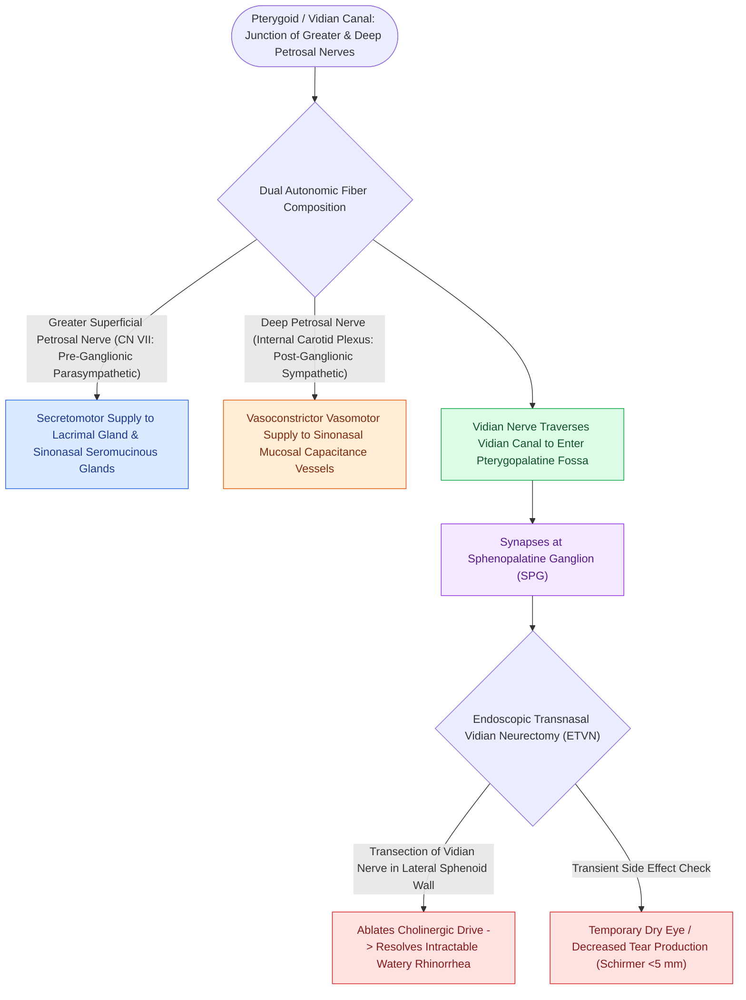

# The Vidian nerve carries parasympathetic secretomotor and sympathetic vasomotor fibers

## Active Recall

> [!question]- Which component of the Vidian nerve synapses in the pterygopalatine ganglion, and what clinical symptom does its stimulation cause?
> *Answer / Clinical Rationale*: The **preganglionic parasympathetic fibers** from the greater petrosal nerve synapse in the PPG; their activation causes profuse watery glandular rhinorrhea and mucosal swelling.

> [!question]- Why can vidian neurectomy cause postoperative dry eye, and what anatomical landmark directs the surgeon to the Vidian canal?
> *Answer / Clinical Rationale*: Parasympathetic secretomotor fibers to the lacrimal gland travel through the Vidian nerve. The Vidian canal is located on the floor of the sphenoid sinus, running directly along the junction of the pterygoid plates and sphenoid body lateral to the vomer.

## Core Clinical & Mechanistic Principles
The **Vidian nerve (nerve of the pterygoid canal)** provides the master autonomic innervation to the nasal mucosa, paranasal sinuses, and lacrimal gland. It is formed at the junction of the **greater petrosal nerve** and the **deep petrosal nerve** within the foramen lacerum / pterygoid canal.

### Neuroanatomical Fiber Composition
1. **Parasympathetic Component (Greater Petrosal Nerve)**:
   - Origin: Superior salivatory nucleus  $\r\r\rightarrow$ Nervus intermedius (CN VII)  $\r\r\rightarrow$ Geniculate ganglion  $\r\r\rightarrow$ Greater petrosal nerve.
   - Synapse: **Pterygopalatine ganglion (PPG)**.
   - Postganglionic Action: Mediates profuse **watery glandular rhinorrhea** and mucosal vasodilation.
2. **Sympathetic Component (Deep Petrosal Nerve)**:
   - Origin: Intermediolateral cell column of thoracic cord  $\r\r\rightarrow$ Superior cervical ganglion (SCG)  $\r\r\rightarrow$ Internal carotid plexus  $\r\r\rightarrow$ Deep petrosal nerve.
   - Synapse: **Does NOT synapse in PPG** (passes directly through).
   - Postganglionic Action: Mediates **vasoconstriction**, venous sinusoid contraction, and nasal decongestion.

## Surgical Nuances & Vidian Neurectomy
- **Indications**: Intractable non-allergic [[Transnasal endoscopic vidian neurectomy treats refractory non-allergic cholinergic rhinitis|vasomotor rhinitis]] (cholinergic hypersecretion / profuse watery rhinorrhea) refractory to topical ipratropium bromide.
- **Surgical Approaches**:
  - **Transnasal Endoscopic Approach**: Elevate a mucoperiosteal flap over the posterior wall of the maxillary sinus and sphenoid floor. The Vidian canal orifice is identified in the floor of the sphenoid sinus directly lateral to the base of the vomer and inferior to the sphenoid ostium.
  - **Neurovascular Landmark**: The Vidian canal is an essential landmark in expanded skull base surgery (EEA), directing the surgeon directly to the **petrous / paraclival internal carotid artery** (see [[Transpterygoid EEA exposes juvenile nasopharyngeal angiofibromas and lateral sphenoid defects|Transpterygoid Corridor]]).
- **Potential Complication**: **Dry eye syndrome (keratoconjunctivitis sicca)** due to denervation of the lacrimal gland (greater petrosal secretomotor fibers).

## Connected Concepts & Graph Traversal
- **Physiological Target**: [[Respiratory epithelium drives mucociliary clearance toward natural ostia|Mucociliary Secretions]]
- **Skull Base Corridor**: [[Transpterygoid EEA exposes juvenile nasopharyngeal angiofibromas and lateral sphenoid defects|Transpterygoid EEA]]
- **Vascular Landmark**: [[The crista ethmoidalis guides endoscopic sphenopalatine artery ligation|Sphenopalatine Artery & PPG]]
- **Carotid Landmark**: [[Intraoperative ICA injury requires two-surgeon suction and crushed muscle patch hemostasis|ICA Localization]]
- **Diagnostic Evaluation**: [[Jones primary and secondary dye tests differentiate canalicular from nasolacrimal duct obstruction|Lacrimal Secretomotor Correlate to Jones Testing]]
- **Anatomical Foundation**: [[Vidian canal identification at the junction of the sphenoid floor and pterygoid base differentiates the Vidian nerve from the inferomedial palatovaginal canal|Vidian Canal Identification]]
