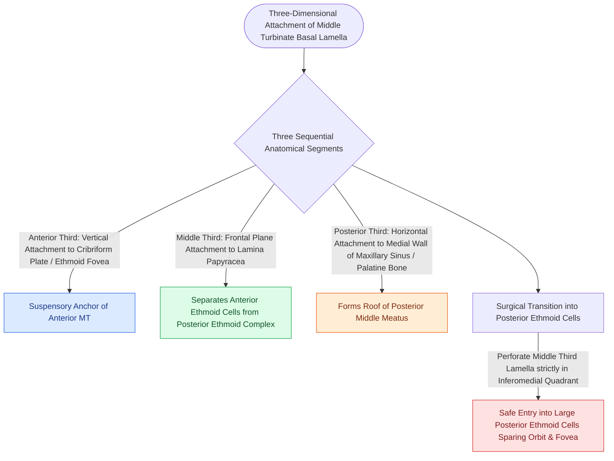

# The basal lamella of the middle turbinate divides anterior from posterior ethmoid cells

## Active Recall

> [!question]- Into which nasal meatus do the ethmoid air cells located posterior to the basal lamella drain?
> *Answer / Clinical Rationale*: Posterior ethmoid cells drain into the **superior meatus** (via the sphenoethmoidal recess / superior meatal ostia), whereas anterior ethmoids drain into the middle meatus.

> [!question]- Which quadrant of the basal lamella provides the safest surgical trajectory for entering the posterior ethmoid complex?
> *Answer / Clinical Rationale*: The **inferomedial quadrant**, because it is farthest away from the lamina papyracea laterally and the fovea ethmoidalis superiorly.

## Core Clinical & Mechanistic Principles
The **basal (ground) lamella of the middle turbinate** is the foundational bony attachment of the middle turbinate to the lateral nasal wall and skull base. It represents the **definitive anatomical and embryological dividing boundary** between the **anterior ethmoid complex** and the **posterior ethmoid complex**.

### The Three Planes of Attachment
1. **Anterior Third (Vertical Sagittal Plane)**: Runs vertically to insert into the junction of the cribriform plate and lateral lamella. Provides superior suspension.
2. **Middle Third (Frontal / Coronal Plane)**: Runs coronally across the ethmoid cavity to insert onto the **[[Lamina papyracea dehiscence predisposes to orbital fat herniation and medial rectus injury|lamina papyracea]]**. Forms the physical barrier separating the retrobullar recess (anterior) from the posterior ethmoids.
3. **Posterior Third (Horizontal Axial Plane)**: Slopes horizontally/inferiorly to attach to the lateral nasal wall near the superior border of the inferior turbinate and the sphenopalatine foramen.

### Physiological & Drainage Consequences
- **Anterior Ethmoids**: Located anterior to the basal lamella; drain into the **middle meatus** (via ethmoid infundibulum or hiatus semilunaris).
- **Posterior Ethmoids**: Located posterior to the basal lamella; drain into the **superior meatus** (above the middle turbinate).

## Surgical Nuances & Dissection Protocol
- **Safe Fenestration Zone**: When transitioning from anterior to posterior ethmoidectomy, the basal lamella should be breached in its **inferomedial quadrant** using a straight curette, ostium seeker, or [[Powered microdebrider blade selection and suction irrigation maintain clean surgical optics|microdebrider]].
- **Preventing Middle Turbinate Destabilization**:
  - The superior vertical attachment must be preserved to prevent lateralization or flail middle turbinate.
  - Perforating too superiorly risks skull base entry; perforating too laterally risks [[Draf IIb frontal sinusotomy extends from lamina papyracea to the nasal septum|lamina papyracea]] injury.

## Connected Concepts & Graph Traversal
- **Lamellar Hierarchy**: [[The four parallel ethmoidal lamellae guide systematic anterior-to-posterior endoscopic orientation|Four Parallel Ethmoidal Lamellae]]
- **Surgical Step**: [[Perforating the basal lamella inferomedially provides safe entry to posterior ethmoids|Basal Lamella Fenestration]]
- **Anterior Partner**: [[The ethmoid bulla serves as the principal anatomical anchor for anterior ethmoidectomy|Ethmoid Bulla]]
- **Posterior Complex**: [[Posterior ethmoidectomy requires dissecting along the skull base from posterior to anterior|Posterior Ethmoidectomy Technique]]
- **Vascular Landmark**: [[The crista ethmoidalis guides endoscopic sphenopalatine artery ligation|Sphenopalatine Foramen & Crista Ethmoidalis]]
- **Superior Attachment Preservation Technique**: [[Partial middle turbinectomy provides surgical access and prevents synechiae in selected polyposis or skull base cases while preserving superior attachments to protect olfaction and skull base stability|Partial Middle Turbinectomy]]
