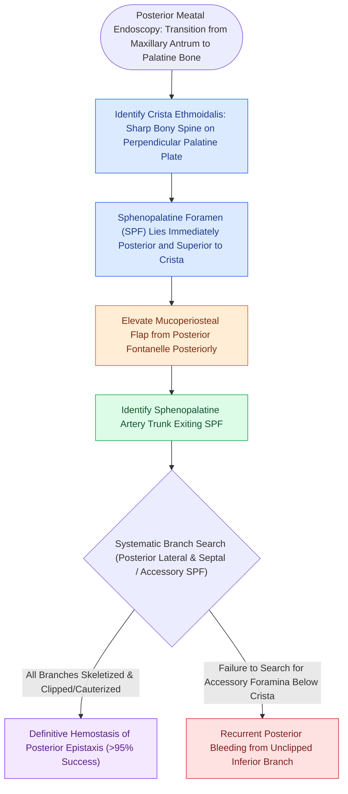

# The crista ethmoidalis guides endoscopic sphenopalatine artery ligation

## Active Recall

> [!question]- Why is the crista ethmoidalis considered the most reliable landmark during endoscopic SPA ligation?
> *Answer / Clinical Rationale*: It is a constant bony spine projecting from the lateral nasal wall located **immediately anterior to the sphenopalatine foramen**, guiding the surgeon directly to the emerging arterial trunk.

> [!question]- What anatomical branching variation is the most frequent cause of persistent bleeding after endoscopic SPA ligation?
> *Answer / Clinical Rationale*: A separate **posterior septal artery** exiting through an accessory foramen inferior to the main sphenopalatine foramen that was missed during primary dissection.

## Core Clinical & Mechanistic Principles
**Endoscopic Sphenopalatine Artery (SPA) Ligation** is the gold-standard surgical intervention for severe, posterior, refractory epistaxis. The sphenopalatine artery is the terminal branch of the internal maxillary artery, supplying $>90\%$ of the nasal cavity mucosa.

The **crista ethmoidalis** is a constant, sharp, triangular bony projection on the lateral nasal wall that serves as the **invariable surgical guide** to the **sphenopalatine foramen (SPF)**.

### Step-by-Step Surgical Craft
1. **Mucosal Incision**:
   - Make a vertical incision $1.0\text{ cm}$ anterior to the posterior attachment of the middle turbinate along the lateral nasal wall.
2. **Subperiosteal Flap Elevation**:
   - Elevate a mucoperiosteal flap posteriorly using a Cottle or Freer elevator directly on bone.
   - Palpate the sharp anterior point of the **crista ethmoidalis**.
3. **Branch Dissection & Ligation**:
   - Dissect the neurovascular bundle exiting immediately posterior to the crista ethmoidalis.
   - Identify both the **posterior lateral nasal branches** and the **posterior septal branch** (which may exit through a separate accessory foramen inferiorly).
   - Apply endoscopic titanium vascular clips or bipolar electrocautery to **ALL branches**.

## Critical Failure Mode: Missed Posterior Septal Artery
- In up to **$30\%$** of patients, the posterior septal branch exits through a separate foramen inferior to the primary SPF.
- Failing to identify and cauterize this secondary branch is the **single leading cause of recurrent [[Posterior epistaxis from sphenopalatine artery arborization requires endoscopic ligation or embolization|posterior epistaxis]]** following SPA ligation.

## Connected Concepts & Graph Traversal
- **Autonomic Parasympathetic Relay**: [[The sphenopalatine ganglion serves as the primary parasympathetic relay for the sinonasal cavity|Sphenopalatine Ganglion]]
- **Pedicled Rescue Flap**: [[The middle turbinate vascularized flap provides an alternative rescue flap for skull base repair|Middle Turbinate Flap]]
- **Nasoseptal Flap Pedicle**: [[The Hadad-Bassagasteguy nasoseptal flap is pedicled on the posterior septal artery|Hadad-Bassagasteguy Flap]]
- **Posterior Basal Lamella**: [[The basal lamella of the middle turbinate divides anterior from posterior ethmoid cells|Basal Lamella of Middle Turbinate]]
- **Ethmoidal Artery Comparison**: [[The 24-12-6 rule governs anterior and posterior ethmoidal artery surgical localization|Ethmoidal Arteries (24-12-6 Rule)]]
- **Anatomical Foundation**: [[Endoscopic sphenopalatine artery ligation requires crista ethmoidalis resection and systematic multi-branch control to prevent recurrent epistaxis|Endoscopic SPA Ligation]]
- **Vascular Supply**: [[Pterygopalatine fossa dissection requires internal maxillary artery ligation and posterior antral wall resection to access the lateral sphenoid recess|Pterygopalatine Fossa Dissection]]
