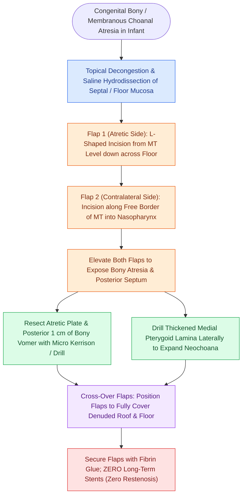

# The endoscopic cross-over flap technique reconstructs congenital choanal atresia by covering denuded bone without circumferential stenting

## Active Recall

> [!question]- Why has the endoscopic cross-over mucosal flap technique eliminated the necessity of postoperative stenting in choanal atresia repair?
> *Answer / Clinical Rationale*: Prolonged stenting acts as a foreign body that incites intense granulation tissue and circular cicatricial stenosis; in contrast, the cross-over flap technique transposes vascularized mucoperiosteal flaps over all denuded bone surfaces (roof and floor of the neochoana), establishing rapid primary mucosal healing and preventing circumferential contraction.

> [!question]- What are the precise structural components resected during the creation of a unified neochoana in the Stamm technique?
> *Answer / Clinical Rationale*: The atretic plate (bony and membranous), the lateral hypertrophic medial pterygoid lamina, and the posterior 1.0 cm of the bony nasal septum (vomer) up to the inferior edge of the middle turbinate.

## Core Clinical & Mechanistic Principles
Congenital choanal atresia results from the embryologic failure of the bucconasal membrane to rupture, occurring in approximately 1 in 7,000 live births. As detailed in [[Congenital bilateral choanal atresia causes cyclical cyanosis relieved by crying and requires urgent oral airway placement|bilateral choanal atresia airway management]], neonates are obligate nasal breathers who present with cyclical cyanosis relieved by crying, mandating emergency airway stabilization.

While historic approaches relied upon blind puncture and prolonged rigid stenting, as analyzed in [[Transnasal endoscopic resection of the atretic plate and posterior vomer establishes choanal patency without stents|stentless choanal atresia principles]], modern pediatric rhinology emphasizes precise endoscopic flap design. The **Stamm cross-over flap technique** reconstructs a wide, unified posterior choana with vascularized mucosal coverage, achieving a zero-restenosis rate without stents.

### Surgical Technique: The Stamm Cross-Over Flap
1. **Preoperative Optimization & Exposure**:
   - The nasal cavity in neonates is narrow; delicate otologic microinstruments and a 2.7-mm or 4.0-mm 0-degree endoscope are utilized.
   - Decongestion is achieved using topical epinephrine (1:100,000) pledgets. The inferior turbinate is covered with cotton and gently outfractured against the lateral nasal wall using a delicate Freer elevator.
   - Saline infiltration (hydrodissection) is performed beneath the posterior septal and nasal floor mucosa to facilitate flap tailoring.
2. **Flap Design & Incisions**:
   - **Flap 1 (Ipsilateral Atretic Side)**: A transfixing vertical incision is made on the nasal septum approximately 1.0 cm anterior to the atretic plate, beginning at the level of the inferior edge of the middle turbinate. The incision extends vertically down the septum and turns laterally across the nasal floor in an **L-shaped configuration** toward the posterior tip of the inferior turbinate.
   - **Flap 2 (Contralateral Side)**: On the opposite nasal cavity, an incision starts at the upper part of the vertical line, turns posteriorly along the free inferior border of the middle turbinate to the posterior edge of the septum, and opens into the nasopharynx.
   - Both mucoperiosteal flaps are elevated and preserved; Flap 1 is reflected superiorly. The non-vascularized pharyngeal mucosal remnant over the atretic plate is excised.
3. **Bony Resection and Unification**:
   - The posterior 1.0 cm of the osteocartilaginous septum (posterior vomer) is removed using a micro Kerrison punch, through-cutting forceps, or diamond burr. The superior boundary of septal resection corresponds strictly to the inferior margin of the middle turbinate.
   - The bony atretic plate is completely drilled out.
   - The thickened extension of the medial pterygoid lamina laterally is drilled or punched back to widen the lateral dimension of the neochoana.
4. **Cross-Over Positioning and Fixation**:
   - The flaps are tailored with delicate scissors to eliminate redundant tissue.
   - Flap 1 and Flap 2 are crossed over and repositioned using a seeker probe or Freer elevator: one flap drapes over the denuded superior neochoanal roof and the other covers the denuded inferior floor.
   - Flaps are secured firmly against bare bone using **fibrin glue** or a soft anchored pack removed after 24 to 48 hours.
   - Stenting with endotracheal tubes is strictly avoided. Stamm et al. reported an 8-year cohort of 25 patients (ranging from 8 days to 40 years old) treated with this technique with zero restenosis and zero stent-related complications.

## Connected Concepts & Graph Traversal
- **🔗 Syndromic Associations (Pediatrics)**: [[CHARGE syndrome is diagnosed by coloboma, heart defects, choanal atresia, growth retardation, genital anomalies, and ear abnormalities]]
- **🔗 Congenital Nasal Stenosis (Pediatrics)**: [[Congenital pyriform aperture stenosis causes neonatal nasal obstruction and presents with a solitary central incisor]]
- **🔗 Neonatal Stridor Differentiation (Pediatrics)**: [[Pediatric stertor and stridor differentiate upper supraglottic airway obstruction from intrathoracic tracheobronchial disease]]
- **Secondary Turbinate Hypertrophy**: [[Inferior turbinate submucosal resection with outfracture provides durable volume reduction while preserving ciliated mucosal function]]
- **Sphenoid Landmarks**: [[The sphenoid sinus ostium lies medial to the superior turbinate above the choana]]
