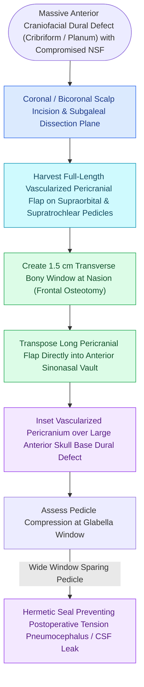

# The endoscopic pericranial flap transposed through the nasion repairs large anterior skull base defects

## Active Recall

> [!question]- What vascular pedicle supplies the endoscopic pericranial flap?
> *Answer / Clinical Rationale*: The **bilateral supraorbital and supratrochlear arteries** arising from the internal carotid / ophthalmic system.

> [!question]- Through what anatomical pathway is the pericranial flap transposed into the nasal cavity?
> *Answer / Clinical Rationale*: Through a **horizontal bony osteotomy window created at the nasion / frontal bone base**, allowing direct entry into the anterior skull base without external facial scars.

## Core Clinical & Mechanistic Principles
The **[[Diagnostic rigid nasal endoscopy utilizes a standardized three-pass examination sequence|Endoscopic]] Transposition Pericranial Flap** provides a massive, robustly vascularized, non-irradiated tissue sheet for reconstructing **massive anterior cranial fossa defects (transcribriform and transplanum resections)** when endonasal donor flaps (nasoseptal flaps) are unavailable or invaded by malignancy.

It is supplied by the **supraorbital and supratrochlear arteries**.

### Advantages Over Nasoseptal Flap
- **Massive Surface Area**: Can cover defects spanning from the frontal sinus back to the sella, and from orbit to orbit.
- **Oncologically Safe**: The pericranium is completely outside the nasal tumor field, avoiding the risk of transferring microscopic cancer cells.

## Connected Concepts & Graph Traversal
- **Nasoseptal First-Line Flap**: [[The Hadad-Bassagasteguy nasoseptal flap is pedicled on the posterior septal artery|Hadad-Bassagasteguy Nasoseptal Flap]]
- **Inferior Floor Rescue Flap**: [[The inferior turbinate flap pedicled on the inferior turbinate artery repairs anterior floor defects|Inferior Turbinate Flap]]
- **Middle Turbinate Rescue Flap**: [[The middle turbinate vascularized flap provides an alternative rescue flap for skull base repair|Middle Turbinate Flap]]
- **Cribriform CSF Repair**: [[Iatrogenic skull base cribriform leaks require immediate intraoperative multi-layer graft repair|Cribriform CSF Repair]]
- **Coronal Frontal Exposure**: [[Draf III modified Lothrop unites both frontal sinuses into a common cavity|Draf III Lothrop Exposure]]
