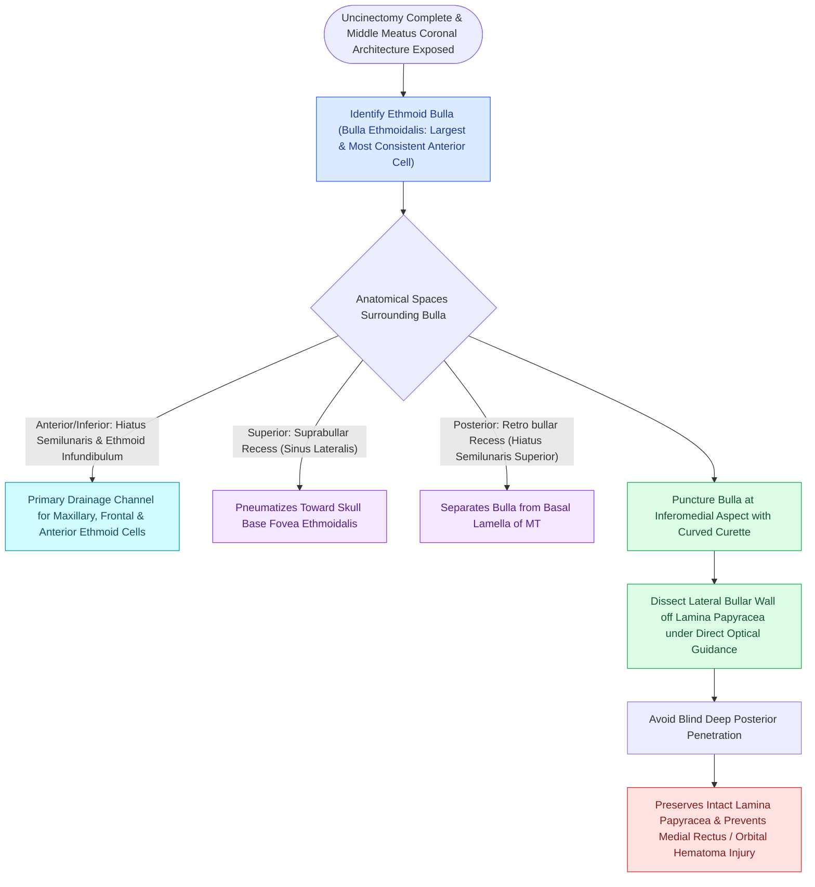

# The ethmoid bulla serves as the principal anatomical anchor for anterior ethmoidectomy

## Active Recall

> [!question]- What anatomical boundary separates the ethmoid bulla from the basal lamella of the middle turbinate?
> *Answer / Clinical Rationale*: The **retrobullar recess (sinus lateralis)** is the cleft located between the posterior wall of the ethmoid bulla and the anterior face of the basal lamella.

> [!question]- Why is the inferomedial wall of the ethmoid bulla chosen as the initial point of surgical entry?
> *Answer / Clinical Rationale*: The inferomedial wall is thin and points directly toward the center of the bulla cavity, providing maximum distance from the lamina papyracea laterally and the fovea ethmoidalis superiorly.

## Core Clinical & Mechanistic Principles
The **ethmoid bulla (bulla ethmoidalis)** is the largest, most constant, and most prominent anterior ethmoid air cell. It projects inferomedially from the [[Draf IIb frontal sinusotomy extends from lamina papyracea to the nasal septum|lamina papyracea]] into the middle meatus, forming the posterior boundary of the **ethmoid infundibulum** and **hiatus semilunaris inferior**.

### Anatomical Relationships & Peribullar Spaces
1. **Lateral Wall**: The lateral boundary of the bulla is formed directly by the **lamina papyracea**.
2. **Superior Relationship**: May extend directly to the anterior skull base (fovea ethmoidalis) or leave a cleft known as the **suprabullar recess**.
3. **Posterior Relationship**: The space between the posterior wall of the bulla and the [[Perforating the basal lamella inferomedially provides safe entry to posterior ethmoids|basal lamella]] of the middle turbinate is the **retrobullar recess (sinus lateralis)**.
4. **Medial Relationship**: Lies lateral to the vertical lamella of the middle turbinate.

## Surgical Nuances & Dissection Protocol
- **Safe Entry Vector**: During anterior ethmoidectomy, the bulla should be entered on its **inferomedial aspect** using a straight curette, Kuhn-Bolger curette, or [[Powered microdebrider blade selection and suction irrigation maintain clean surgical optics|microdebrider]].
- **Biomechanical Rationale**:
  - The inferomedial wall is the thinnest bone of the bulla.
  - This trajectory directs instruments safely away from the **lamina papyracea laterally** and the **ethmoid roof / skull base superiorly**.
- **Peribullar Clearance**: Once entered, the interior cavity of the bulla is skeletonized outward to the lamina papyracea laterally and unroofed superiorly to connect with the suprabullar and retrobullar recesses.

## Critical Failure Modes & Error Traps
- **Orbital Penetration**: Directing an instrument laterally into the lateral bulla wall can fracture a thin or dehiscent lamina papyracea, entering orbital fat (see [[Lamina papyracea dehiscence predisposes to orbital fat herniation and medial rectus injury|Lamina Papyracea & Orbital Danger Zones]]).
- **Skull Base Penetration**: Instrumenting too superiorly without establishing the medial landmark risks penetrating the paper-thin lateral lamella of the cribriform plate (see [[The Keros classification stages olfactory fossa depth and lateral lamella vulnerability|Keros Classification]]).

## Connected Concepts & Graph Traversal
- **Surgical Step**: [[Entering the ethmoid bulla inferomedially avoids orbital and skull base penetration|Inferomedial Bulla Entry]]
- **Posterior Boundary**: [[The basal lamella of the middle turbinate divides anterior from posterior ethmoid cells|Basal Lamella of Middle Turbinate]]
- **Anterior Channel**: [[The hiatus semilunaris and infundibulum form the primary drainage channel of the ostiomeatal complex|Hiatus Semilunaris & Infundibulum]]
- **Orbital Risk**: [[Lamina papyracea dehiscence predisposes to orbital fat herniation and medial rectus injury|Lamina Papyracea Dehiscence]]
- **Anatomical Foundation**: [[Perforating the basal lamella inferomedially provides safe entry to posterior ethmoids|Basal Lamella Fenestration Technique]]
