# The four parallel ethmoidal lamellae guide systematic anterior-to-posterior endoscopic orientation

## Active Recall

> [!question]- What are the four embryologic ethmoidal lamellae in sequence from anterior to posterior, and which lamella serves as the critical surgical boundary between anterior and posterior ethmoids?
> *Answer / Clinical Rationale*: The four parallel, obliquely oriented lamellae derived from ethmoturbinals are: (1) **First lamella**: [[Incisive uncinectomy exposes the ethmoid infundibulum while protecting the nasolacrimal duct|Uncinate process]] (first ethmoturbinal descending portion); (2) **Second lamella**: [[Entering the ethmoid bulla inferomedially avoids orbital and skull base penetration|Bulla ethmoidalis]] anterior/inferior wall; (3) **Third lamella**: [[The basal lamella of the middle turbinate divides anterior from posterior ethmoid cells|Basal lamella of the middle turbinate]] (second ethmoturbinal); and (4) **Fourth lamella**: Lamella of the superior turbinate (third ethmoturbinal). The **third lamella (basal lamella)** is the definitive anatomic boundary: anterior ethmoid cells drain anterior-inferiorly into the middle meatus, while posterior ethmoid cells drain posterior-medially into the superior and supreme meatuses.

> [!question]- Where is the basal lamella safely breached during endoscopic sinus surgery to enter the posterior ethmoids without endangering the lamina papyracea or skull base?
> *Answer / Clinical Rationale*: The basal lamella must be breached **inferomedially and horizontally**, immediately superior to its horizontal attachment to the lateral nasal wall. Penetrating superolaterally risks violating a down-sloping skull base or the thin [[The CLOSE checklist systematically evaluates critical radiological danger zones|lamina papyracea]], while an inferomedial puncture safely enters the large postbullar air spaces of the posterior ethmoid cavity.

## Core Clinical & Mechanistic Principles
During endoscopic sinus surgery (FESS), the complex anatomy of the ethmoid labyrinth can be conceptualized as **four obliquely oriented, parallel bony partitions (lamellae)** that develop sequentially from embryonic ethmoturbinals. Understanding these landmarks allows the surgeon to maintain anterior-to-posterior spatial orientation and safely compartmentalize surgical dissection.

```mermaid
%% Four Ethmoidal Lamellae Anterior-to-Posterior Endoscopic Corridor
flowchart LR
  subgraph AnteriorEthmoid["Anterior Ethmoid Compartment (Drains via Middle Meatus)"]
    N1(["Anterior Nasal Sill"]) ==> N2["1st Lamella: Uncinate Process"]
    N2 -->|"Infundibulum & Hiatus Semilunaris"| N3["2nd Lamella: Ethmoid Bulla"]
  end
  subgraph Boundary["Oblique Partition"]
    N4["3rd Lamella: Basal Lamella of Middle Turbinate"]
  end
  subgraph PosteriorSphenoid["Posterior Ethmoid & Sphenoid Corridor (Drains via Superior Meatus)"]
    N5["4th Lamella: Superior Turbinate"] -->|"Sphenoethmoidal Recess"| N6(["Sphenoid Sinus Ostium & Anterior Wall"])
  end
  N3 -->|"Retrobullar & Suprabullar Recesses"| N4
  N4 ==>|"Inferomedial Perforation Enters Posterior Ethmoids"| N5
  classDef blue fill:#dbeafe,stroke:#2563eb,color:#1e3a8a
  class N2 blue
  classDef green fill:#dcfce7,stroke:#16a34a,color:#14532d
  class N3 green
  classDef orange fill:#ffedd5,stroke:#ea580c,color:#7c2d12
  class N4 orange
  classDef purple fill:#f3e8ff,stroke:#9333ea,color:#581c87
  class N5,N6 purple
```

### Anatomic & Embryologic Hierarchy of the Four Lamellae
1. **First Lamella (Uncinate Process)**:
   - Arises from the descending portion of the first ethmoturbinal (anlagen at 9–10 weeks).
   - Serves as the anterior gatekeeper to the [[The hiatus semilunaris and infundibulum form the primary drainage channel of the ostiomeatal complex|ethmoidal infundibulum]] and [[Controlled middle meatal antrostomy enlargement preserves the anterior inferior fontanelle|maxillary sinus natural ostium]].
2. **Second Lamella (Bulla Ethmoidalis)**:
   - Formed by the anterior-inferior bony wall of the bulla ethmoidalis.
   - Typically the largest and most consistent anterior ethmoid cell; bounded posteriorly by the retrobullar and suprabullar recesses.
3. **Third Lamella (Basal/Ground Lamella of the Middle Turbinate)**:
   - Attaches vertically to the cribriform junction anteriorly, courses obliquely across the fovea ethmoidalis, and turns horizontally to insert onto the lamina papyracea and perpendicular process of the palatine bone.
   - **Functional Dividing Line**: Separates anterior ethmoid drainage (middle meatus) from posterior ethmoid drainage (superior meatus).
4. **Fourth Lamella (Superior Turbinate Lamella)**:
   - Originates from the third ethmoturbinal; bounds the superior meatus and guides identification of the sphenoethmoidal recess and sphenoid sinus ostium.

## Connected Concepts & Graph Traversal
- **Anatomical Boundary**: [[The basal lamella of the middle turbinate divides anterior from posterior ethmoid cells|Basal Lamella Anatomy]]
- **Surgical Craft**: [[Perforating the basal lamella inferomedially provides safe entry to posterior ethmoids|Inferomedial Basal Lamella Entry]]
- **Anterior Gatekeeper**: [[Incisive uncinectomy exposes the ethmoid infundibulum while protecting the nasolacrimal duct|Uncinectomy Technique]]
- **Second Partition**: [[Entering the ethmoid bulla inferomedially avoids orbital and skull base penetration|Bulla Ethmoidalis Landmarks]]
- **Posterior Target**: [[The sphenoid sinus ostium lies medial to the superior turbinate above the choana|Sphenoid Ostium Identification]]
