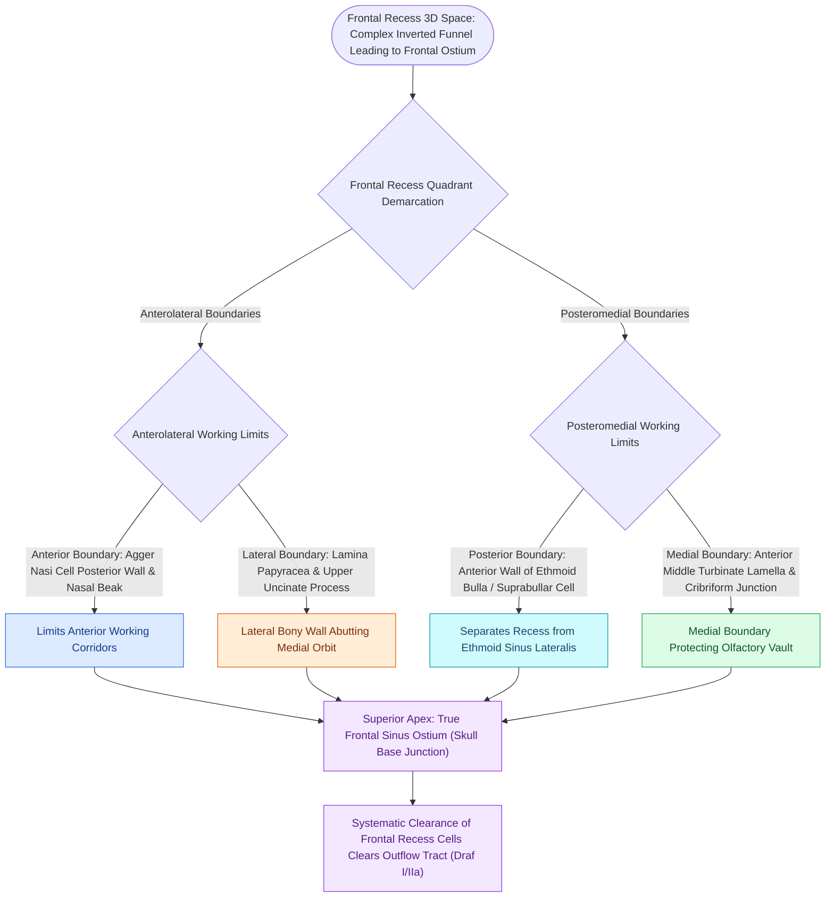

# The frontal recess is bounded by the agger nasi, middle turbinate, and skull base

## Active Recall

> [!question]- What anatomical structure forms the anterior wall of the frontal recess?
> *Answer / Clinical Rationale*: The **posterior wall of the agger nasi cell** and the internal nasal spine (beak of the frontal bone).

> [!question]- What forms the medial and lateral boundaries of the frontal recess?
> *Answer / Clinical Rationale*: Medially by the **vertical lamella of the middle turbinate**, and laterally by the **[[Lamina papyracea dehiscence predisposes to orbital fat herniation and medial rectus injury|lamina papyracea]]** and posterior lacrimal bone.

## Core Clinical & Mechanistic Principles
The **frontal recess** is an inverted hourglass-shaped space representing the narrowest and most anatomically complex outflow tract in the paranasal sinuses. It connects the **frontal sinus ostium** superiorly to the middle meatus or ethmoid infundibulum inferiorly.

### The Frontal Sinus Outflow Tract (FSOT) Continuum
1. **Frontal Sinus Ostium (FSO)**: The narrowest constriction at the true floor of the frontal sinus.
2. **Frontal Recess (FR)**: The expansion beneath the ostium containing frontoethmoidal air cells.
3. **Pneumatization Interactions**:
   - Anterior encroachment by [[Agger nasi cells form the anterior boundary of the frontal recess|Agger Nasi Cells]] or Kuhn Type 1–3 cells pushes the drainage pathway posteriorly against the skull base.
   - Posterior encroachment by [[Supraorbital ethmoid cells suspend the anterior ethmoidal artery below the skull base|supraorbital ethmoid cells]] or bullar frontal cells pushes the pathway anteriorly against the [[Nasal beak drill-out and mucosal grafting prevent neo-ostium restenosis in Draf III|frontal beak]].

## Connected Concepts & Graph Traversal
- **Uncinate Superior Insertion**: [[The uncinate process superior attachment dictates the frontal sinus drainage pathway|Uncinate Attachments]]
- **Agger Nasi Anterior Cell**: [[Agger nasi cells form the anterior boundary of the frontal recess|Agger Nasi Cells]]
- **Frontal Cell Staging**: [[The Kuhn classification stages frontal recess and frontal sinus air cells|Kuhn Frontal Cells]]
- **Draf IIb Sinusotomy**: [[Draf IIb frontal sinusotomy extends from lamina papyracea to the nasal septum|Draf IIb Frontal Sinusotomy]]
- **Anterior Ethmoid Artery**: [[The 24-12-6 rule governs anterior and posterior ethmoidal artery surgical localization|Anterior Ethmoid Artery]]
