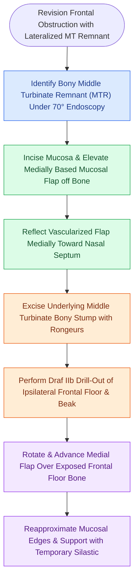

# The frontal sinus rescue procedure utilizes a medially based middle turbinate mucosal flap to resurface denuded bone and prevent Draf IIb ostial restenosis

## Active Recall

> [!question]- What specific iatrogenic etiology is the primary indication for the frontal sinus rescue procedure?
> *Answer / Clinical Rationale*: Obstruction of the frontal sinus outflow tract secondary to previous incomplete middle turbinate resection, where the residual middle turbinate stump has lateralized, scarred to the lateral nasal wall, and incited surrounding osteitis and neo-osteogenesis.

> [!question]- How is the mucosal flap harvested from the middle turbinate remnant during the rescue procedure before bone resection?
> *Answer / Clinical Rationale*: A medially based mucosal flap is carefully elevated and stripped from the middle turbinate bony remnant and reflected medially toward the septum. The underlying denuded middle turbinate bony stump is then excised with punches, preserving the vascularized mucosal flap.

> [!question]- How does advancing the preserved middle turbinate mucosal flap over the drilled frontal neo-ostium prevent surgical failure?
> *Answer / Clinical Rationale*: The advanced vascularized mucosal flap covers the raw, denuded bone of the resected frontal sinus floor and nasofrontal beak. This eliminates circular wound contracture, suppresses granulation tissue and neo-osteogenesis, and establishes immediate primary mucosal healing.

## Core Clinical & Mechanistic Principles
The frontal sinus rescue procedure, popularized by Barham and Ramakrishnan, is an innovative reconstructive adaptation of the [[Draf IIb frontal sinusotomy extends from lamina papyracea to the nasal septum]]. It specifically salvages frontal outflow tract compromise caused when [[Middle turbinate lateralization causes secondary ostiomeatal obstruction and frontal sinus stenosis]].

In standard revision surgery, cutting away scarred turbinate remnants leaves a large circumference of bare, devascularized bone at the frontal neo-ostium. Without mucosal coverage, concentric cicatricial stenosis rapidly recurs. By harvesting a vascularized local mucosal flap—analogous to reconstructive principles seen in [[The middle turbinate vascularized flap provides an alternative rescue flap for skull base repair]]—the rescue procedure provides immediate epithelial resurfacing.

### Operative Technique of the Rescue Procedure
1. **Remnant Identification and Incision**:
   - Utilize a $45^\circ$ or $70^\circ$ endoscope to examine the scarred frontal recess and the lateralized middle turbinate remnant (MTR).
   - Trace the attachment of the MTR to the skull base.
   - Make sharp mucosal incisions along the inferior and lateral borders of the MTR using curved micro-scissors or an endoscopic blade.
2. **Subperiosteal Mucosal Flap Elevation**:
   - With a small Freer or Cottle elevator, dissect the mucosa in a subperiosteal plane from lateral to medial across the surface of the turbinate bone.
   - The flap remains pedicled medially along the superior nasal septum and skull base transition.
   - Gently tuck the mobilized mucosal flap medially against the septum for intraoperative protection.
3. **Bony Stump Excision and Draf IIb Sinusotomy**:
   - Using through-cutting punches and Kerrison rongeurs, resect the devascularized bony stump of the middle turbinate up to its skull base junction.
   - Perform an extended Draf IIb frontal sinusotomy: excise the frontal sinus floor from the lamina papyracea to the septum using Hosemann punches and a $70^\circ$ diamond burr, flattening the nasofrontal beak.
4. **Flap Insetting and Re-epithelialization**:
   - Meticulously irrigate bone dust and debris from the frontal sinus cavity.
   - Unfold the medially based mucosal flap and rotate it laterally and superiorly across the newly drilled, bare bone of the frontal sinus floor.
   - Reapproximate mucosal margins. The flap provides immediate vascularized coverage over the critical neo-ostial transition zone.
   - Secure the flap in place using a small piece of non-adherent Silastic sheeting or soft gel dressing for $10\text{ to }14\text{ days}$.

## Connected Concepts & Graph Traversal
- **Extended Procedural Benchmark**: [[Draf IIb versus Draf III modified Lothrop procedures differentiate unilateral middle turbinate resection from bilateral interfrontal septectomy and sinus floor drill-out|Draf IIb vs Draf III Comparison]]
- **Conservative Procedural Tier**: [[Draf IIa frontal sinusotomy resects the sinus floor between middle turbinate and lamina|Draf IIa Frontal Sinusotomy]]
- **Skull Base Dissection Margin**: [[First olfactory filum marks the posterior limit of frontal drill-out to avoid CSF leak|Olfactory Boundary Limit]]
- **Topical Anti-Stenosis Delivery**: [[Steroid-eluting sinus implants deliver localized anti-inflammatory therapy to prevent restenosis|Steroid-Eluting Implants]]
- **Transition Zone Dissection Craft**: [[Frontal recess cell dissection requires systematic uncapping of agger nasi and Kuhn cells along mucosal transition zones to preserve drainage patency|Frontal Recess Dissection Protocol]]
