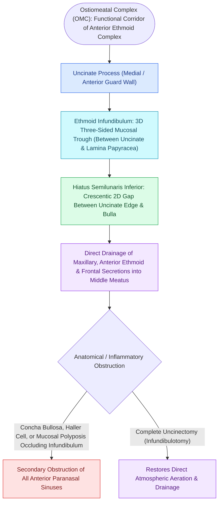

# The hiatus semilunaris and infundibulum form the primary drainage channel of the ostiomeatal complex

## Active Recall

> [!question]- What is the precise structural difference between the hiatus semilunaris inferior and the ethmoid infundibulum?
> *Answer / Clinical Rationale*: The **hiatus semilunaris inferior** is a two-dimensional crescentic aperture between the uncinate process and the ethmoid bulla, whereas the **ethmoid infundibulum** is the three-dimensional trough deep to the uncinate process containing the maxillary ostium.

> [!question]- Where does the natural maxillary sinus ostium sit within the ethmoid infundibulum?
> *Answer / Clinical Rationale*: It resides in the **inferior and posterior aspect of the lateral wall of the ethmoid infundibulum**, hidden from direct endoscopic view until uncinectomy is performed.

## Core Clinical & Mechanistic Principles
The **ostiomeatal complex (OMC)** is the functional anatomical crossroad of the anterior paranasal sinuses. It represents the final common drainage pathway for the **maxillary sinus**, **anterior ethmoid air cells**, and (frequently) the **frontal sinus**.

### 2D Hiatus vs 3D Infundibulum
1. **Hiatus Semilunaris Inferior (2D Crescentic Gap)**:
   - The two-dimensional crescent-shaped gap between the posterior free margin of the **uncinate process** and the anterior face of the **[[Entering the ethmoid bulla inferomedially avoids orbital and skull base penetration|ethmoid bulla]]**.
   - Serves as the entryway from the middle meatus into the infundibulum.
2. **Hiatus Semilunaris Superior**:
   - The 2D opening between the ethmoid bulla and the skull base / middle turbinate leading into the sinus lateralis.
3. **Ethmoid Infundibulum (3D Gutter-like Space)**:
   - The three-dimensional space bounded:
     - **Medially**: Uncinate process.
     - **Laterally**: [[Lamina papyracea dehiscence predisposes to orbital fat herniation and medial rectus injury|Lamina papyracea]] and lacrimal bone.
     - **Posteriorly**: Anterior surface of the ethmoid bulla.
     - **Floor**: Houses the primary **natural maxillary sinus ostium**.

## Pathophysiology of Ostiomeatal Blockage
- **Contact Areas & Mucosal Edema**: Mucosal contact between the uncinate process and ethmoid bulla (due to anatomic variants like a [[Concha bullosa pneumatization of the middle turbinate can obstruct the ostiomeatal complex|concha bullosa]], Haller cell, or uncinate medialization) impairs ciliary motility.
- **Hypoxia & Bacterial Stasis**: Obstruction causes progressive sinus hypoxia, decreased [[Respiratory epithelium drives mucociliary clearance toward natural ostia|mucociliary clearance]] velocity, mucin hyperviscosity, and chronic bacterial bioburden.

## Connected Concepts & Graph Traversal
- **Medial Wall**: [[The uncinate process superior attachment dictates the frontal sinus drainage pathway|Uncinate Process]]
- **Posterior Wall**: [[The ethmoid bulla serves as the principal anatomical anchor for anterior ethmoidectomy|Ethmoid Bulla]]
- **Anatomical Narrowing**: [[Infraorbital Haller cells narrow the ethmoid infundibulum and maxillary ostium|Haller Cell Narrowing]]
- **Surgical Unroofing**: [[Incisive uncinectomy exposes the ethmoid infundibulum while protecting the nasolacrimal duct|Incisive Uncinectomy]]
- **Anatomical Foundation**: [[Concha bullosa pneumatization of the middle turbinate can obstruct the ostiomeatal complex|Concha Bullosa]]
