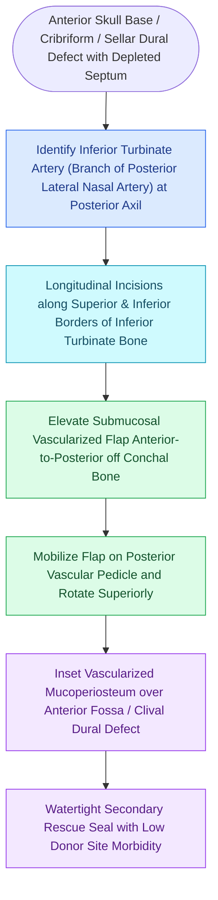

# The inferior turbinate flap pedicled on the inferior turbinate artery repairs anterior floor defects

## Active Recall

> [!question]- What is the primary arterial pedicle for a posteriorly based inferior turbinate flap?
> *Answer / Clinical Rationale*: The **inferior turbinate artery**, arising from the posterior lateral nasal branch of the sphenopalatine artery.

> [!question]- Why is the conchal bone removed during harvest of an inferior turbinate flap?
> *Answer / Clinical Rationale*: Removing the rigid conchal bone converts the turbinate into a **flexible, pliable mucoperiosteal paddle** that easily drapes over irregular skull base contours.

## Core Clinical & Mechanistic Principles
The **Inferior Turbinate Vascularized Flap (IT Flap)** is a pedicled mucoperiosteal flap supplied by the **inferior turbinate artery** (a terminal branch of the posterior lateral nasal artery).

It is indicated for reconstructing defects of the **anterior skull base, fovea ethmoidalis, clivus, and nasal floor** when the [[Temporoparietal fascia free and pedicled flaps provide vascularized tissue when nasoseptal flaps fail|nasoseptal flap]] is compromised.

### Anterior vs Posterior Pedicle Variations
- **Posteriorly Pedicled**: Workhorse version; covers the sella, clivus, and posterior ethmoid roof.
- **Anteriorly Pedicled**: Based on the **angular / facial artery anastomoses** at the anterior head of the turbinate; can be rotated anteriorly to cover the caudal septum or anterior cribriform.

## Connected Concepts & Graph Traversal
- **Nasoseptal Primary Flap**: [[The Hadad-Bassagasteguy nasoseptal flap is pedicled on the posterior septal artery|Hadad-Bassagasteguy Flap]]
- **Middle Turbinate Alternative**: [[The middle turbinate vascularized flap provides an alternative rescue flap for skull base repair|Middle Turbinate Flap]]
- **Endoscopic Pericranial Flap**: [[The endoscopic pericranial flap transposed through the nasion repairs large anterior skull base defects|Endoscopic Pericranial Flap]]
- **Sphenopalatine Supply**: [[The crista ethmoidalis guides endoscopic sphenopalatine artery ligation|Crista Ethmoidalis & SPA]]
- **Cribriform Defect Repair**: [[Iatrogenic skull base cribriform leaks require immediate intraoperative multi-layer graft repair|Cribriform CSF Leak Repair]]
- **Vascular Supply**: [[Inferior turbinate submucosal resection with outfracture provides durable volume reduction while preserving ciliated mucosal function|Submucosal IT Resection]]
- **Flap Design**: [[The endoscopic cross-over flap technique reconstructs congenital choanal atresia by covering denuded bone without circumferential stenting|Cross-Over Flap (Choanal Atresia)]]
